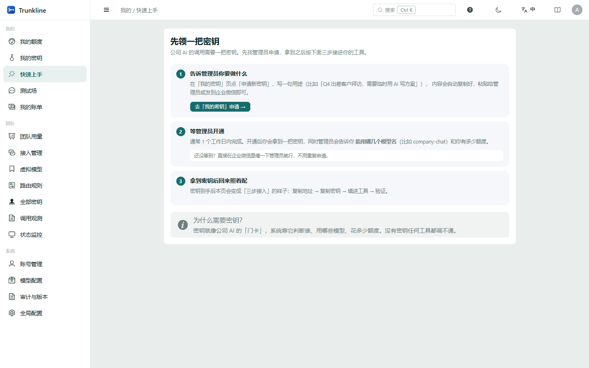
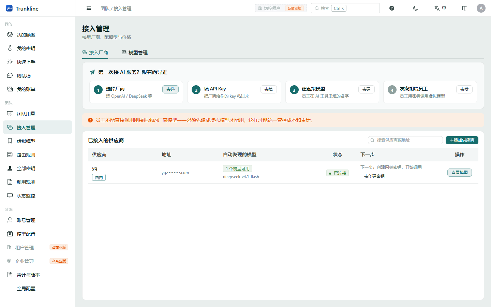

# Trunkline

<p align="center">
  
</p>

<p align="center">
  <strong>简单易用、安全可信的智能路由模型网关</strong>
</p>

<p align="center">
  
  
</p>

<p align="center">
  <a href="https://github.com/wjy2027/trunkline/releases"><strong>下载安装包</strong>（Windows / Mac / Linux，无需装环境，双击即用）</a>
</p>

<p align="center">
  <a href="README.md">English</a> •
  <a href="https://github.com/wjy2027/trunkline/issues">问题反馈</a> •
  <a href="https://github.com/wjy2027/trunkline/discussions">想法与讨论</a>
</p>

---

## 先说人话：Trunkline 解决什么问题？

如果您所在的公司同时用好几个 AI 模型——有的自己部署，有的用 OpenAI、Claude 这类云端服务——多半遇到过这些麻烦：

| 麻烦 | 没有 Trunkline | 有了 Trunkline |
|------|---------------|---------------|
| 模型太多 | 每个模型一套调用方式，换个模型就改一次代码 | 只对接一个地方，换模型不用改代码 |
| 模型故障 | 某个模型挂了，要人工去改配置 | 自动切到还能用的模型 |
| 用量不清 | 谁在用、用了多少，说不清 | 每个模型的 token 用量、每个人的用量一目了然 |
| 安全没底 | 敏感信息可能随着提问发出去，事后查不到 | 敏感内容自动打码，每次调用都留记录 |
| 员工不会配 | 每次都要找技术人员帮忙 | 界面说人话，员工自己就能上手 |

**Trunkline 就是放在您的应用和各种 AI 模型之间的「总调度台」。** 您的应用只跟它说话，至于用哪个模型、出问题怎么切换、谁能用、用了多少，交给它管。

三个词概括我们的追求：

- **简单易用** —— 上手门槛低，选一选、点一点就能用起来；
- **智能** —— 自动帮您挑模型、省钱、省时间；
- **安全** —— 权限、脱敏、留痕都在，让企业放心用。

## 现在已经能用（v0.1.0）

Trunkline 不是概念演示。下面这些能力在 **0.1.0 版本里已经可以实际使用**：

**日常调用，一个入口就够了**
- 不管模型在您自己的机器上还是云端，应用只认一个地址；已经用 OpenAI 方式写好的程序，把连接地址换成 Trunkline 就能跑，原来的代码基本不用动。
- 已经接好的模型：本地的 Ollama、vLLM、GPUStack、Xinference、LocalAI，云端的 OpenAI、Claude、Gemini。控制台里还备好了 13 家常见服务商的现成模板（DeepSeek、智谱、月之暗面、通义千问、Minimax 等），点一下就能加；像 Claude 这种调用方式比较特别的服务商，走「自定义适配器」也能接进来。
- 不只是聊天：文字向量、重排序、语音转写、语音合成、图片生成，都能走同一套入口。

**出了问题，不用人工救火**
- 某个模型卡住或挂了，自动换到还能用的模型；单次请求失败也会自动换实例重试，使用者几乎没感觉。
- 访问量突然变大时会自动限流，不会把后端压垮。
- 可以按条件分流：比如按模型名、请求来源、实例标签，决定走哪条路。

**用多少、谁在用、有没有泄露，都看得见**
- 登录账号和调用密钥两种凭证，按角色分配权限，不是谁都能碰所有模型。
- 敏感信息在调用记录中自动脱敏；调用记录可以选择只留摘要或加密保存，每一次调用都留痕，出事能查。
- 用量和额度按人、按模型、按时间统计，超了就自动限制。
- token 用量、成功率、响应速度都有现成图表，不用自己再搭一套监控。

**装完就能上手**
- 三步初始化向导，没有默认账号、默认密码，装完自己设，别人拿不到现成入口。
- 控制台说人话，分「我的 / 团队 / 系统」三块：员工看自己的，运维管团队，管理员管全局。
- 改配置即时生效，不用重启服务；界面支持亮色/暗色和中英双语。

## 界面长这样

话不多说，直接看控制台。下面都是 0.1.0 真实界面：

**内置 13 家服务商模板，点一下就能加**（下图可见 OpenAI、Google Gemini，以及 DeepSeek、智谱、月之暗面等）：

<p align="center">
  
</p>

**员工三步就能拿到密钥、开始调用**；运维配厂商时，也是先接供应商、再造虚拟模型、最后发给员工：

<table>
  <tr>
    <td width="50%" align="center"><br><sub>员工快速上手：领密钥 → 等开通 → 复制配置</sub></td>
    <td width="50%" align="center"><br><sub>运维接入管理：选厂商 → 填密钥 → 造模型 → 发员工</sub></td>
  </tr>
</table>

**一个测试场，对话、语义搜索、重排序、语音、图像都能试**：

<p align="center">
  
</p>

## 整体规划

下面是 Trunkline 的整体规划。其中不少能力在 0.1.0 已经可用（见上一节）；标着「待补 / 待建 / 规划中」的，是后续版本要补齐的部分。

### 一、易用层：配得快

| 能力 | 说的是什么 | 目前进度 |
|------|-----------|---------|
| 一键创建虚拟模型 | 选一个用途（比如「客服问答」），系统自动配好背后用哪些模型、怎么分配 | 向导已有，自动配策略待补 |
| 能力画像库 | 主流模型各自擅长什么，写清楚给您看，不用自己一个个试 | 待补 |
| 接入向导增强 | 贴一个密钥进去，自动认出这是哪家的模型 | 待补 |
| 配置模板市场 | 常见场景都预设好了，一键套用 | 待补 |
| 视频 / 多模态补齐 | 不只是文字，图片、语音、视频也能走 | 规划中 |

### 二、智能层：选得准

| 能力 | 说的是什么 | 目前进度 |
|------|-----------|---------|
| 语义感知路由 | 看问题本身的内容和长短，自动挑合适的模型 | 规划中 |
| 成本 / 延迟最优 | 在预算范围内，自动选又快又划算的 | 规划中 |
| 语义缓存 | 差不多的问题问过一次，直接复用之前的答案，省钱 | 规划中 |
| 智能降级链 | 一个模型挂了，自动切到备用的 | 基础调度能力已有 |
| A/B 灰度自动调权 | 新旧模型一起跑，自动把更多流量给效果更好的 | 规划中 |

### 三、安全层：守得牢

| 能力 | 说的是什么 | 目前进度 |
|------|-----------|---------|
| 数据与内容防护 | 调用记录中的敏感信息自动脱敏 | 已有 |
| 输出安全扫描 | 模型说不该说的话，自动拦下来 | 待建 |
| 调用日志 | 每次调用都留痕，方便事后排查 | 已有 |

### 四、信任与生态层：看得清、扩得开

| 能力 | 说的是什么 | 目前进度 |
|------|-----------|---------|
| 用量可观测 | 每个模型用了多少 token，明明白白 | 已有 |
| 效果评测台 | 让模型们自动跑分比一比，用数据说话 | 待建 |
| 智能告警诊断 | 不只告诉您「坏了」，还说清楚为什么坏 | 已有基础 |
| MCP / 工具网关 | 把各种工具能力统一接进来 | 待建 |
| 多语言 SDK / 开放 API | 各种编程语言都能方便地接入 | 规划中 |

> 以上「目前进度」是 0.1.0 版本的实际状况，会随版本更新。

## 怎么装、怎么开始用

Trunkline 有两种用法。**想直接跑起来用，选方式一；是运维或开发人员、要部署到服务器长期运行，选方式二。**

| 您的情况 | 推荐方式 | 需要提前准备 |
|---------|---------|-------------|
| 普通用户，不想装环境、不想敲命令 | 方式一：下载安装包，双击即用 | 一个浏览器，别的都不用装 |
| 运维 / 技术人员，部署到服务器 | 方式二：Docker 或 jar 包 | Docker，或 Java 17 及以上 |

### 方式一：下载安装包，双击就能用（普通用户推荐）

Windows、macOS、Linux 都有现成安装包，**运行需要的环境已经打包进去，您不用安装 Java，也不用装 Docker**。到 [Releases 页面](https://github.com/wjy2027/trunkline/releases) 下载对应您电脑系统的那一个：

| 您的电脑 | 下载这个文件 | 怎么打开 |
|---------|-------------|---------|
| Windows（多数台式机 / 笔记本，x64） | `Trunkline-0.1.0-win-x64-portable.zip` | 解压后双击 `Trunkline.exe` |
| Windows（骁龙 Copilot+ PC、Surface 等 ARM 机型） | `Trunkline-0.1.0-win-arm64-portable.zip` | 解压后双击 `启动.bat` |
| Mac（Apple 芯片 M1/M2/M3/M4） | `Trunkline-0.1.0-macos-arm64.tar.gz` | 解压后双击 `start.command` |
| Mac（Intel 芯片） | `Trunkline-0.1.0-macos-x64.tar.gz` | 解压后双击 `start.command` |
| Linux（x64） | `Trunkline-0.1.0-linux-x64.tar.gz` | 解压后运行 `./start.sh` |
| Linux（ARM / aarch64） | `Trunkline-0.1.0-linux-aarch64.tar.gz` | 解压后运行 `./start.sh` |

> **不知道自己电脑是哪种？** Windows 打开「设置 → 系统 → 关于」看"系统类型"；Mac 点左上角苹果图标 →「关于本机」，Apple 芯片会写明是 M 系列。

启动后会自动打开浏览器；如果没有，手动打开 `http://localhost:8080/admin/`。第一次进入会引导您做初始化（见下方"第一次打开，照着做三步"）。**用完想关闭，把启动时弹出的黑框 / 终端窗口关掉就行。**

<details>
<summary>系统弹出安全提示 / 打不开怎么办？（点开看）</summary>

- **Windows** 提示"Windows 已保护你的电脑"：点「更多信息」→「仍要运行」。
- **Mac** 提示"身份不明开发者"：在「终端」执行 `xattr -dr com.apple.quarantine "/安装包路径"`，再重新双击打开。
- **Linux** 提示权限不足：先执行 `chmod +x start.sh runtime/bin/java` 再运行。
- **8080 端口被占用**：用文本编辑器打开启动脚本，把 `--server.port=8080` 改成别的端口，如 `8081`。

</details>

### 方式二：Docker 或 jar 部署（技术人员）

这一节给运维和开发人员，用于把 Trunkline 部署到服务器长期运行。普通用户用上面的安装包即可，可跳过本节。

**Docker（最省事）**

```bash
docker run -d --name trunkline -p 8080:8080 \
  -v trunkline-data:/app/data \
  -e JWT_SECRET="换成您自己的至少32位随机密钥" \
  ghcr.io/wjy2027/trunkline:0.1.0
```

> 官方镜像 `ghcr.io/wjy2027/trunkline` 随 v0.1.0 发布。镜像发布前，可先用 jar 方式，或自行构建：`docker build --build-arg VERSION=0.1.0 -f Dockerfile.optimized -t trunkline:0.1.0 .`

**jar 包（服务器已装 Java 17 及以上）**

```bash
java -jar trunkline-0.1.0.jar
```

**从源码构建**

准备 **Java 17 或以上**，下载仓库后运行：

```bash
./mvnw clean package -DskipTests
java -jar target/trunkline-0.1.0.jar
```

### 第一次打开，照着做三步

不管用哪种方式，第一次打开页面都会进入初始化向导：

1. 选数据存在哪里 —— 第一次用，选「本地」就行；
2. 如果选了远程数据库，填好信息后重启一次；
3. 设一个管理员账号和密码（至少 12 位，别用 `123456` 这种好猜的）。

安装包方式打开 `http://localhost:8080/admin/`，Docker / jar 方式打开 `http://localhost:8080/init`。

**Trunkline 没有默认账号、没有默认密码。** 账号是您第一次打开页面时自己设的，别人拿不到现成入口。

设好账号登录控制台，把您的模型加进去，以后员工用控制台发的「钥匙」就能调用了。

> 正式对外提供服务前，请务必设自己的安全密钥（环境变量 `JWT_SECRET`，至少 32 位），并以 `prod` 模式运行（Docker 镜像默认 `prod`；jar 可加 `--spring.profiles.active=prod`）。示例里的值不能用于正式环境：启动门闩会拒绝 `your-*` / `change-*` / `replace-*` / `example-*` 这类占位串，`.env.example` 的凭据字段也刻意留空，原样复制不填值在生产会直接 fail-fast。请用 `openssl rand -base64 32` 生成；也支持 `PROD_JWT_SECRET` / `DEV_JWT_SECRET`，优先级低于 `JWT_SECRET`。

如果您原来的程序已经在用 OpenAI 的方式调用模型，改一下连接地址就能切到 Trunkline，原来的代码基本不用动。

## 谁适合用 Trunkline？

- 公司自己部署了 AI 模型（比如 Ollama、vLLM、GPUStack）
- 同时用好几个云端模型，想统一管理
- 需要知道员工用了多少 token、有没有把敏感信息发出去
- 希望普通同事不用懂技术细节，也能自己接入模型

## 以后的安排

按版本逐步推进，下面是大致节奏（不是死板承诺，会听社区反馈调整）：

| 版本 | 重点 |
|------|------|
| v0.1.0 | 打好底子：首启向导、去掉默认管理员、清理旧东西、统一品牌（已完成） |
| v0.2.0 | 配得更快：模型能力画像、一键创建虚拟模型 |
| v0.3.0 | 看得更清：智能告警诊断与用量看板 |
| v0.4.0 | 选得更准：语义路由、省钱省时、问题缓存 |
| v0.5.0 | 守得更牢：防注入、防越权 |
| v0.6.0 | 更聪明：故障自动降级、新旧模型自动调流量 |
| v1.0.0 | 更开放：效果评测台、工具网关、多语言 SDK |


## 关于 JAiRouter

Trunkline 是在 [JAiRouter](https://github.com/Lincoln-cn/JAiRouter) 的基础上继续开发的。感谢原作者 Lincoln-cn 的出色工作。我们完整保留了原项目的版权声明，详见 [NOTICE](NOTICE)。

## 开源协议

本项目遵循 [Apache 2.0 协议](LICENSE)：可以自由使用、修改、商用，只需保留原作者的声明。

## 参与和反馈

| 您手上的东西 | 发到哪里 |
|-------------|---------|
| 遇到了缺陷：崩溃、结果不对、文档写错 | [Issues](https://github.com/wjy2027/trunkline/issues) |
| 有想法、想加功能、想提问、想讨论 | [Discussions](https://github.com/wjy2027/trunkline/discussions) |

拿不准发哪里？先发 Discussions，如果确认是缺陷，我们会帮您转到 Issues。

想自己编译或部署？见上面的「怎么装、怎么开始用」。

---

<p align="center">
  如果 Trunkline 帮到了您，欢迎点个 <a href="https://github.com/wjy2027/trunkline/stargazers">Star</a> ⭐
</p>

<p align="center">
  Trunkline Team · 基于 JAiRouter · Apache-2.0
</p>
