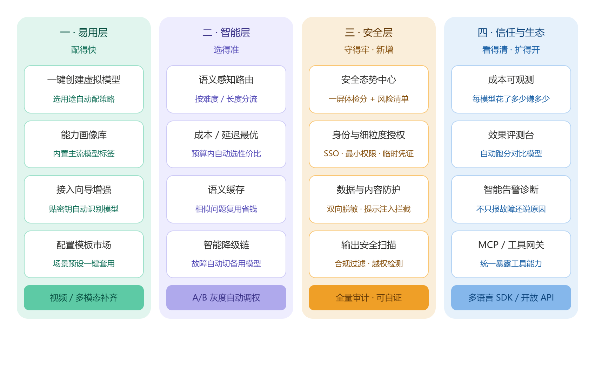

# Trunkline

<p align="center">
  
</p>

<p align="center">
  <strong>简单易用、安全可信的智能模型路由</strong>
</p>

<p align="center">
  
  
</p>

<p align="center">
  <a href="README.md">English</a> •
  <a href="https://github.com/Lincoln-cn/trunkline/issues">问题反馈</a> •
  <a href="https://github.com/Lincoln-cn/trunkline/discussions">想法与讨论</a>
</p>

---

## 先说人话：Trunkline 解决什么问题？

如果您所在的公司同时用好几个 AI 模型——有的自己部署，有的用 OpenAI、Claude 这类云端服务——多半遇到过这些麻烦：

| 麻烦 | 没有 Trunkline | 有了 Trunkline |
|------|---------------|---------------|
| 模型太多 | 每个模型一套调用方式，换个模型就改一次代码 | 只对接一个地方，换模型不用改代码 |
| 模型故障 | 某个模型挂了，要人工去改配置 | 自动切到还能用的模型 |
| 费用不清 | 谁在用、用了多少、花了多少钱，说不清 | 每个模型的花费、每个人的用量一目了然 |
| 安全没底 | 敏感信息可能随着提问发出去，事后查不到 | 敏感内容自动打码，每次调用都留记录 |
| 员工不会配 | 每次都要找技术人员帮忙 | 界面说人话，员工自己就能上手 |

**Trunkline 就是放在您的应用和各种 AI 模型之间的「总调度台」。** 您的应用只跟它说话，至于用哪个模型、出问题怎么切换、谁能用、用了多少，交给它管。

三个词概括我们的追求：

- **简单易用** —— 上手门槛低，选一选、点一点就能用起来；
- **智能** —— 自动帮您挑模型、省钱、省时间；
- **安全** —— 权限、脱敏、留痕都在，让企业放心用。

## 现在已经能用（v0.1.0）

Trunkline 不是概念演示。下面这些能力在 **0.1.0 版本里已经可以实际使用**：

**日常调用，一个入口就够了**
- 不管模型在您自己的机器上还是云端，应用只认一个地址；已经用 OpenAI 方式写好的程序，把连接地址换成 Trunkline 就能跑，原来的代码基本不用动。
- 已经接好的模型：本地的 Ollama、vLLM、GPUStack、Xinference、LocalAI，云端的 OpenAI、Claude、Gemini。控制台里还备好了 13 家常见服务商的现成模板（DeepSeek、智谱、月之暗面、通义千问、Minimax 等），点一下就能加；像 Claude 这种调用方式比较特别的服务商，走「自定义适配器」也能接进来。
- 不只是聊天：文字向量、重排序、语音转写、语音合成、图片生成，都能走同一套入口。

**出了问题，不用人工救火**
- 某个模型卡住或挂了，自动换到还能用的模型；单次请求失败也会自动换实例重试，使用者几乎没感觉。
- 访问量突然变大时会自动限流，不会把后端压垮。
- 可以按条件分流：比如按模型名、请求来源、实例标签，决定走哪条路。

**用多少、谁在用、有没有泄露，都看得见**
- 登录账号和调用密钥两种凭证，按角色分配权限，不是谁都能碰所有模型。
- 敏感信息发出去和返回来时自动打码；调用记录可以选择只留摘要或加密保存，每一次调用都留痕，出事能查。
- 用量和额度按人、按模型、按时间统计，超了就自动限制。
- 花费、成功率、响应速度都有现成图表，不用自己再搭一套监控。

**装完就能上手**
- 三步初始化向导，没有默认账号、默认密码，装完自己设，别人拿不到现成入口。
- 控制台说人话，分「我的 / 团队 / 系统」三块：员工看自己的，运维管团队，管理员管全局。
- 改配置即时生效，不用重启服务；界面支持亮色/暗色和中英双语。

## 产品蓝图

<p align="center">
  
</p>

下面是完整蓝图。其中不少能力在 0.1.0 已经可用（见上一节）；标着「待补 / 待建 / 规划中」的，是后续版本要补齐的部分。

蓝图分四层，一层解决一类问题。安全不单独占一格——它贯穿在所有层里面：一键建模型会自动带上脱敏和用量限制，智能调度也会把合规和输出安全当成条件。

### 一、易用层：配得快

| 能力 | 说的是什么 | 目前进度 |
|------|-----------|---------|
| 一键创建虚拟模型 | 选一个用途（比如「客服问答」），系统自动配好背后用哪些模型、怎么分配 | 向导已有，自动配策略待补 |
| 能力画像库 | 主流模型各自擅长什么，写清楚给您看，不用自己一个个试 | 待补 |
| 接入向导增强 | 贴一个密钥进去，自动认出这是哪家的模型 | 待补 |
| 配置模板市场 | 常见场景都预设好了，一键套用 | 待补 |
| 视频 / 多模态补齐 | 不只是文字，图片、语音、视频也能走 | 规划中 |

### 二、智能层：选得准

| 能力 | 说的是什么 | 目前进度 |
|------|-----------|---------|
| 语义感知路由 | 看问题本身的内容和长短，自动挑合适的模型 | 规划中 |
| 成本 / 延迟最优 | 在预算范围内，自动选又快又划算的 | 规划中 |
| 语义缓存 | 差不多的问题问过一次，直接复用之前的答案，省钱 | 规划中 |
| 智能降级链 | 一个模型挂了，自动切到备用的 | 基础调度能力已有 |
| A/B 灰度自动调权 | 新旧模型一起跑，自动把更多流量给效果更好的 | 规划中 |

### 三、安全层：守得牢

| 能力 | 说的是什么 | 目前进度 |
|------|-----------|---------|
| 安全态势中心 | 一屏看清整体安全状况，有哪些风险要处理 | 待建 |
| 身份与细粒度授权 | 谁能用哪些模型、能用多少，管得很细 | 已有基础 |
| 数据与内容防护 | 发出去和返回来的敏感信息自动打码 | 已有 |
| 输出安全扫描 | 模型说不该说的话，自动拦下来 | 待建 |
| 全量审计 · 可自证 | 每次调用都留痕，出事能查、能交代 | 已有 |

### 四、信任与生态层：看得清、扩得开

| 能力 | 说的是什么 | 目前进度 |
|------|-----------|---------|
| 成本可观测 | 每个模型花了多少钱，明明白白 | 已有 |
| 效果评测台 | 让模型们自动跑分比一比，用数据说话 | 待建 |
| 智能告警诊断 | 不只告诉您「坏了」，还说清楚为什么坏 | 已有基础 |
| MCP / 工具网关 | 把各种工具能力统一接进来 | 待建 |
| 多语言 SDK / 开放 API | 各种编程语言都能方便地接入 | 规划中 |

> 以上「目前进度」是 0.1.0 版本的实际状况，会随版本更新。

## 三步用起来

**第一步：启动**

```bash
docker run -d --name trunkline -p 8080:8080 trunkline/trunkline:latest
```

**第二步：打开浏览器做初始化**

访问 `http://localhost:8080/init`（如果用安装包方式运行，地址是 `/admin/init`），按提示走三步：

1. 选数据存在哪里——第一次用，选「本地」就行；
2. 如果选了远程数据库，填好信息后重启一次；
3. 设一个管理员账号和密码（至少 12 位，别用 `123456` 这种好猜的）。

**Trunkline 没有默认账号、没有默认密码。** 账号是您第一次打开页面时自己设的，这样别人拿不到现成的入口。

**第三步：登录控制台，把您的模型加进去**

用刚设的账号登录，在控制台里添加模型。以后员工只需要用控制台发的「钥匙」，就能调用了。

> 正式对外提供服务前，请再设一个自己的安全密钥（环境变量 `JWT_SECRET`，至少 32 位）。示例里的值不能用于正式环境。

如果您原来的程序已经在用 OpenAI 的方式调用模型，改一下连接地址就能切到 Trunkline，原来的代码基本不用动。

## 谁适合用 Trunkline？

- 公司自己部署了 AI 模型（比如 Ollama、vLLM、GPUStack）
- 同时用好几个云端模型，想统一管理
- 需要知道员工用了多少、花了多少钱、有没有把敏感信息发出去
- 希望普通同事不用懂技术细节，也能自己接入模型

## 以后的安排

按版本逐步推进，下面是大致节奏（不是死板承诺，会听社区反馈调整）：

| 版本 | 重点 |
|------|------|
| v0.1.0 | 打好底子：首启向导、去掉默认管理员、清理旧东西、统一品牌（已完成） |
| v0.2.0 | 配得更快：模型能力画像、一键创建虚拟模型 |
| v0.3.0 | 安全看得见：安全态势中心，一屏体检 |
| v0.4.0 | 选得更准：语义路由、省钱省时、问题缓存 |
| v0.5.0 | 守得更牢：内容护栏、防注入、防越权、单点登录 |
| v0.6.0 | 更聪明：故障自动降级、新旧模型自动调流量 |
| v1.0.0 | 更开放：效果评测台、工具网关、多语言 SDK |

以后还计划推出**商业版**，面向需要单点登录、不可篡改审计、高可用部署的团队。

## 关于 JAiRouter

Trunkline 是在 [JAiRouter](https://github.com/Lincoln-cn/JAiRouter) 的基础上继续开发的。感谢原作者 Lincoln-cn 的出色工作。我们完整保留了原项目的版权声明，详见 [NOTICE](NOTICE)。

## 开源协议

本项目遵循 [Apache 2.0 协议](LICENSE)：可以自由使用、修改、商用，只需保留原作者的声明。

## 参与和反馈

| 您手上的东西 | 发到哪里 |
|-------------|---------|
| 遇到了缺陷：崩溃、结果不对、文档写错 | [Issues](https://github.com/Lincoln-cn/trunkline/issues) |
| 有想法、想加功能、想提问、想讨论 | [Discussions](https://github.com/Lincoln-cn/trunkline/discussions) |

拿不准发哪里？先发 Discussions，如果确认是缺陷，我们会帮您转到 Issues。

想自己编译：准备 **Java 17 或以上**，把仓库下载下来，运行 `./mvnw clean package -DskipTests`，然后用 `java -jar target/trunkline-0.1.0.jar` 启动。

---

<p align="center">
  如果 Trunkline 帮到了您，欢迎点个 <a href="https://github.com/Lincoln-cn/trunkline/stargazers">Star</a> ⭐
</p>

<p align="center">
  Trunkline Team · 基于 JAiRouter · Apache-2.0
</p>
