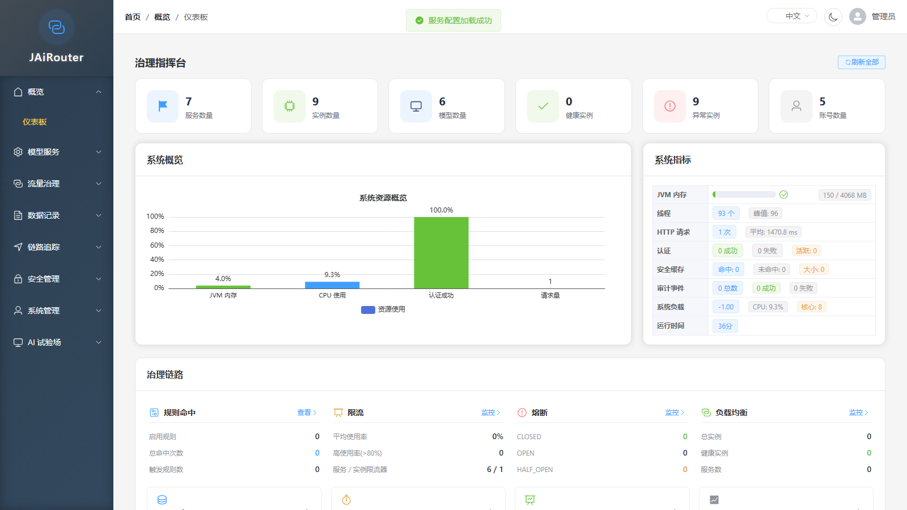
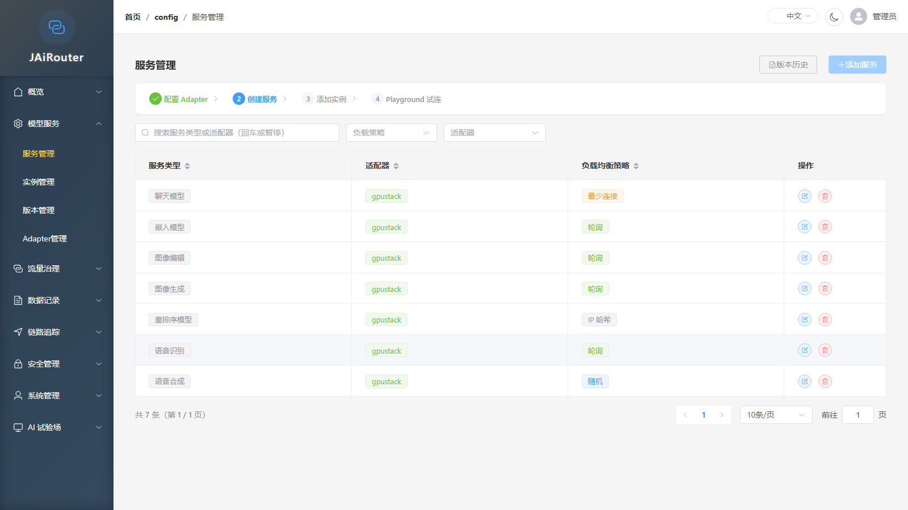
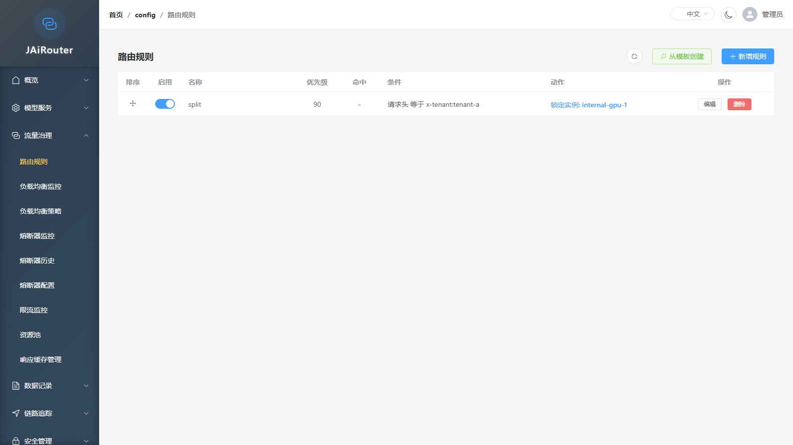
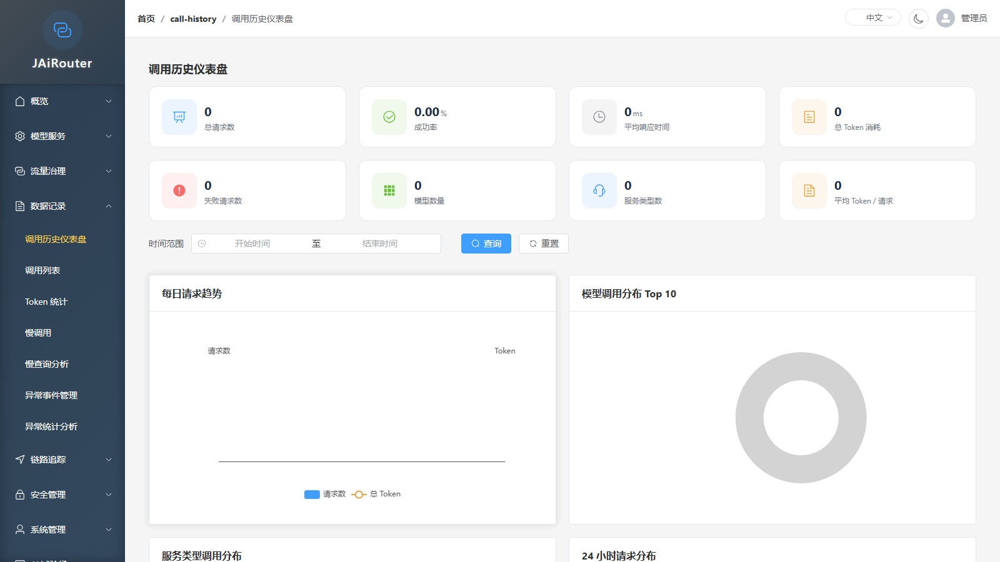
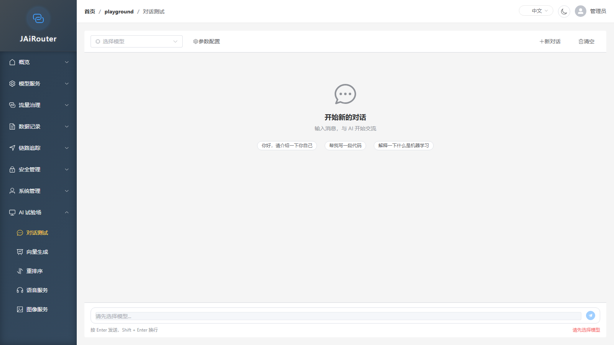
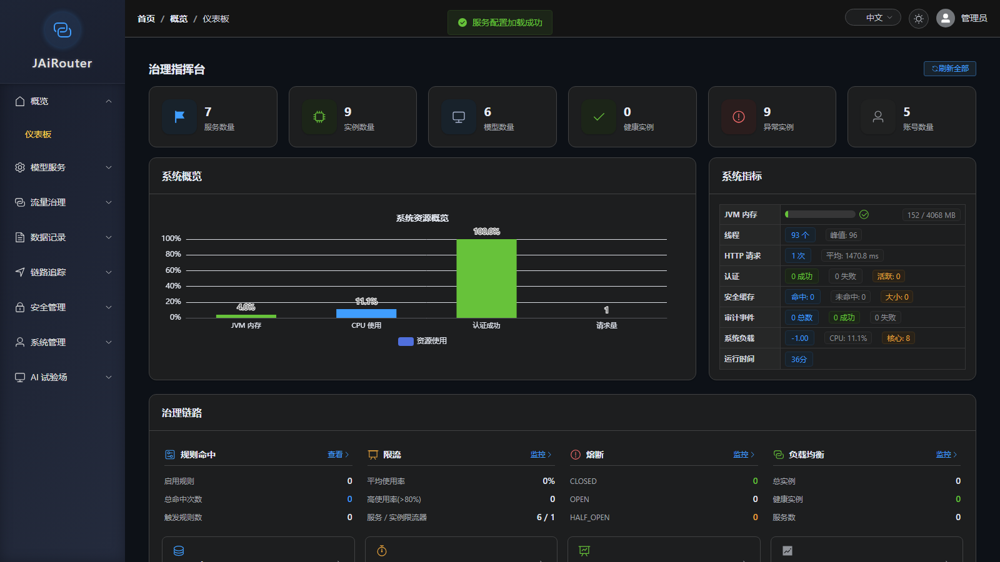

# Trunkline

<p align="center">
  
</p>

> **Trunkline** is an enterprise AI governance gateway built on top of [JAiRouter](https://github.com/Lincoln-cn/JAiRouter) (Apache License 2.0). It is distributed under the [Apache License 2.0](LICENSE) with upstream copyright notices preserved in [NOTICE](NOTICE). Many thanks to the original author [Lincoln-cn](https://github.com/Lincoln-cn).

<p align="center">
  <strong>Bring all your LLM backends behind one OpenAI-compatible endpoint.</strong>
</p>

<p align="center">
  Ollama · vLLM · GPUStack · Xinference · OpenAI · Claude · Gemini<br>
  Unified Routing · Load Balancing · Rate Limiting · Circuit Breaking · Failover · Web Console
</p>

<p align="center">
  
  
  
</p>

<p align="center">
  <a href="README-ZH.md">简体中文</a> •
  <a href="https://trunkline.com">Docs</a> •
  <a href="https://github.com/Lincoln-cn/trunkline/issues">Issues</a> •
  <a href="https://github.com/Lincoln-cn/trunkline/discussions">Discussions</a>
</p>

- **One endpoint for all models** — unify direct calls to Ollama, vLLM, GPUStack, OpenAI, Claude, and Gemini behind a single OpenAI-compatible `base_url`. Existing OpenAI SDK, LangChain, and LlamaIndex code switches over with zero changes.
- **Built for local inference clusters** — multi-instance load balancing (latency-aware, tag-based routing), circuit breaking, and per-request failover that **automatically retries on a healthy instance**.
- **Built for enterprise teams** — hot-reload web console, config versioning & rollback, RBAC, audit logging, encrypted call records, and full observability. Route changes need no restart.
- **Designed for non-technical users** — three role-based views (end user / ops / admin) and a minimal-config wizard. The console speaks human; technical details stay in advanced sections.

## Quick Start in 3 Minutes

```bash
# Start the gateway — dev profile, no key required (built-in dev key)
docker run -d --name trunkline -p 8080:8080 \
  -e SPRING_PROFILES_ACTIVE=dev \
  trunkline/trunkline:latest

# Web console: http://localhost:8080/admin
# Default account: admin / ChangeMeOnFirstStartup123456
```

For production, use the default `prod` profile and supply your own secret — prod deliberately ships no default key:

```bash
docker run -d --name trunkline -p 8080:8080 \
  -e JWT_SECRET="<at-least-32-chars>" \
  trunkline/trunkline:latest
```

Any OpenAI-compatible client works out of the box:

```python
from openai import OpenAI

client = OpenAI(
    base_url="http://localhost:8080/v1",             # OpenAI-native face (JSON / SSE)
    api_key="not-needed",                            # Authorization header is forwarded downstream
    default_headers={"X-API-Key": "<your API key>"}  # Gateway auth (API Key created in the console)
)

response = client.chat.completions.create(
    model="llama3.2",  # any configured backend model
    messages=[{"role": "user", "content": "Hello!"}]
)
print(response.choices[0].message.content)
```

Add your own backends — Ollama, vLLM, GPUStack, or any cloud provider — in the console's instance management. Hot-reload applies instantly, no restart.

<details>
<summary><b>Upgrading from JAiRouter?</b></summary>

Trunkline ships a transparent compatibility layer — existing setups migrate automatically:

- Config prefix `jairouter.*` → `trunkline.*`: legacy keys keep working with a deprecation warning in logs;
- Redis quota keys `jairouter:quota:*` → `trunkline:quota:*`: one-time migration at startup, usage counters are preserved;
- Config store key `model-router-config` → `trunkline-config`: reads fall back to the legacy key; writes go to the new key.

The default auth header `Jairouter_Token` and the `~/.jairouter` key directory remain unchanged (API contract compatibility).

</details>

<p align="center">
  
  <br/>
  <em>Admin console — live service / instance / system metrics</em>
</p>

<details>
<summary><b>More screenshots</b></summary>

<p align="center">
  
  <br/>
  <em>Service management — per-service adapter and load-balancing policy</em>
</p>

<p align="center">
  
  <br/>
  <em>Visual routing rules — hit stats, drag-to-prioritize, scenario templates</em>
</p>

<p align="center">
  
  <br/>
  <em>Call history analytics — success rate, latency, and token usage trends</em>
</p>

<p align="center">
  
  <br/>
  <em>AI playground — chat / embedding / rerank / TTS / STT / image testing</em>
</p>

<p align="center">
  
  <br/>
  <em>Dark theme built in — light/dark switch and bilingual UI</em>
</p>

</details>

## What is Trunkline?

Trunkline is a **production-grade AI model gateway** for teams running their own inference infrastructure (Ollama, vLLM, GPUStack, Xinference) alongside cloud models. It collapses every backend into one OpenAI-compatible API and adds the resilience and governance you would otherwise build yourself: load balancing, rate limiting, circuit breaking, failover, RBAC, audit logging, and observability.

| Problem | Trunkline answer |
|---------|------------------|
| Too many model endpoints to manage | One unified API entry |
| Manual switching when a service fails | Automatic circuit breaking & failover |
| Auth implemented per service | Built-in JWT + API Key |
| Scattered logs and metrics | Unified observability |
| Config changes require restarts | Hot-reload web console |
| Employees can't configure models | Role-based views + minimal-config UI |

### Core Features

- **🔌 OpenAI-compatible API** — drop-in for OpenAI SDK, LangChain, LlamaIndex (plus a native Anthropic `/v1/messages` face)
- **🔧 Configurable adapters** — add new AI providers (DeepSeek, Zhipu, etc.) via config or the web UI, no code
- **⚖️ Smart load balancing** — round robin, weighted, least connections, IP Hash, consistent hashing, EWMA latency-aware
- **🎯 Rule engine & tag routing** — visual conditional routing (model, service type, headers, source IP, weight, instance tags)
- **🛡️ Traffic control** — token bucket, leaky bucket, sliding window
- **🔥 Circuit breaking** — automatic failover with configurable thresholds, plus per-request failover (retry on healthy instances)
- **🔐 Auth & RBAC** — JWT + API Key dual auth, audit logging, data-driven RBAC (permission codes + role templates + menu/URL permissions)
- **📊 Observability** — Prometheus metrics, OpenTelemetry tracing, live dashboards, call history analytics
- **🔒 Record governance** — three levels (metadata only / redacted summary / AES-256-GCM encrypted full text)
- **💰 Quota ledger** — multi-dimensional, multi-window token quotas (MINUTE/HOUR/DAY/MONTH) with Redis distributed counting and automatic degradation
- **⚡ Response caching** — deterministic requests served from cache (optional, tenant-isolated keys)
- **💾 State persistence** — Redis / H2 / file storage for distributed deployments
- **🎛️ Web console** — visual management, versioning, rollback, light/dark themes, bilingual UI

## Supported AI Backends

<details>
<summary><b>Built-in adapters</b> — Chat / Embedding / Rerank / TTS / STT / Image matrix</summary>

| Backend | Chat | Embedding | Rerank | TTS | STT | Image | Notes |
|---------|:----:|:---------:|:------:|:---:|:---:|:-----:|-------|
| **Ollama** | ✅ | ✅ | - | - | - | - | Local inference |
| **vLLM** | ✅ | ✅ | - | - | - | - | High throughput |
| **GPUStack** | ✅ | ✅ | ✅ | ✅ | ✅ | ✅ | Full coverage |
| **Xinference** | ✅ | ✅ | ✅ | ✅ | ✅ | ✅ | Multi-model |
| **LocalAI** | ✅ | ✅ | - | ✅ | ✅ | ✅ | OpenAI-compatible |
| **OpenAI** | ✅ | ✅ | - | ✅ | ✅ | ✅ | Cloud fallback |
| **Anthropic Claude** | ✅ | - | - | - | - | - | Native Claude API |
| **Google Gemini** | ✅ | - | - | - | - | - | Native Gemini API |

</details>

<details>
<summary><b>Configurable adapters</b> — any OpenAI-compatible provider, no code</summary>

| Provider | Configuration |
|----------|---------------|
| **DeepSeek** | `adapter-definitions: deepseek: type: openai-compatible` |
| **Zhipu (GLM)** | `adapter-definitions: zhipu: type: openai-compatible` |
| **Moonshot** | `adapter-definitions: moonshot: type: openai-compatible` |
| **Qwen** | `adapter-definitions: qwen: type: openai-compatible` |
| **Baichuan** | `adapter-definitions: baichuan: type: openai-compatible` |
| **Minimax** | `adapter-definitions: minimax: type: openai-compatible` |

> 📖 See the [Adapter configuration guide](https://trunkline.com/configuration/adapter-config/)

</details>

## Why Trunkline?

- **Versus direct backend calls** — no unified resilience, no centralized keys, no call visibility. Trunkline gives you one entry, automatic failover, and a complete audit trail.
- **Versus One-API / new-api** — they focus on API key distribution and billing (good for account sharing / reselling); Trunkline targets **self-hosted inference clusters** as a governance gateway: multi-instance load balancing, circuit breaking, rule routing, RBAC, and observability. The two can complement each other.
- **Versus Nginx** — Nginx is a general-purpose web server; Trunkline is **purpose-built for AI/LLM workloads** with OpenAI-compatible routing, circuit breaking, and model-aware load balancing.
- **Versus LangChain** — LangChain is an application framework; Trunkline is the **infrastructure layer beneath it**.

## Documentation

| Resource | Link |
|----------|------|
| Full docs | https://trunkline.com |
| Deployment | https://trunkline.com/deployment/ |
| Configuration | https://trunkline.com/configuration/ |
| Monitoring | https://trunkline.com/monitoring/ |
| API reference | http://localhost:8080/swagger-ui |

## Roadmap

**Current version: 0.1.0** (version number frozen — will bump once the community edition matures; see the [iteration plan](docs/product/Trunkline-产品迭代计划.md))

0.1.0 inherits all capabilities of upstream JAiRouter v3.1.2 and adds the Trunkline brand system with a smooth compatibility layer (legacy config prefixes / Redis keys / config store keys migrate automatically).

**Community edition stages** (stage names, not release versions):

- **S1 Brand & baseline** — full brand-prefix cleanup + legacy compat mapping, NOTICE/license attribution, green test baseline
- **S2 Debt & stability** — code cleanup, load testing, security audit
- **S3 Production-ready** — deployment experience, TTV (deploy-to-first-response) measurement, docs site revamp
- **S4 Config reduction & user activation** — wizard-based onboarding, table slimming, human-friendly employee-side UI

**Commercial edition (planned)** — SSO, content safety, tamper-proof auditing, K8s HA delivery; boundary defined in the [editions page](docs/product/editions.md).

## Contributing

Contributions are welcome — see the [contributing guide](https://trunkline.com/development/contributing/).

```bash
git clone https://github.com/Lincoln-cn/trunkline.git
cd trunkline
./mvnw clean package -DskipTests
java -jar target/model-router-*.jar
```

## Support

- **Docs**: https://trunkline.com

### Issue or Discussion — where should it go?

The two GitHub entry points are deliberately separated so no feedback falls through the cracks. Choose by **what you have in hand**:

| What you have | Where it goes | What happens |
|---------------|---------------|--------------|
| **Reproducible bug** — crash, wrong result, regression, doc error | [**Issues**](https://github.com/Lincoln-cn/trunkline/issues) | **Fast triage** — confirmed bugs get fixed or scheduled |
| **Feature or idea** — new feature, new adapter, design talk, usage question | [**Discussions**](https://github.com/Lincoln-cn/trunkline/discussions) | **Curated regularly** — summarized, voted on, folded into the [roadmap](#roadmap) |

**In short**: bugs → **Issues**, ideas & questions → **Discussions**.

> Not sure? Start with Discussions — if it turns out to be a reproducible bug, we'll move it to Issues.

## License

This project is open-sourced under the [Apache 2.0 License](LICENSE), forked from [JAiRouter](https://github.com/Lincoln-cn/JAiRouter) (original author Lincoln-cn, also Apache-2.0). Upstream copyright notices are fully preserved in [NOTICE](NOTICE).

---

<p align="center">
  <strong>If Trunkline helps you, please give it a <a href="https://github.com/Lincoln-cn/trunkline/stargazers">Star</a> ⭐</strong>
  <br/>
  <em>Found a bug? Open an Issue. Have an idea? Start a Discussion.</em>
</p>

<p align="center">
  Trunkline Team · Based on JAiRouter · Apache-2.0
</p>
