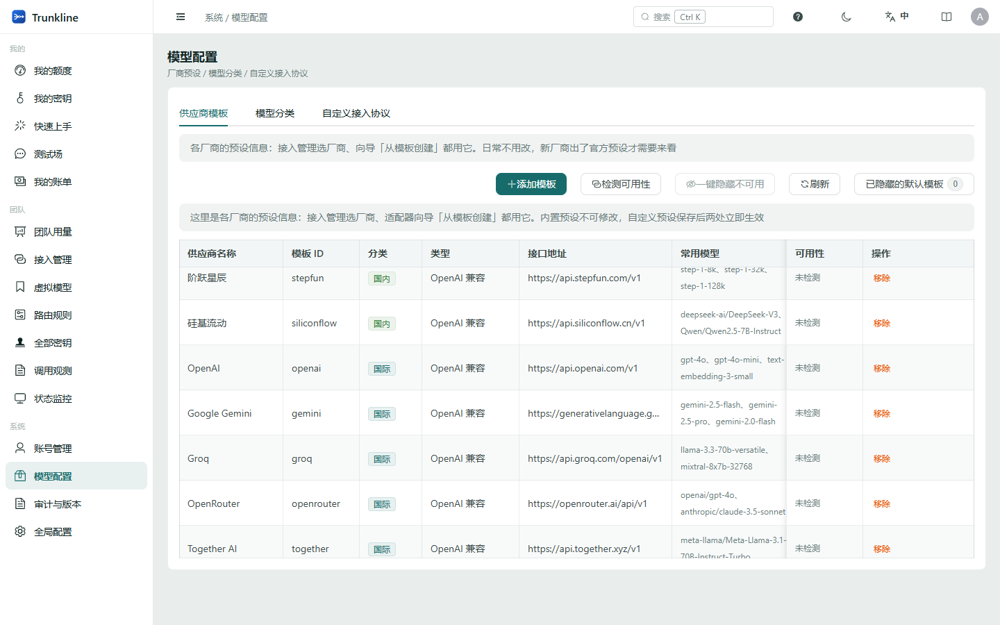
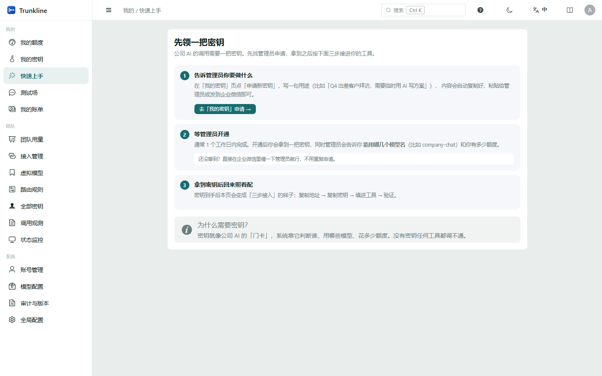
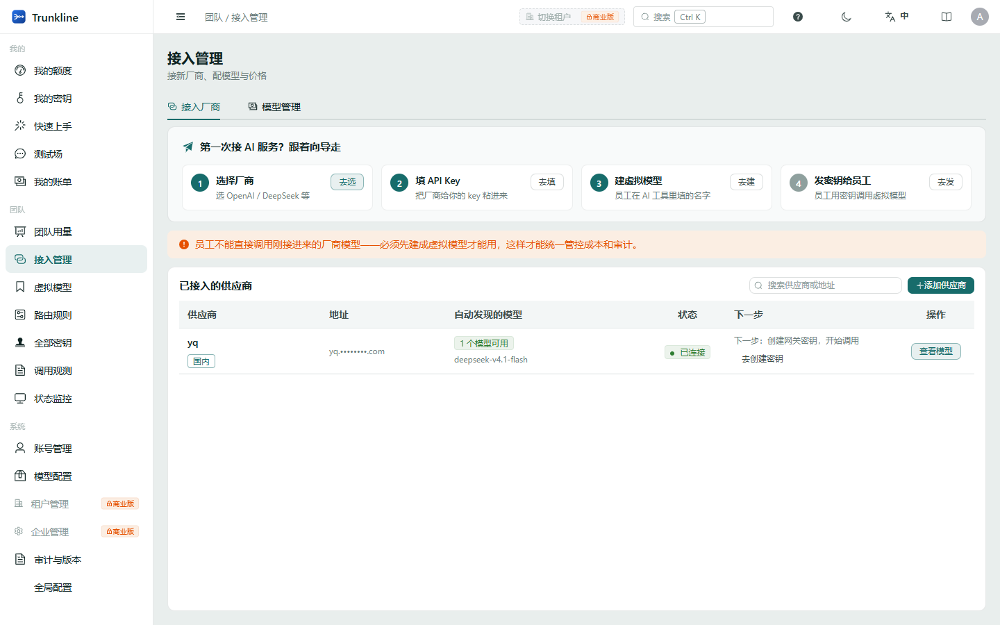
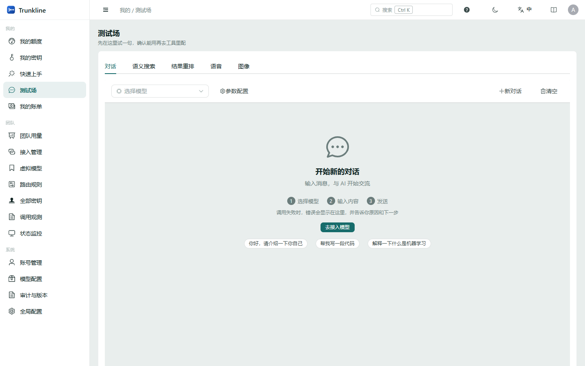
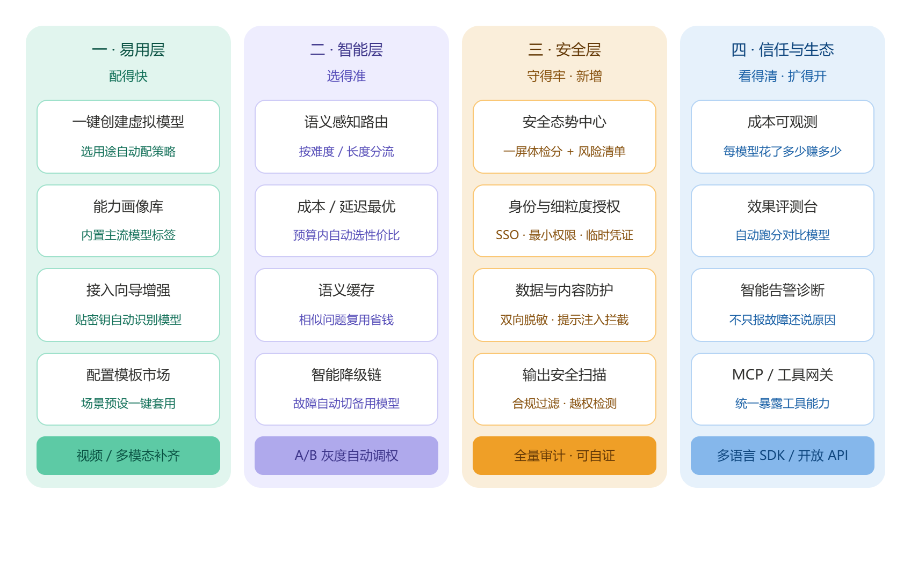

# Trunkline

<p align="center">
  
</p>

<p align="center">
  <strong>A simple, easy-to-use, secure and trustworthy intelligent routing model gateway</strong>
</p>

<p align="center">
  
  
</p>

<p align="center">
  <a href="https://github.com/wjy2027/trunkline/releases"><strong>Download installers</strong> (Windows / Mac / Linux — no setup, just double-click)</a>
</p>

<p align="center">
  <a href="README-ZH.md">简体中文</a> •
  <a href="https://github.com/wjy2027/trunkline/issues">Report a bug</a> •
  <a href="https://github.com/wjy2027/trunkline/discussions">Ideas &amp; discussions</a>
</p>

---

## In plain words: what problem does Trunkline solve?

If your team uses several AI models at once — some running on your own machines, others from cloud services like OpenAI or Claude — you have probably run into these headaches:

| Headache | Without Trunkline | With Trunkline |
|----------|-------------------|----------------|
| Too many models | Every model has its own way of calling, so switching means rewriting code | Connect once, switch models without touching your code |
| A model goes down | Someone has to manually change the settings | Traffic automatically moves to a model that still works |
| Unclear costs | Who used what, and how much did it cost? Nobody knows | Spend per model and usage per person, all in one place |
| Weak safety | Sensitive data may leave with a question, with no record afterwards | Sensitive content is masked automatically, every call is logged |
| Staff can't set it up | Every change needs a technical person | The console speaks human — staff can do it themselves |

**Trunkline sits between your application and all your AI models, like a traffic controller.** Your app talks only to Trunkline; Trunkline decides which model to use, how to recover from failures, who gets access, and how much each person uses.

Three words sum up what we aim for:

- **Simple** — easy to get started; pick a few options and you are up and running.
- **Intelligent** — it picks models for you, saves money, and saves time.
- **Secure** — permissions, masking, and audit trails come built in, so enterprises can adopt it with confidence.

## Working today (v0.1.0)

Trunkline is not a concept demo. Everything below is **already usable in version 0.1.0**:

**One entry point for everyday calls**
- Whether a model runs on your own machines or in the cloud, your app talks to one address. If your code already calls models the OpenAI way, just change the connection address — your existing code mostly stays as it is.
- Models already supported: Ollama, vLLM, GPUStack, Xinference and LocalAI on your own infrastructure; OpenAI, Claude and Gemini in the cloud. The console also ships one-click templates for 13 common providers (DeepSeek, Zhipu, Moonshot, Qwen, Minimax and others). Providers with a different protocol, such as Claude, can still be connected through a custom adapter.
- More than chat: embeddings, reranking, speech-to-text, text-to-speech and image generation all go through the same entry point.

**When something breaks, no firefighting**
- If a model stalls or goes down, traffic automatically moves to one that still works; a failed request is retried on a healthy instance, almost unnoticed by the user.
- Sudden traffic spikes are throttled automatically so your backends are not overwhelmed.
- Route by conditions such as model name, request source, or instance tags.

**See who uses what, and stay in control**
- Two kinds of credentials — user accounts and access keys — with role-based permissions, so not everyone can touch every model.
- Sensitive data is masked on the way in and out. Call records can be summary-only or encrypted; every call is logged so you can investigate later.
- Usage and quotas are tracked per person, per model and per time window, with automatic limits when you run over.
- Spend, success rates and response times come with ready-made charts — no separate monitoring stack needed.

**Easy from the moment you install it**
- A three-step setup wizard with no default username or password — you create the admin account yourself, so there is no ready-made entry point for someone else.
- The console speaks human and is split into "My workspace / Team / System": staff see their own things, operators manage the team, admins manage everything.
- Configuration changes take effect immediately, without a restart; light/dark themes and Chinese/English are both built in.

## What it looks like

Enough talk — here is the actual 0.1.0 console.

**13 built-in provider templates, one click to add** (OpenAI, Google Gemini, DeepSeek, Zhipu, Moonshot and more are visible below):

<p align="center">
  
</p>

**Staff get a key and start calling in three steps**; operators add a provider, build a virtual model, then hand it to staff:

<table>
  <tr>
    <td width="50%" align="center"><br><sub>Staff quick start: get a key → wait for access → copy the config</sub></td>
    <td width="50%" align="center"><br><sub>Operator onboarding: pick a provider → add a key → build a model → assign to staff</sub></td>
  </tr>
</table>

**One playground to try chat, semantic search, reranking, speech and images**:

<p align="center">
  
</p>

## Product blueprint

<p align="center">
  
</p>

The blueprint below is the full picture. Many items are already available in 0.1.0 (see above); ones marked "pending" or "planned" are what later releases will add. It has four layers, each solving a different class of problem. Security is not a separate box — it runs through every layer. Creating a model with one click automatically adds masking and usage limits, and intelligent routing treats compliance and output safety as conditions to meet.

### 1 · Simplicity — set up fast

| Capability | What it means in practice | Where it stands |
|------------|---------------------------|-----------------|
| One-click virtual models | Pick a purpose (say "customer support") and the system builds the model pool and routing rules for you | Wizard exists; auto-configuration pending |
| Capability profiles | A clear guide to what each mainstream model is good at, so you don't have to try them all | Pending |
| Smarter onboarding | Paste a key and the system figures out which provider it belongs to | Pending |
| Configuration templates | Common scenarios are pre-set — apply one with a single click | Pending |
| Video / multimodal support | Not just text: images, audio and video too | Planned |

### 2 · Intelligence — route well

| Capability | What it means in practice | Where it stands |
|------------|---------------------------|-----------------|
| Semantic-aware routing | Looks at the content and length of the question to pick a suitable model | Planned |
| Best cost / latency | Picks the fast, economical option within your budget | Planned |
| Semantic caching | If a similar question was answered before, reuse that answer and save money | Planned |
| Smart fallback chain | If one model fails, automatically switch to a backup | Basic routing in place |
| A/B canary tuning | Run old and new models together, then shift more traffic to the better one | Planned |

### 3 · Security — stay safe

| Capability | What it means in practice | Where it stands |
|------------|---------------------------|-----------------|
| Security posture center | One screen to see your overall security health and what needs attention | Pending |
| Identity &amp; fine-grained access | Control exactly who can use which models, and how much | Foundations in place |
| Data &amp; content protection | Sensitive information is masked on the way in and on the way out | In place |
| Output safety scanning | Catch and block things a model should not say | Pending |
| Full audit trail | Every call is recorded so you can investigate and prove what happened | In place |

### 4 · Trust &amp; ecosystem — see clearly, grow freely

| Capability | What it means in practice | Where it stands |
|------------|---------------------------|-----------------|
| Cost visibility | See exactly what each model costs | In place |
| Evaluation bench | Let models run the same tests and compare results with data | Pending |
| Smart alert diagnostics | Not just "it broke" — it tells you why | Foundations in place |
| MCP / tool gateway | Bring all kinds of tool capabilities through one door | Pending |
| Multi-language SDK / open API | Easy to connect from any programming language | Planned |

> "Where it stands" reflects version 0.1.0 and will be updated as releases go out.

## How to install and get started

There are two ways to use Trunkline. **Want to just run it? Go with option 1. Are you an operator or developer deploying to a server for the long run? Go with option 2.**

| Your situation | Recommended way | What you need beforehand |
|----------------|-----------------|--------------------------|
| Everyday user — no environment setup, no command line | Option 1: download an installer, double-click to run | A browser; nothing else |
| Operator / developer deploying to a server | Option 2: Docker or the jar | Docker, or Java 17+ |

### Option 1: Download an installer and double-click (recommended for most people)

Windows, macOS and Linux all have ready-to-run packages. **The runtime is bundled inside — you do not need to install Java or Docker.** Grab the one for your system from the [Releases page](https://github.com/wjy2027/trunkline/releases):

| Your computer | Download this file | How to open it |
|---------------|--------------------|----------------|
| Windows (most desktops / laptops, x64) | `Trunkline-0.1.0-win-x64-portable.zip` | Unzip, double-click `Trunkline.exe` |
| Windows (Snapdragon Copilot+ PCs, Surface ARM models) | `Trunkline-0.1.0-win-arm64-portable.zip` | Unzip, double-click `启动.bat` |
| Mac (Apple silicon M1/M2/M3/M4) | `Trunkline-0.1.0-macos-arm64.tar.gz` | Unzip, double-click `start.command` |
| Mac (Intel) | `Trunkline-0.1.0-macos-x64.tar.gz` | Unzip, double-click `start.command` |
| Linux (x64) | `Trunkline-0.1.0-linux-x64.tar.gz` | Unzip, run `./start.sh` |
| Linux (ARM / aarch64) | `Trunkline-0.1.0-linux-aarch64.tar.gz` | Unzip, run `./start.sh` |

> **Not sure which one you have?** On Windows, open Settings → System → About and check "System type"; on a Mac, click the Apple icon → About This Mac — Apple silicon models list an M-series chip.

A browser opens automatically on launch; if it does not, open `http://localhost:8080/admin/` yourself. On first launch you will be guided through setup (see "First launch: three steps" below). **To stop it, just close the black terminal window that appeared.**

<details>
<summary>A security warning, or it won't open? (expand)</summary>

- **Windows** says "Windows protected your PC": click **More info** → **Run anyway**.
- **Mac** says "unidentified developer": in Terminal run `xattr -dr com.apple.quarantine "/path/to/Trunkline"`, then double-click again.
- **Linux** says permission denied: run `chmod +x start.sh runtime/bin/java` first.
- **Port 8080 is busy**: open the start script in a text editor and change `--server.port=8080` to another port, e.g. `8081`.

</details>

### Option 2: Docker or jar deployment (for technical users)

This section is for operators and developers who want to run Trunkline on a server long-term. Everyday users can stick with the installers above and skip this.

**Docker (easiest)**

```bash
docker run -d --name trunkline -p 8080:8080 \
  -v trunkline-data:/app/data \
  -e JWT_SECRET="replace-with-your-own-32-char-secret" \
  ghcr.io/wjy2027/trunkline:0.1.0
```

> The official image `ghcr.io/wjy2027/trunkline` ships with v0.1.0. Before it is published, use the jar option or build it yourself: `docker build --build-arg VERSION=0.1.0 -f Dockerfile.optimized -t trunkline:0.1.0 .`

**jar (server already has Java 17+)**

```bash
java -jar trunkline-0.1.0.jar
```

**Build from source**

With **Java 17 or newer**, clone the repo and run:

```bash
./mvnw clean package -DskipTests
java -jar target/trunkline-0.1.0.jar
```

### First launch: three steps

Whichever option you chose, the first launch opens a setup wizard:

1. Choose where data is stored — pick **local** if you are just getting started;
2. If you chose a remote database, enter its details and restart once;
3. Create an admin username and password (12+ characters — avoid anything guessable like `123456`).

With an installer, open `http://localhost:8080/admin/`; with Docker or the jar, open `http://localhost:8080/init`.

**Trunkline ships with no default username and no default password.** You create the admin account the first time you open the page, so there is no ready-made entry point for someone else to find.

Sign in with the account you just created and add your models in the console. From then on, staff only need the "key" the console issues to start calling them.

> Before serving real traffic, set your own secret key (environment variable `JWT_SECRET`, at least 32 characters) and run in `prod` mode (the Docker image defaults to `prod`; for the jar add `--spring.profiles.active=prod`). Never use the sample value in production — the startup gate rejects placeholder-looking secrets, and `.env.example` ships empty credential fields on purpose (copying it without filling them in fails fast in prod). Generate one with `openssl rand -base64 32`. `PROD_JWT_SECRET` / `DEV_JWT_SECRET` are also accepted, in that priority order after `JWT_SECRET`.

If your application already calls models the OpenAI way, just change the connection address to switch to Trunkline — your existing code mostly stays as it is.

## Who is it for?

- Teams running their own AI models (Ollama, vLLM, GPUStack, and others)
- Teams using several cloud models who want one place to manage them
- Anyone who needs to know who used what, what it cost, and whether sensitive data leaked
- Teams that want non-technical colleagues to connect models without digging into technical details

## What's next

We move forward one release at a time. This is a rough outline, not a fixed promise — community feedback shapes it.

| Version | Focus |
|---------|-------|
| v0.1.0 | Laying the foundation: first-run wizard, no default admin, legacy cleanup, brand unification (released) |
| v0.2.0 | Faster setup: model capability profiles, one-click virtual models |
| v0.3.0 | Security you can see: security posture center, one-screen health check |
| v0.4.0 | Better choices: semantic routing, cost / latency optimization, semantic caching |
| v0.5.0 | Stronger guardrails: content safety, injection and privilege-abuse protection, SSO |
| v0.6.0 | Smarter recovery: automatic fallback chains, A/B canary tuning |
| v1.0.0 | More open: evaluation bench, tool gateway, multi-language SDK |


## About JAiRouter

Trunkline continues the work started in [JAiRouter](https://github.com/Lincoln-cn/JAiRouter). Thanks to the original author, Lincoln-cn, for the excellent foundation. The upstream copyright notices are preserved in full in [NOTICE](NOTICE).

## License

Released under the [Apache 2.0 License](LICENSE) — free to use, modify, and ship commercially, provided the original notices are kept.

## Contribute &amp; give feedback

| What you have | Where to send it |
|---------------|------------------|
| A reproducible bug: crash, wrong result, doc error | [Issues](https://github.com/wjy2027/trunkline/issues) |
| An idea, a feature request, a question, or a discussion | [Discussions](https://github.com/wjy2027/trunkline/discussions) |

Not sure? Start with Discussions — if it turns out to be a reproducible bug, we will move it to Issues for you.

Want to build or deploy it yourself? See "How to install and get started" above.

---

<p align="center">
  If Trunkline helps you, please give it a <a href="https://github.com/wjy2027/trunkline/stargazers">Star</a> ⭐
</p>

<p align="center">
  Trunkline Team · Based on JAiRouter · Apache-2.0
</p>
