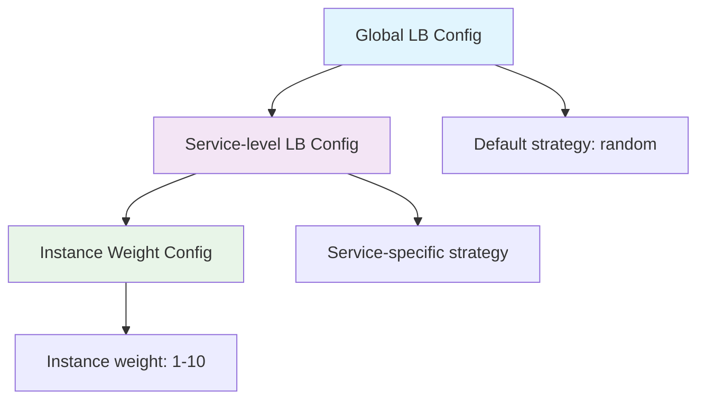
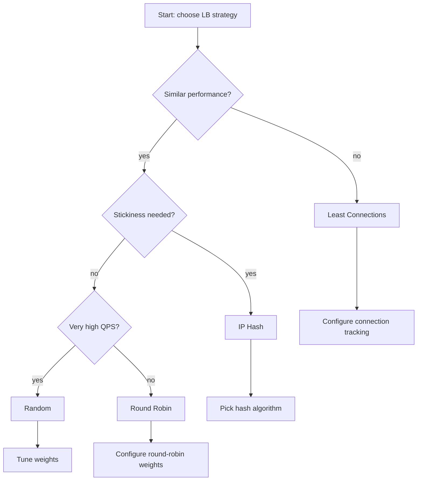

# Load Balancing Configuration

<!-- 版本信息 -->
> **Doc Version**: 1.0.2  
> **Last Updated**: 2026-05-21
> **Git Commit**: 61384b4a  
> **Author**: Lincoln
<!-- /版本信息 -->

Trunkline provides six load balancing strategies, configurable at global, service, and instance level. This document details how to configure each strategy and when to use it.

## Modular Configuration Notes

Since v2.8.x, Trunkline uses a modular configuration structure. Load balancing lives in its own files:

- Main config: `application.yml`
- Load balancing config: the former `config/router/loadbalancer.yml` was removed on 2026-11-09; defaults live in code (`ModelRouterProperties` / `RoutingMonitorConfig`). Override via `application-{profile}.yml` or external mount.
- Service instance config: `config/router/services.yml`

Global load balancing settings use `model.load-balance.*` keys and routing-monitor settings use `trunkline.loadbalancer.routing-monitor.*`; per-service instances and weights live in `config/router/services.yml`.

## Load Balancing Overview

### Supported Strategies

| Strategy | Algorithm | Traits | Best For |
|----------|-----------|--------|----------|
| **Random** | random pick | simple, even over time (default) | similar instance performance |
| **Round Robin** | round-robin | every instance gets a turn | similar instance performance |
| **Least Connections** | fewest active connections | balances load automatically | uneven request durations |
| **IP Hash** | client IP hash | session stickiness | client affinity needed |
| **Consistent Hash** | consistent hash (150 virtual nodes) | instance churn only moves a few keys | sticky + dynamic scaling |
| **Latency** (v2.9.3+) | EWMA latency-aware | weights by historical latency; lower latency = higher probability | cross-region / mixed hardware, large latency spread |

> Candidate instances can first be narrowed by **instance tags** (tag routing, v2.9.7+) before the load balancer selects among them — see [Routing Rules](routing-rules.md).

### Configuration Layers



## Global Load Balancing Configuration

### Basic Configuration

Global load balancing defaults live in code (the former `config/router/loadbalancer.yml` was removed); override via any higher-priority configuration source:

```yaml
# application-{profile}.yml or external mount
model:
  # Global
  load-balance:
    type: round-robin           # global default strategy (code default: random)
    hash-algorithm: "md5"       # hash algorithm for ip-hash / consistent-hash

  # Global adapter - used when a service does not specify its own
  adapter: gpustack # one of: normal, gpustack, ollama, vllm, xinference, localai

  # Global rate limit
  rate-limit:
    enabled: true
    algorithm: "token-bucket"
    capacity: 1000
    rate: 100
    scope: "service"
    client-ip-enable: true  # enable client-IP rate limiting

  # Global circuit breaker
  circuit-breaker:
    enabled: true
    failureThreshold: 5
    timeout: 60000
    successThreshold: 2

  # Global fallback
  fallback:
    enabled: true
    strategy: default
```

### Advanced Configuration

```yaml
model:
  load-balance:
    type: consistent-hash
    hash-algorithm: "md5"       # hash algorithm for ip-hash / consistent-hash
    virtual-nodes: 150          # consistent-hash virtual node count
    ewma-alpha: 0.2             # EWMA smoothing factor (latency strategy only)
```

## Service-level Load Balancing

### YAML

Configure per-service strategies in `config/router/services.yml`:

```yaml
model:
  services:
    chat:
      load-balance:
        type: least-connections
        hash-algorithm: "sha256"  # only needed for IP Hash
      adapter: gpustack # use the GPUStack adapter
      # Service-level rate limit
      rate-limit:
        enabled: true
        algorithm: "token-bucket"
        capacity: 100
        rate: 10
        scope: "service"
        client-ip-enable: true
      instances:
        - name: "high-perf-model"
          base-url: "http://gpu-server:8080"
          path: "/v1-openai/chat/completions"
          weight: 3               # high weight
        - name: "standard-model"
          base-url: "http://cpu-server:8080"
          path: "/v1/chat/completions"
          weight: 1               # standard weight
    
    embedding:
      load-balance:
        type: ip-hash
        hash-algorithm: "md5"
      rate-limit:
        enabled: true
        algorithm: "token-bucket"
        capacity: 200
        rate: 20
        scope: "service"
        client-ip-enable: true
      instances:
        - name: "embedding-model-1"
          base-url: "http://embed-server-1:8080"
          path: "/v1/embeddings"
          weight: 2
        - name: "embedding-model-2"
          base-url: "http://embed-server-2:8080"
          path: "/v1/embeddings"
          weight: 2
```

### JSON

Trunkline also supports updating instance config via the dynamic config API:

```json
{
  "services": {
    "chat": {
      "loadBalance": {
        "type": "round-robin",
        "hashAlgorithm": "md5"
      },
      "instances": [
        {
          "name": "qwen2:7b",
          "baseUrl": "http://gpu-cluster:8080",
          "path": "/v1/chat/completions",
          "weight": 3
        },
        {
          "name": "llama3.2:3b",
          "baseUrl": "http://cpu-cluster:8080",
          "path": "/v1/chat/completions",
          "weight": 1
        }
      ]
    }
  }
}
```

## Strategy Details

### 1. Random

#### Example

```yaml
model:
  services:
    chat:
      load-balance:
        type: random
      instances:
        - name: "model-1"
          base-url: "http://server-1:8080"
          weight: 1
        - name: "model-2"
          base-url: "http://server-2:8080"
          weight: 2
        - name: "model-3"
          base-url: "http://server-3:8080"
          weight: 1
```

#### Traits and Use Cases

**Traits**:
- Simple algorithm, lowest overhead
- Supports weights
- Even distribution over time
- Stateless, easy to scale

**Use cases**:
- Similar instance performance
- Stable request durations
- High concurrency
- Stateless services

**Weight math**:
```
selection probability = instance weight / total weight
```

Probabilities for the example:
- model-1: 1/4 = 25%
- model-2: 2/4 = 50%
- model-3: 1/4 = 25%

### 2. Round Robin

#### Example

```yaml
model:
  services:
    embedding:
      load-balance:
        type: round-robin
      instances:
        - name: "embed-1"
          base-url: "http://embed-server-1:8080"
          weight: 2
        - name: "embed-2"
          base-url: "http://embed-server-2:8080"
          weight: 1
        - name: "embed-3"
          base-url: "http://embed-server-3:8080"
          weight: 3
```

#### Traits and Use Cases

**Traits**:
- Guarantees every instance gets traffic
- Supports weighted round-robin
- Predictable distribution
- Good for batch processing

**Use cases**:
- Similar instance performance
- Even distribution desired
- Batch data processing
- Testing and debugging

**Weighted round-robin**: builds a schedule by weight; an instance with weight 2 is picked twice in a row.

Example schedule: embed-1, embed-1, embed-2, embed-3, embed-3, embed-3

### 3. Least Connections

#### Example

```yaml
model:
  services:
    chat:
      load-balance:
        type: least-connections
      instances:
        - name: "fast-model"
          base-url: "http://fast-server:8080"
          weight: 2
        - name: "slow-model"
          base-url: "http://slow-server:8080"
          weight: 1
```

#### Traits and Use Cases

**Traits**:
- Balances load automatically
- Adapts to performance differences
- Must track connection state
- Dynamically adjusts allocation

**Use cases**:
- Large performance spread
- Variable request durations
- Long-lived connections
- Precise load balancing needed

**Selection**:
```
choose instance = min(activeConnections / weight)
```

### 4. IP Hash

#### Example

```yaml
model:
  services:
    chat:
      load-balance:
        type: ip-hash
        hash-algorithm: "md5"    # one of: md5, sha1, sha256
      instances:
        - name: "session-model-1"
          base-url: "http://session-server-1:8080"
          weight: 1
        - name: "session-model-2"
          base-url: "http://session-server-2:8080"
          weight: 1
        - name: "session-model-3"
          base-url: "http://session-server-3:8080"
          weight: 2
```

#### Traits and Use Cases

**Traits**:
- Same client always routes to the same instance
- Session stickiness
- Instance churn changes routing
- May cause imbalance

**Use cases**:
- Session stickiness needed
- Stateful services
- Cache locality
- Personalized services

**Hash algorithms**:

| Algorithm | Traits | Speed | Distribution |
|-----------|--------|-------|--------------|
| MD5 | fast, even | high | good |
| SHA1 | better security | medium | good |
| SHA256 | best security | low | best |

#### Consistent Hash

Consistent hash is a standalone strategy with a flat config (virtual node count at `model.load-balance.virtual-nodes`, default 150):

```yaml
model:
  load-balance:
    type: consistent-hash        # select consistent-hash directly
    hash-algorithm: "md5"        # hash function: md5 / sha1 / sha256
    virtual-nodes: 150           # virtual node count
```

> The nested `load-balance.consistent-hash.{enabled,virtual-nodes,hash-function}` structure in earlier docs does not exist; the virtual node count is the flat key `model.load-balance.virtual-nodes`.

## Dynamic Load Balancing

### Adjust Instance Weight via API

Instance weights can be hot-updated via the instance management API:

```bash
# Scenario: GPU server got faster, raise weight
curl -X PUT "http://localhost:8080/api/config/instance/chat/gpu-model@http://gpu-server:8080" \
  -H "Content-Type: application/json" \
  -d '{
    "name": "gpu-model",
    "baseUrl": "http://gpu-server:8080",
    "path": "/v1/chat/completions",
    "weight": 4
  }'

# Scenario: CPU server overloaded, lower weight
curl -X PUT "http://localhost:8080/api/config/instance/chat/cpu-model@http://cpu-server:8080" \
  -H "Content-Type: application/json" \
  -d '{
    "name": "cpu-model",
    "baseUrl": "http://cpu-server:8080",
    "path": "/v1/chat/completions",
    "weight": 1
  }'
```

## Load Balancing Monitoring

### Metrics

```bash
# LB selection metric
curl "http://localhost:8080/actuator/metrics/trunkline_loadbalancer_selections_total"

# Per-instance request distribution
curl "http://localhost:8080/actuator/metrics/trunkline_requests_total"

# Connection count (Least Connections only)
curl "http://localhost:8080/actuator/metrics/trunkline_rate_limit_remaining"
```

### Prometheus Metrics

```prometheus
# Total LB requests
trunkline_loadbalancer_selections_total{service="chat",strategy="round-robin"}

# Per-instance request distribution
trunkline_requests_total{service="chat",instance="model-1",status="success"}

# Active connections
trunkline_rate_limit_remaining{service="chat",instance="model-1"}

# Instance latency
trunkline_request_duration_seconds{service="chat",instance="model-1"}
```

### Dashboard Example

```yaml
# Grafana query examples
queries:
  - name: "Request distribution"
    query: 'rate(trunkline_requests_total[5m])'
    
  - name: "LB effect"
    query: 'trunkline_requests_total / ignoring(instance) group_left sum(trunkline_requests_total) by (service)'
    
  - name: "Instance health"
    query: 'trunkline_backend_health'
```

## Performance Tuning

### 5. Latency (v2.9.3+)

EWMA (exponentially weighted moving average) latency-aware load balancing: selection probability adjusts to each instance's historical call latency — the lower the latency, the higher the probability.

#### How It Works

- Each successful call updates the instance's EWMA with the actual duration: `ewma = alpha × sample + (1 - alpha) × ewma`
- Failed calls use a penalty (equivalent to a 30s timeout), penalizing high-failure instances
- Selection weights by `1 / (1 + ewma)` for weighted random choice
- Cold start: instances without samples start at weight 1.0 (zero-latency equivalent) for fair exploration
- `alpha` (default 0.2) controls smoothing: larger = more sensitive to new samples

#### Example

```yaml
# Global
model:
  load-balance:
    type: latency        # latency-aware
    ewma-alpha: 0.2      # EWMA smoothing (optional, default 0.2)

# Service-level (overrides global)
model:
  services:
    chat:
      load-balance:
        type: latency
        ewma-alpha: 0.3
```

#### Traits and Use Cases

- **Traits**: auto-adapts to latency changes; fair exploration for unsampled instances; converges gradually under jitter
- **Use cases**: cross-region deployments, mixed hardware, load that varies over time
- **Note**: latency comes from call history (not active probing); convergence is ~1 request cycle under high load; duration passthrough is wired up for Sticky routing.



### 1. Strategy Selection Guide

### 2. Weight Best Practices

```yaml
# Weight by instance capability
model:
  services:
    chat:
      instances:
        # High-performance GPU
        - name: "gpu-model"
          base-url: "http://gpu-server:8080"
          weight: 5              # high
          
        # Mid-tier
        - name: "cpu-model"
          base-url: "http://cpu-server:8080"
          weight: 2              # medium
          
        # Backup
        - name: "backup-model"
          base-url: "http://backup-server:8080"
          weight: 1              # low
```

### 3. Connection Pool Tuning

The outbound WebClient connection pool lives in `config/common/webclient.yml`, prefix `trunkline.webclient`:

```yaml
trunkline:
  webclient:
    connect-timeout-ms: 5000       # connect timeout
    response-timeout-seconds: 60   # response timeout
    max-connections: 500           # pool size
    pending-acquire-timeout-ms: 10000  # acquire-timeout
    max-idle-time-seconds: 300     # idle connection recycle
```

> The top-level `webclient.connection-pool.*` keys in earlier docs are deprecated; the pool moved to `trunkline.webclient.*`.

## Troubleshooting

### 1. Instance Failure and Circuit Breaker Isolation

Instance failure detection is the circuit breaker's job (after `failureThreshold` consecutive failures the instance trips and is excluded from LB selection while OPEN) — see [Circuit Breaker](circuit-breaker.md).

> The `model.load-balance.health-check.*` block (interval/timeout/failure-threshold/success-threshold) in earlier docs **does not exist**; failure detection is the circuit breaker.

### 2. Failover

Failover works by "retry on a different instance" (v2.9.6+): on a retryable error (connection error / 5xx / timeout), the current instance is added to this request's failure blacklist, and the normal selection chain (health/circuit-breaker filter + LB strategy) picks an untried instance to retry.

> The `load-balance.failover.{enabled,retry-attempts,retry-delay}` block and the instance `priority` field in earlier docs **do not exist**; retry counts follow each service's retry policy and need no LB-level config.

#### Request-level Failover (v2.9.6+)

Since v2.9.6, on a retryable error (connection error / 5xx / timeout), the gateway **reselects another instance** instead of hammering the same one:

- **Different-instance retry**: on a retryable error the current instance is blacklisted for this request, and the selection chain picks an untried instance
- **Blacklist isolation**: already-failed instances in the same request are not re-picked
- **All-failed fallback**: if every instance failed (or there is only one), fall back to the original instance; retry count is still governed by `RetryPolicy`
- **Non-retryable errors** (e.g. 4xx client errors): no switch, no retry, return immediately
- On by default, no extra config; retry cap follows each service's configured retry count

### 3. Diagnosing LB Issues

```bash
# Instance states
curl "http://localhost:8080/api/config/instance/chat"

# Instance circuit breaker states
curl "http://localhost:8080/api/config/instance/circuit-breaker/states"

# Health
curl "http://localhost:8080/actuator/health"
```

## Real-world Examples

### Case 1: E-commerce Recommendation

```yaml
# Sticky recommendation service
model:
  services:
    recommendation:
      load-balance:
        type: ip-hash
        hash-algorithm: "md5"
      instances:
        - name: "rec-server-1"
          base-url: "http://rec-1:8080"
          weight: 1
        - name: "rec-server-2"
          base-url: "http://rec-2:8080"
          weight: 1
        - name: "rec-server-3"
          base-url: "http://rec-3:8080"
          weight: 1
```

### Case 2: Multi-model AI Service

```yaml
# Instances of varying capability
model:
  services:
    chat:
      load-balance:
        type: least-connections
      instances:
        - name: "gpt-4"
          base-url: "http://openai-proxy:8080"
          weight: 1              # slow but high quality
        - name: "llama3.2:70b"
          base-url: "http://gpu-cluster:8080"
          weight: 3              # fast and good
        - name: "qwen2:7b"
          base-url: "http://cpu-cluster:8080"
          weight: 2              # mid
```

### Case 3: High Concurrency

```yaml
# High-QPS chat service
model:
  services:
    chat:
      load-balance:
        type: random             # lowest overhead
      instances:
        - name: "chat-1"
          base-url: "http://chat-server-1:8080"
          weight: 1
        - name: "chat-2"
          base-url: "http://chat-server-2:8080"
          weight: 1
        - name: "chat-3"
          base-url: "http://chat-server-3:8080"
          weight: 1
```

## Next Steps

After load balancing, continue with:

- **[Rate Limiting](rate-limiting.md)** - traffic control and protection
- **[Circuit Breaker](circuit-breaker.md)** - failure protection
- **[Monitoring Guide](../monitoring/index.md)** - LB monitoring
- **[Troubleshooting](../troubleshooting/index.md)** - diagnosing LB issues
