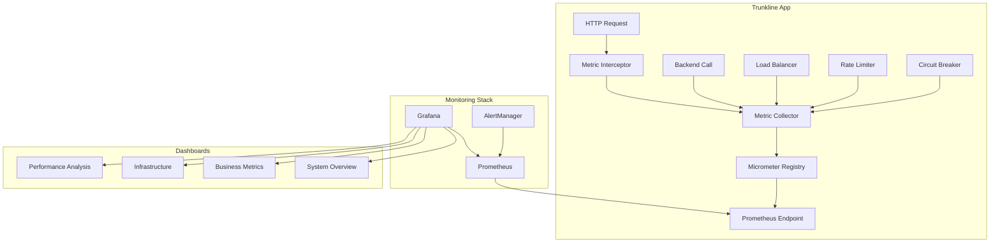

# Monitoring Guide

<!-- Version Info -->
> **Doc Version**: 1.0.3  
> **Last Updated**: 2026-09-15  
> **Git Commit**: 61384b4a  
> **Author**: Lincoln
<!-- /Version Info -->


Trunkline provides comprehensive monitoring, including system metric collection, Prometheus integration, Grafana dashboards and alerting. This guide helps you understand and use Trunkline's monitoring.

## Quick Start

### Start the monitoring stack

#### Windows
```powershell
.\scripts\monitoring\setup-monitoring.ps1
```

#### Linux/macOS
```bash
./scripts/monitoring/setup-monitoring.sh
```

### Access the monitoring UI

- **Trunkline app**: http://localhost:8080
- **Prometheus**: http://localhost:9090
- **Grafana**: http://localhost:3000 (admin/trunkline2024)
- **Metrics endpoint**: http://localhost:8080/actuator/prometheus

## Monitoring Architecture



## Monitoring Feature Overview

### System metrics
- JVM memory usage
- Garbage collection statistics
- HTTP request statistics
- Thread pool status

### Business metrics
- AI model call statistics
- Service-type distribution
- User session tracking
- Request response time

### Infrastructure metrics
- Load balancer status
- Rate limiter event statistics
- Circuit breaker state changes
- Backend service health

## Documentation Navigation

### Configuration guides
- [Monitoring Setup](setup.md) - Basic monitoring configuration and startup
- [Configuration Reference](configuration.md) - Detailed configuration options

### Usage guides
- [Grafana Dashboards](dashboards.md) - Dashboard usage and customization
- [Metrics Reference](metrics.md) - Detailed description of all available metrics

### Operations guides
- [Alert Configuration](alerts.md) - Alert rule configuration and management
- [Alert Rules](alert_rules_guide.md) - Detailed alert rule instructions
- [Troubleshooting](troubleshooting.md) - Common issues and solutions

### Advanced topics
- [Performance Tuning](performance.md) - Monitoring system performance optimization
- [Testing Guide](testing.md) - Monitoring feature testing

## Key Metrics Quick Reference

> The PromQL below is **illustrative**. The actually-registered metric names are listed under "Code-registered metrics" in [Metrics Reference](metrics.md) and in the live `/actuator/prometheus` output. Generic request/latency metrics usually map to Micrometer's `http.server.requests`.

### System health
```promql
# Service availability
up{job="trunkline"}

# Request error rate
sum(rate(trunkline_requests_total{status=~"5.."}[5m])) / sum(rate(trunkline_requests_total[5m]))

# P95 response time
histogram_quantile(0.95, sum(rate(trunkline_request_duration_seconds_bucket[5m])) by (le))
```

### Business metrics
```promql
# Model call success rate
sum(rate(trunkline_model_calls_total{status="success"}[5m])) / sum(rate(trunkline_model_calls_total[5m]))

# Active user sessions
sum(trunkline_user_sessions_active)
```

### Infrastructure
```promql
# Healthy backend instances
sum(trunkline_backend_health)

# Services with an open circuit breaker
count(trunkline_circuit_breaker_state == 1)
```

## Support and Feedback

If you hit issues while using monitoring:

1. Check the troubleshooting sections of the relevant docs
2. Review the application and monitoring-service logs
3. Verify the configuration files
4. Contact the development team for support

---

**Note**: Monitoring has some performance impact; in production tune sampling and caching to your needs.
