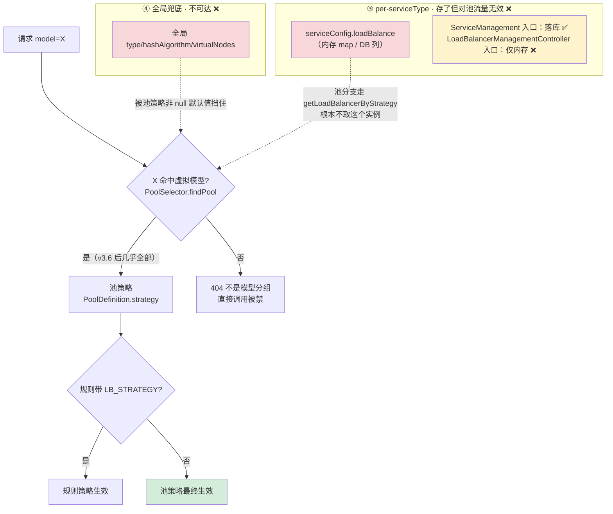

# Trunkline 非技术用户可理解性 · 代码现状勘察报告

> 勘察对象：`D:\wdx\wjy\wjy-ai-gateway`（二次改造规范库）
> 勘察日期：2026-11-02
> 勘察范围：前端 `frontend/src/`（18 个菜单项 / 4 组）+ 后端 `src/main/java/org/unreal/modelrouter/`
> 方法：逐文件读源码，非文件名推测；所有结论带 `文件:行号` 证据
> 性质：**只读勘察，不修改任何代码**

---

## 一、摘要（给决策者）

1. **Trunkline 的「非技术化」只完成了员工侧，运维侧几乎没做。** 员工页（我的额度/我的密钥/我的账单/快速上手/测试场）已建立 `employeeTerms.ts` 双视角术语单点，但 8 个团队页（技术总览/团队用量/接入管理/虚拟模型/全部密钥/调用观测/链路追踪/状态监控）全部是工程师语言，术语密度最高达「每屏 15+ 个未解释技术词」。
2. **最严重的一致性缺陷：`全部密钥` 页面配置的「每月额度」在默认配置下完全不生效。** `monthlyTokenLimit` 只被配额账本读取，而账本 `trunkline.quota.enabled` 默认 `false`（`config/quota/quota-base.yml:19`）；认证链路只校验每日与每分钟（`ApiKeyValidator.java:205-227`）。管理员配了月度预算、员工看到进度条、实际不拦截——**控制台在撒谎**。
3. **负载均衡有 4 条配置通道、3 种落点，只有一条真正生效。** 规则 LB_STRATEGY > 池策略 > per-serviceType 兜底 > 全局兜底；但全局兜底因 `PoolDefinition.strategy` 默认值硬编码 `"weighted-random"`（`PoolDefinition.java:21`）而**永远不可达**。且「服务级配置」保存只改内存不落库（`LoadBalancerManagementController.java:238`）。
4. **「策略中心」与「全局配置」职责已经重叠。** 策略中心只剩「路由规则」一个 tab（响应缓存被 feature flag 关闭），但菜单副标题仍宣称管 4 件事（`menu.ts:175`）——文案与实际能力不符。
5. **「全部密钥」与「我的密钥」不是简单重复，是两套不同数据源。** 管理员页用账本桶读「本月已用」（账本关闭时显示 `-`），员工页用 `token_usage` 表读「本月已用」（永远有值）。同一个指标、同一个月份、两个数字。
6. **「接入管理」是术语密度最高的页面**：一张表里同时出现「厂商模型 / 模型分类 / 输入单价 / 输出单价 / 每小时 Token / 熔断 / 限流 / 令牌桶 / scope / 实例」11 个概念，其中 6 个无解释。
7. **「我的额度」的额度上限是前端拼出来的估算值**，不是系统里的真实预算字段（`MyQuotaView.vue:79-82` 把多把密钥的 token 限额相加再按均价折算成 ¥）。系统里根本没有「月度金额预算」这个概念。
8. **已有的 5 个可复用模式质量很高**，应直接推广：`employeeTerms.ts` 双视角单点、`glossary.ts` 术语 tooltip、`effectScope.ts` 副本生效提示、`ClusterScopeNotice`、`useDependencyGuard` 删除预检。
9. **本次勘察发现 1 处与任务书「已知关键事实」矛盾的结论**：价格陷阱在当前代码中**已不成立**（详见 §3.1 第 3 条），任务书描述的「按虚拟模型名查 model_price」是旧版本行为；当前实现已改为「分组维度与计价维度分离」（`BillingService.java:265-280`），且 UI 已有提示（`MyBillsView.vue:180-185`）。
10. **建议优先做三件事**：① 修「每月额度不生效」（P0，一行开关或补校验）；② 收口负载均衡为单一入口（池策略），其余降级为只读展示；③ 给「接入管理」拆出「价格」与「额度/限流/熔断」两张表。

### 后续复检追加的 5 条结论（2026-11-02 第二轮）

11. **【P0-0，最严重】「接入管理」有两套完全可达的实现，其中一套的「价格与额度」是纯前端假数据。** 菜单入口 `/providers`（`ProviderConsoleView.vue` + `PricingQuotaPanel.vue`，真实读写后端）vs 无菜单入口的 `/models`（`ModelsView.vue` + `ModelPricing.vue`，**95 行硬编码 7 条假数据、「保存」按钮不落库**）。git 跟踪状态显示 A 套是本轮新增未提交（UNTRACKED）、B 套是已提交老骨架被改造——**方向是 A 套，B 套是改了一半的旧骨架**。详见 §3.1 P0-0，含「保留哪套 + 如何下线 + 成本」的明确建议。
12. **【P0-S1，安全维度最严重】员工可直接调 API 拿到全公司 Token 用量明细，含他人 apiKeyId、userId、clientIp、instanceUrl。** `GET /api/token-usage/recent`（`TokenUsageController.java:137-146`）**无 `@PreAuthorize`、无属主过滤**，URL 规则绑定 `monitoring:tokenusage:read`（`PermissionRuleRegistry.java:128`），而该码**在 `userCodes()` 里明确授予 USER 角色**（`RolePermissionSeeder.java:235`）。返回的是 JPA 实体全字段。对照 `/api/billing/team` 有 `hasAnyRole('OPERATOR','ADMIN')`——**billing 侧做了角色隔离，token-usage 侧漏了**。详见 §3.5.3。
13. **【好消息】后端 RBAC 架构本身是健康的，不需要推翻。** 默认姿态 fail-closed（`PermissionAuthorizationManager.java:65` `DEFAULT_POLICY = DENY_ALL`），未登记端点只对 ADMIN 开放；员工自助端点已有统一范式（`/api/call-history/mine`、`/api/auth/api-keys/mine`、`/api/billing/my`——归属由服务端从 principal 解析，前端不可指定 userId）。**前端守卫只是体验层，后端才是唯一有效防线**——§3.5 给了三条重点路径的实测权限规则与逐条结论。
14. **【P1】`/settings/global`「全局配置」用 `system:accounts:manage`（admin 专属）+ `roles: ['admin']` 开门，但该页 4 个 tab（记录治理/负载均衡/熔断阈值/用量配额）没有一個与账号权限有关**，而后端对应端点只要求 `config:quota:*` / `lb:*` / `config:circuitbreaker:*`——**ops 在后端有权改这些配置却进不了这个页面**。是前端权限码用错，不是后端过严。详见 §3.5.6(c)。
15. **【机会】约 2400 行「已建成但未暴露」的能力，后端 + 权限规则 + 前端 API 封装全部健在，只差一个路由和菜单项。** 异常管理（`views/exception/` 1330 行 + `api/exception.ts` + `types/exception.ts`，后端 `ExceptionManagementController.java:38` + 权限规则 `PermissionRuleRegistry.java:208-209`）与慢查询分析（`SlowQueryAnalysis.vue` + `api/slowQuery.ts`，后端 `SlowQueryAnalysisController.java:23` + 权限规则 `:168`）。**复活成本 0.5-0.75 人日，是本报告投入产出比最高的一项**；同时 `_attic/` 3 个文件（435 行）+ `ModelPricing.vue`（95 行假页面）建议删除，**净减 530 行**。详见 §5.6。
16. **【工程措施】前端巡检缺失已有 2 个真实缺陷作证**：① `pool.json` 有 **37 个 zh-only key**（全是本轮新增的池页面文案，含 `explainBody` 解释文案）→ **英文环境下池页面 37 处文案静默回退成 key 名**；② **7 个 v3.5 新页面 `useI18n` 出现次数全部为 0**（`MyQuotaView` / `MyKeysView` / `MyBillsView` / `ProviderConsoleView` / `PricingQuotaPanel` / `TeamUsageView` / `GlobalSettingsView`）→ **完全不接 i18n，全硬编码中文**。建议新增 2 个 node 脚本（约 220 行）+ CI 步骤（约 2.5 人日，运行 < 2 秒），**L1/L2 层零漏报可阻断 CI，L3 层 20-30% 漏报应设为 warning**。详见 §5.7。

---

## 二、四段业务流的前后端代码地图

### 2.1 业务流 1：接入厂商模型

| 层 | 文件 | 关键行 | 说明 |
|---|---|---|---|
| 前端页面 | `views/providers/ProviderConsoleView.vue` | 1-388 模板；`openAddDialog` 644；`submitProvider` 662；`importModels` 728 | 两个 tab：接入厂商 / 价格与额度 |
| 前端价格表 | `views/providers/PricingQuotaPanel.vue` | 25-145 表格；`save` 304；`openQuotaDialog` 342；`toggleCircuitBreaker` 455 | 一行 = 一个厂商模型 |
| 前端分类器 | `views/providers/ModelCategoryPicker.vue` | 226 行 | 逐模型下拉改分类 |
| 前端 API | `api/provider.ts` / `api/providerPrice.ts` / `api/instance.ts` | — | `createProvider` / `upsertModelPrice` / `saveCircuitBreakerConfig` |
| 后端 | `config/controller/ModelProviderController.java` | — | 供应商 CRUD |
| 后端 | `config/service/ModelPriceService.java` | `catalog()` 184-248；`upsert` 81-152；`resolveQuotaLimit` 262 | 价格 + 额度合并在一张表 |
| 后端 | `config/service/ModelPriceQuotaLimitResolver.java` | 34 | `@Qualifier("model")` 把厂商模型额度注入配额执行层 |
| 后端 | `router/controller/ServiceCircuitBreakerController.java` / `ServiceRateLimitController.java` | — | 实例级熔断 / 限流 |

**用户必须理解的技术概念**：

| 概念 | UI 上是否隐藏 | 证据 | 备注 |
|---|---|---|---|
| `baseUrl` / 地址 | ❌ 未隐藏，但降级为域名 | `ProviderConsoleView.vue:87` `domainOf(row.baseUrl)` | 列表只显域名，编辑时才显全文——**做得好** |
| `adapter` / 协议适配器 | ❌ 未隐藏 | `ProviderConsoleView.vue:680` `adapter: selectedPreset.value.adapter` | 提交时带 adapter，但 UI 不展示 |
| `path` / 端点路径 | ⚠️ 半隐藏 | `ProviderConsoleView.vue:679` `path: selectedPreset.value.path` | 表单里 `地址` 是 disabled，用户以为不可改，实际路径由后端按分类换算 |
| `serviceType` / 模型分类 | ⚠️ 半隐藏 | `PricingQuotaPanel.vue:34` `{{ row.serviceType \|\| '-' }}` | **直接渲染原始枚举值** `chat`/`embedding`，没走 `getServiceTypeLabel()` |
| `weight` / 权重 | ❌ 未隐藏 | `PoolManagement.vue:452` `{ instanceId: n, weight: 1 }` | 池成员有 weight，但 UI 编辑时不暴露（只在 glossary 里有解释） |
| 熔断（实例级） | ❌ 未隐藏 | `PricingQuotaPanel.vue:96-115` | 表格列头直接写「熔断」 |
| 限流（实例级） | ❌ 未隐藏 | `PricingQuotaPanel.vue:116-135` | 表格列头直接写「限流」 |
| 令牌桶 / `scope` / `capacity` | ❌ 未隐藏 | `RateLimitConfig.vue`（组件）经 `PricingQuotaPanel.vue:509` 传 `algorithm:'token-bucket', scope:'instance'` | **整个 UI 里唯一的算法名与 scope 概念** |
| 价格单位 ¥/千 token | ⚠️ 半隐藏 | `PricingQuotaPanel.vue:9` 提示语 | 提示语存在，但列头只写「输入单价」「输出单价」 |

> **「接入管理」的认知障碍总结**：价格、额度、限速、熔断四类完全不同的治理手段被塞进**同一张表**的 8 个列里。列宽总和远超视口，靠 `fixed="right"` 横向滚动（`PricingQuotaPanel.vue:136`）。非技术管理员无法建立心智模型：**「限制这个模型被用多少」和「限制它坏了多久不切走」是两件事**。

### 2.2 业务流 2：配置虚拟模型（模型池）

| 层 | 文件 | 关键行 | 说明 |
|---|---|---|---|
| 前端页面 | `views/config/pools/PoolManagement.vue` | 16-19 说明块；`STRATEGY_OPTIONS` 331-337；`el-select form.strategy` 142；`saveQuota` 578 | 列表 + 新建/编辑弹窗 + 独立配额弹窗 |
| 前端 i18n | `locales/zh-CN/pool.json` | `explainBody` 103；`strategies` 35-48 | **已有白话策略名**（按权重随机/轮流使用/最少连接优先/按使用者固定/一致性哈希） |
| 后端 | `router/controller/PoolConfigController.java` | `reloadActivePools` 79-95；`validatePool` 233-278 | CRUD + 热生效，**落库闭环** |
| 后端 | `router/pool/PoolPersistenceService.java` | — | 序列化整个 `PoolDefinition` 落库 |
| 后端 | `router/pool/PoolSelector.java` | `findPool` 90-102；`resolveCandidates` 109-126 | 池匹配 + 成员候选 |
| 后端 | `router/pool/model/PoolDefinition.java` | `strategy` 21（默认 `"weighted-random"`）；`members` 25 | **无 hashAlgorithm / virtualNodes 字段** |

**用户必须理解的技术概念**：

| 概念 | UI 上是否隐藏 | 证据 | 备注 |
|---|---|---|---|
| 池 / `poolName` / `members` | ✅ **已隐藏且重命名** | `pool.json` 全表用「虚拟模型」「背后挂的模型」；`PoolManagement.vue:42` 渲染 `m.instanceId` | **做得好**：员工侧叫「虚拟模型」，`poolName` 只在副标题以 `model-name:` 露出（`PoolManagement.vue:28`） |
| `strategy` | ✅ **已白话化** | `pool.json:35-48` 五个选项全有白话名 + 一句话说明 | **做得好**：`weighted-random`→「按权重随机（推荐）」 |
| `hashAlgorithm` / `virtualNodes` | ✅ 员工侧不出现 | 池页面无此字段 | 但运维侧「全局配置 → 负载均衡」出现（`LoadBalancerGlobalConfig.vue:51-77`） |
| `serviceType` | ⚠️ 半隐藏 | `PoolManagement.vue:528-538` 创建时**从成员推导**，报错文案 `pool.messages.serviceTypeMismatch` 直接暴露 `{a}` `{b}` 原始值 | 正常路径不暴露，异常路径暴露 |
| `weight` | ❌ 未隐藏 | `pool.json:31` `memberWeightTip` 有解释但**当前 UI 已无 weight 输入框** | 遗留文案，与实现脱节 |
| 配额窗口（HOUR/DAY/MONTH） | ⚠️ 半隐藏 | `PoolManagement.vue:176-217` 7 个字段：`quotaHourlyRequest`/`quotaHourlyToken`/… | 标签是「每小时（次）」「每小时（Token）」——**Token 直接暴露** |
| 429 | ✅ 已白话化 | `pool.json:100` "超限时请求返回 429" | 保留 429 是可接受的（HTTP 状态码员工能理解） |

### 2.3 业务流 3：创建密钥

| 层 | 文件 | 关键行 | 说明 |
|---|---|---|---|
| 管理员页 | `views/security/ApiKeyManagement.vue`（经 `views/security/KeysView.vue` 壳） | 2931 行；配额抽屉 210-330；`monthlyTokenUsed` 974 | `/all-keys` 路由复用 |
| 员工页 | `views/my/MyKeysView.vue` | 1-186 脚本；表格 199-255 | 真实数据，`getMyApiKeys` |
| 后端 | `auth/controller/ApiKeyManagementController.java` | — | CRUD |
| 后端 | `auth/security/service/ApiKeyService.java` | `createApiKey` ~110-160；`updateApiKey` ~239-240 | 限额落库 |
| 后端 | `auth/security/service/ApiKeyQuotaService.java` | 106；`validateLimitNonNegative` 270 | 配额管理端点 |
| 后端 | `auth/security/config/properties/ApiKey.java` | `monthlyTokenLimit` 138；`isDailyTokenLimitExceeded` 335 | 限额模型 |

**用户必须理解的技术概念**：

| 概念 | UI 上是否隐藏 | 证据 | 备注 |
|---|---|---|---|
| `keyId` | ❌ **完全暴露** | `ApiKeyManagement.vue:104-106` 直接显示 `scope.row.keyId` 并提供复制按钮 | 运维合理；员工页 `MyKeysView.vue:205` 只显 `keyMasked`，**做得好** |
| `allowedGroups` | ✅ 管理员页已白话 | `apiKeys.json` `columns.allowedGroups` = 「可用虚拟模型」 | **做得好** |
| `permissions`（模型分类） | ⚠️ 半白话 | `apiKeys.json` `form.permissions` = 「可调用的模型分类」 | 「模型分类」本身是黑名单外的半个技术词 |
| IP 白名单 | ❌ 未隐藏 | `apiKeys.json` `form.ipWhitelist` = 「IP白名单」 | 员工侧不可见，管理员侧保留合理 |
| Token 限额 | ❌ **员工侧已隐藏、管理员侧未隐藏** | `ApiKeyManagement.vue:133` `{{ ... }} tokens`（硬编码英文 tokens）；`MyKeysView.vue:224` 用 `employeeTerm('amountUnit')` | **同一概念两个页面两种措辞** |
| 密钥轮换周期 | ⚠️ 白话但未解释 | `apiKeys.json` `form.rotationPeriodHint` = "设置密钥自动轮换周期（天数）" | 没说清「轮换」= 换新密钥 |
| 账本（quota ledger） | ❌ 未隐藏 | `apiKeys.json` `quotaForm.multiWindowHint` 直接写 `trunkline.quota.enabled` | **YAML 键名出现在 UI 文案里** |

### 2.4 业务流 4：员工使用

| 层 | 文件 | 关键行 | 说明 |
|---|---|---|---|
| 额度首页 | `views/my/MyQuotaView.vue` | `tokenLimit` 79-82；`averagePrice` 90-97；`limitAmount` 105-108 | 状态感知欢迎语 152-156 |
| 账单页 | `views/my/MyBillsView.vue` | `hasAnyPrice` 53；价格提示 180-185；交叉表 190+ | 按天 × 虚拟模型 |
| 快速上手 | `views/my/QuickstartView.vue` | `baseUrl` 31；`sampleModels` 38-46 | 三步 |
| 测试场 | `views/playground/PlaygroundView.vue` | `isStaff` 40-44 | 员工/运维 tab 分流 |
| 报错 | `constants/employeeTerms.ts` | 85-130 九条人话报错 | **做得好** |
| 后端 | `billing/service/BillingService.java` | `getMyBills` 67-140；`getMyRecentUsage` 190-260；`buildDailyBills` 279-330 | 三种聚合口径 |

---

## 三、一致性缺陷清单（按严重度排序）

### 3.1 P0 级

---

#### 【P0-0】「接入管理」存在两套完全可达、组织方式不同的实现，且其中一套的「价格」是假数据

> 本条为后续复检追加，优先级高于 P0-1。team-lead 标注为「全站最严重的入口重复缺陷」。

**两套实现的对照**：

| 维度 | A 套（菜单入口） | B 套（无菜单入口） |
|---|---|---|
| 路由 | `/providers` | `/models` |
| 路由声明 | `router/index.ts:228-232`，`meta: { title: '接入管理' }` | `router/index.ts:52-57`，`meta: { permissions: ['config:instances:read'] }` |
| 菜单 | `menu.ts:116-122`「接入管理」，`permission: 'config:instances:read'`，`roles: ['ops','admin']` | **无**（`menu.ts` 全文无 `/models`） |
| 壳组件 | `ProviderConsoleView.vue`（1236 行） | `ModelsView.vue`（74 行） |
| tab 数 | 2 个：「接入厂商」「价格与额度」 | 3 个：「供应商接入」「已接入模型」「💰 价格与额度」 |
| 价格实现 | `PricingQuotaPanel.vue`（648 行）→ `getPriceCatalog()` / `upsertModelPrice()`，**真实读写后端** | `ModelPricing.vue`（95 行）→ **纯前端硬编码 7 行假数据** |
| 熔断/限流 | 在价格表第 8/9 列，各带「配置」弹窗（`:96`/`:116`） | **无**（`ModelPricing.vue` 只有价格与每日限额两个可编辑字段） |
| git 跟踪状态 | `ProviderConsoleView.vue`、`PricingQuotaPanel.vue` = **UNTRACKED（未提交）** | `ModelsView.vue` = **TRACKED（已提交，但有 `M` 修改）**；`ModelPricing.vue` = **UNTRACKED** |

**证据（关键三点）**：

1. **`/models` 路由可达但无菜单入口。** 守卫 `router/index.ts:278` 用 `menuGroups.flatMap(g=>g.children).find(c=>c.path===to.path)` 找菜单项，`/models` 找不到 → `menuItem` 为 `undefined` → 落到 `:290-294` 的 `meta.permissions` 分支 → 校验 `config:instances:read`。该权限码在 `RolePermissionSeeder.userCodes()` 里**明确授予 USER 角色**（`RolePermissionSeeder.java:218`）→ **普通员工敲 `/models` 也能进入这个管理员级页面**。

2. **B 套的「价格与额度」是假页面。** `ModelPricing.vue:18-26` 整页数据是 `const rows = ref<PriceRow[]>([...7 条硬编码...])`（OpenAI gpt-4o ¥0.018/¥0.072 等），文件头注释 `:4` 写着 `TODO: 后端补 model_price 表后，接 GET /api/admin/model-prices`。弹窗「保存」按钮 `:91` 只做 `editVisible.value = false`，**不调用任何 API、不落库**。管理员在这里改价会得到「保存成功」的假象，实际毫无作用。

3. **两套用同一套后端 API 写，但组织方式与引导能力相反。**
   - 写操作：两套都调 `@/api/provider`（`ProviderManagement.vue:386-398` / `ProviderConsoleView.vue:418-428`），端点相同（`api/provider.ts` 的 `/config/providers/**`）。
   - A 套用 `getProviderCatalog()`（`api/provider.ts:72-74` → `/config/providers/catalog`），返回脱敏聚合 `ProviderCatalogItem`（`hasApiKey: boolean`、`modelCount`、`unhealthyCount`、`models[]`，**后端永不回传 Key 本身**）；
   - B 套用 `getProviders()`（`api/provider.ts:77-79` → `/config/providers`），返回 `ModelProvider`（含 `baseUrl`、`path`、`adapter`、`modelsPath`、`status` 等**内部接入细节**）。
   - **引导能力相反**：B 套的 `ProviderManagement.vue` 有三态 `nextStepHint(p)`（没 Key→去设 Key / 没模型→去加模型 / 有模型→去创建密钥）+ 空态 onboarding 三步块；A 套 `ProviderConsoleView.vue` 的引导卡是**静态的**，且产品经理已实测其第 1、2 步 `action` **完全相同**（都调 `openAddDialog()`），步骤卡形同装饰。

**命名冲突**：菜单叫「接入管理」，B 套 tab 叫「供应商接入」——同一功能两个名字。用户问「接厂商在哪」会同时指向两个页面。

**结论与建议（保留哪套、另一套如何下线）**：

- **保留 A 套 `/providers`**。理由：① 它是唯一有菜单入口的（`menu.ts:116`）；② 它的价格表是真实读写后端；③ 它是熔断/限流的唯一配置位；④ 它用 catalog 脱敏接口，员工误入也不会看到内部接入细节。
- **下线 B 套 `/models`**，具体动作：
  1. **先摘除 B 套的假页面**：`ModelPricing.vue` 是**必须立即下线**的一项（假数据 + 假保存，误导性最强，改造成本最低——删除即可）。若产品想保留「价格」入口，应直接把 A 套的 `PricingQuotaPanel` 挂进 `ModelsView` 的第 3 tab（**同一组件实例，不复制代码**）。
  2. **保留 B 套的三态引导**：把 `ProviderManagement.vue` 的 `nextStepHint(p)` 与空态 onboarding 三步块**移植进 A 套的引导卡**——这是 A 套目前缺的、也是产品经理实测认可的优点。
  3. **最后摘路由**：把 `router/index.ts:52-57` 的 `/models` 路由改为 `redirect` 到 `/providers?tab=providers`（保留深链兼容，不留 404），或直接删除路由 + 在 `ModelsView` 组件内做 redirect。
  4. **同步删 `views/models/ProviderManagement.vue`（1475 行）与 `views/models/ModelsView.vue`（74 行）**，前提是第 2 步的引导移植已完成。
- **一个容易漏的前置**：`/models` 的 `meta.permissions` 是 `config:instances:read`，而 **USER 角色也持有该码**（`RolePermissionSeeder.java:218`）。仅靠删菜单挡不住员工敲 URL。下线时必须**同时**删除路由或改权限码，否则「菜单看不见但 URL 能进」的问题会从 `/models` 转移到别的路径。

**成本估计**：删除 B 套约 1600 行（`ProviderManagement.vue` 1475 + `ModelsView.vue` 74 + `ModelPricing.vue` 95，含 4 个假价格字段）；移植引导卡约 0.5 人日（纯前端复制 + 一处 API 调用）；路由下线 0.5 人日。**合计约 1.5 人日，净减代码约 1600 行。**

---

#### 【P0-1】「每月额度」在默认配置下**完全不生效** —— 控制台显示的数字不是真实约束

**证据链**：

1. 管理员在「全部密钥」配 `monthlyTokenLimit`（`ApiKeyManagement.vue:249` 绑定 `quotaDrawer.form.monthlyTokenLimit`；`ApiKeyCreateRequest.java:115` / `ApiKey.java:138` 落库）。
2. 唯一读 `monthlyTokenLimit` 做判定的地方是 `QuotaEnforcementService.evaluate()`（`QuotaEnforcementService.java:169`）与 `tryReserve()` → `limitsOf()`（`:538`）。
3. **`evaluate()` 没有任何调用方** —— 全仓 grep `evaluate(` 只命中 `QuotaEnforcementService.java:138`（定义处）与规则引擎的同名方法（`RuleConfigController.java:266`、`ModelServiceRegistry.java:279/488`，无关）。
4. `tryReserve()` 只在 `quotaEnforcementService.isEnabled()` 为真时被调用（`ServiceRequestHandler.java:816`），而 `isEnabled()` → `QuotaLedgerService.isEnabled()` → `properties.isEnabled()` → **`trunkline.quota.enabled`，默认 `false`**（`config/quota/quota-base.yml:19`；`QuotaProperties.java:63` `private boolean enabled = false;`；各 profile yml 无覆盖）。
5. 认证链路的兜底只覆盖 **daily + perMinute**：`ApiKeyValidator.validateFully()` 步骤 6/7/8 分别调 `validateDailyLimit` / `validateTokenLimit` / `validateRateLimit`（`ApiKeyValidator.java:205-227`），对应 `ApiKey.isDailyLimitExceeded()` / `isDailyTokenLimitExceeded()`。**`hourlyRequestLimit`、`hourlyTokenLimit`、`monthlyRequestLimit`、`monthlyTokenLimit` 在认证链路里完全没有校验点。**
6. 账本关闭时的兜底 `checkEstimatedTokenQuota()` **只判 `dailyTokenLimit`**（`QuotaEnforcementService.java:217` `if (apiKey == null || apiKey.getDailyTokenLimit() <= 0L) return Optional.empty();`）。

**影响**：
- 管理员在「全部密钥 → 配额」里设「每月 Token 上限 = 100 万」，弹出保存成功，`apiKeys.json` `quotaForm.monthlyTokenLimit` 标签明确写着「每月Token上限」，管理员合理认为「超了会被拒」。
- 实际：**永远不会触发 429**。员工可以无限用。
- 员工侧「我的额度」却拿这个数字当分母画进度条（`MyQuotaView.vue:79-82`），显示「已用 30%」，给出「额度还有 70%」的错觉。
- 「全部密钥」的配额抽屉里 `quotaForm.usedPercent`（`:239-241`）也基于它算百分比——**越像真的越是误导**。

**这是本次勘察发现的最高危问题**：整个「配额度 → 超额拦截 → 员工看到额度」的价值主张在默认部署下不成立。

**修复方向**（供后续决策，本报告不改代码）：
- 短期：把 `monthlyTokenLimit` 纳入认证链路校验（仿 `isDailyTokenLimitExceeded` 增一个 `isMonthlyTokenLimitExceeded`，在 `UsageStatistics` 里加 `monthlyTokenUsage`）；或
- 短期（更轻）：在 `trunkline.quota.enabled=false` 时，UI 对「每小时/每月」类限额字段加显式禁用 + 提示「当前未启用多窗口配额账本，仅每日与每分钟限额生效」；
- 中期：打开账本为默认，并补齐 `UsageStatistics` 的月度桶。

---

#### 【P0-2】负载均衡有 4 条配置通道、3 种落点，且**全局兜底永远不可达**

**证据链**：

| 层级 | 配置载体 | 落点 | 热生效 | 实际是否参与选路 |
|---|---|---|---|---|
| ① 规则 `LB_STRATEGY` | `rule.json` `actionType.LB_STRATEGY` | 规则表（DB） | ✅ | ✅ **最高优先级** |
| ② 池策略 `PoolDefinition.strategy` | `PoolManagement.vue:142` | `model_pool` 表 | ✅ `reloadActivePools()` | ✅ |
| ③ per-serviceType | `StrategyConfig.vue` `PUT /loadbalancer/config/{st}` | **仅内存** | ✅ 但重启丢失 | ⚠️ 仅非池路径 |
| ④ 全局兜底 | `LoadBalancerGlobalConfig.vue` | **无 PUT 端点** | ❌ | ❌ **不可达** |

**关键断裂点**：

1. **④ 全局兜底不可达**：`PoolDefinition.strategy` 的默认值是硬编码 `"weighted-random"` 而非 `null`（`PoolDefinition.java:21`）。`ModelServiceRegistry.java:359` 走 `loadBalancerManager.getLoadBalancerByStrategy(matchedPool.getStrategy())` —— 池策略永远非空，全局配置**永远不会被读到**。
   > 证据补强：`docs/zh/analysis/plan-c-pool-strategy-removal-assessment.md` 已独立核实同一结论（「全局策略永远不会被读到」），本报告独立复核确认。

2. **③ per-serviceType 保存不落库**：`LoadBalancerManagementController.updateServiceConfig()`（`:223-251`）只调 `loadBalancerManager.reinitializeLoadBalancer(type, config)`（`:238`），**没有任何 `ServiceConfigManager` / DB 调用**。对比「系统 → 模型配置 → 模型分类」页的 `ServiceManagement.vue:767` 走 `updateServiceConfig()` → `ServiceConfigManager.updateDatabaseEntity()` → `entity.setLoadBalanceType()`（`ServiceConfigManager.java:314`）**是落库的**。
   > 即：**同一个概念，两个 UI 入口，一个落库一个不落库**。用户在「全局配置 → 负载均衡」里配的服务级策略，重启即失；在「模型配置」里配的，重启仍在——但那页是给 admin 的「模型分类」子页签里的一个表单项（`ServiceManagement.vue:232`），语义完全不匹配。

3. **③ 对池流量基本无效**：v3.5 治理收口后，请求必须命中池才不 404（`ModelServiceRegistry.java:381-386` 抛 `NOT_FOUND` "is not a model group"）。池分支里用的是 `getLoadBalancerByStrategy(pool.getStrategy())`（`:359`），**per-serviceType 的 LB 实例根本没被取出**。只有 `matchedPool == null` 且规则显式锁定实例的边角路径才走 `getLoadBalancer(serviceType)`（`:397`）。

4. **③ 的 PUT 也没有 GET 之外的闭环**：`GET /api/loadbalancer/config/{serviceType}`（`:178-218`）在没有 service 配置时回退到全局配置并标 `isGlobal=true`（`:210`）。前端 `StrategyConfig.vue:44-46` 就渲染这个「默认」标签——**但这个「默认」值来自第 ④ 层，而第 ④ 层对池流量无效**。用户看到「聊天模型：按权重随机（默认）」，实际生效的是池自己的策略。

**影响**：管理员在「全局配置 → 负载均衡」这一整页做的配置工作，**对 95% 以上的真实流量（走池的）不产生任何效果**；页面还会用「已保存并生效」的成功提示（`StrategyConfig.vue:315` `effectMessage(..., 'config')`）确认。这是一个「看起来能用的假控件」。

---

#### 【P0-3】「本月已用」在员工页与管理员页读的是两个不同的数据源

**证据链**：

| 页面 | 数据源 | 后端实现 | 账本关闭时 |
|---|---|---|---|
| 「我的额度」 | `GET /api/billing/my` → `bills.totalTokens` | `BillingService.getMyBills()`（`:67`）→ `token_usage` 表 | **有值**（历史落库数据） |
| 「我的密钥」 | `GET /api/monitoring/quota/usage` | `QuotaMonitoringController.java:153` → `QuotaLedgerService.usage()` → 账本 | **显示 `—`**（`MyKeysView.vue:126` `if (!ledgerAvailable.value) return null`） |
| 「全部密钥」 | 同上 | 同上 | **显示 `-`**（`ApiKeyManagement.vue:974-977`） |

**问题**：
- 「我的额度」说「本月已用 300,000 单位」，「我的密钥」对同一把密钥说「本月已用 —」。**员工在同一菜单组内看到自相矛盾的答案。**
- `MyQuotaView.vue:76` `usedTokens = bills.value.totalTokens` 是**用户全部密钥的总量**；`MyKeysView` 是**逐把密钥**。两者数值不同但都叫「本月已用」。
- 更隐蔽的：`MyQuotaView.vue:113` `usedPercent = usedTokens / tokenLimit`，其中 `tokenLimit` 是多把密钥 `monthlyTokenLimit` 的**算术和**（`:79-82`）。员工看到「已用 30%」，但实际每把密钥是**独立**限额——A 密钥超了不影响 B 密钥。**加总的分母对应的是加总的分子，但系统并不按加总的额度执行**（见 P0-1）。

---

#### 【P0-4】「接入管理 → 价格与额度」一张表承载 4 种治理语义

**证据**：`PricingQuotaPanel.vue` 表格列顺序为：厂商模型(26) / 模型分类(32) / 输入单价(37) / 输出单价(50) / 额度与限速(63) / 启用(91) / 熔断(96) / 限流(116) / 操作(136)。

**问题**：
- **熔断**（实例级 resilience）与**限流**（实例级 throughput）是两件正交的事，却与**价格**（成本）挤在同一行。运维看这张表无法回答「这个模型多少钱」「这个模型能扛多快」「这个模型挂了多久能恢复」三个不同问题中的任何一个。
- 「模型分类」列**直接渲染原始枚举**（`:34` `{{ row.serviceType || '-' }}` → 显示 `chat` / `embedding`），而同项目 `constants/serviceTypes.ts` 已经提供了 `getServiceTypeLabel()`（中文名），`ProviderConsoleView.vue:307` 也确实用了。**同一页面体系内两种做法**。
- 熔断/限流两列都只有「开/关」+「配置」按钮，配置弹窗里才有 `failureThreshold`/`timeout`/`successThreshold`（`CircuitBreakerConfig` 组件）与 `algorithm:'token-bucket'`/`capacity`/`rate`/`scope:'instance'`（`PricingQuotaPanel.vue:509`）。**「令牌桶」「scope」这些词只在二级弹窗里出现，且完全无解释。**

---

### 3.2 P1 级

---

#### 【P1-1】「策略中心」职责已空，菜单副标题仍在承诺 4 件事

**证据**：
- `menu.ts:175` 副标题：「路由规则 / 多模型分工 / 模型挂了怎么办 / 新员工默认额度」
- `StrategyView.vue:34` 实际 `TABS = ['rules', ...(RESPONSE_CACHE_ENABLED ? ['cache'] : [])]`
- `featureFlags.ts` `RESPONSE_CACHE_ENABLED = false`

**即**：菜单承诺「多模型分工 / 模型挂了怎么办 / 新员工默认额度」三件事，页面**一件都没有**。「多模型分工」在 v3.6 已迁到「全局配置 → 负载均衡」（`GlobalSettingsView.vue:20` `<ServiceStrategyList />`）；「模型挂了怎么办」是池策略 + 熔断；「新员工默认额度」根本无对应功能。

同时 `shell.json` 的策略中心标题写「帮你省钱、分流、保稳定，都是开关不用懂技术」（`shell.json:29`）——而页面上唯一的内容是「路由规则」，`rule.json` 里的条件类型全是 `SERVICE_TYPE`/`MODEL_NAME`/`HEADER`/`CLIENT_IP`/`WEIGHT`，动作类型有 `TARGET_ADAPTER`/`LB_STRATEGY`/`TARGET_TAGS`，正则/CIDR 匹配。**承诺与实现的落差是本报告中最刺眼的一处。**

---

#### 【P1-2】「全部密钥」与「我的密钥」在管理员视角下是重复入口

**证据**：
- 两者渲染**同一个组件**：`/all-keys` → `views/security/KeysView.vue` → `ApiKeyManagement.vue`（`router/index.ts:236`）
- `MyKeysView.vue` 用 `getMyApiKeys()`（`GET /api/auth/api-keys/mine`，服务端按登录用户过滤）
- `ApiKeyManagement.vue` 用 `getApiKeys()`（管理端全量）

**判定**：**不重复**（数据范围不同，管理员需要全量视图），但**术语不统一**：
- 管理员页 `apiKeys.title` = 「API密钥管理」（`apiKeys.json`），页面内 `listTitle` = 「全部密钥」
- 菜单标题 = 「全部密钥」
- 员工页标题 = 「我的密钥」
- `ApiKeyManagement.vue:133` 硬编码 `tokens`，`MyKeysView.vue:224` 用 `employeeTerm('amountUnit')` → 「单位」

**同一概念在两个页面用两种计量单位**，员工与管理员交叉查看时会误判数值。

---

#### 【P1-3】配额三层（账本 / 密钥级 / 虚拟模型级）的口径与生效范围在 UI 上无说明

**三个配额层**：

| 层 | 配置位置 | 载体 | 判定方 | 默认是否生效 |
|---|---|---|---|---|
| A. 账本基础设施 | 「全局配置 → 用量配额」 | `trunkline.quota.*` | 全局开关 | ❌ 关闭 |
| B. 密钥级 | 「全部密钥 → 配额」 | `ApiKey.monthlyTokenLimit` 等 | `QuotaEnforcementService` | ⚠️ 仅 daily + perMinute |
| C. 虚拟模型级 | 「虚拟模型 → 配额」 | `PoolDefinition.*Limit` | `PoolQuotaLimitResolver`（`@Qualifier("group")`） | ❌ 需账本开启 |
| D. 厂商模型级 | 「接入管理 → 价格与额度」 | `model_price.*Limit` | `ModelPriceQuotaLimitResolver`（`@Qualifier("model")`） | ❌ 需账本开启 |

**问题**：
- B/C/D 三层的限额字段**完全同构**（都是 rateLimitPerMinute + hourly/daily/monthly × requests/tokens + quotaAlertThreshold，共 8 个字段），散落在**三个不同页面**的三张不同表格里，**用同一套字段名**。
- `PoolQuotaController.java:101` `if (ledgerService.isEnabled())` —— 账本关闭时**直接返回空 usage 数组**，但 `limits` 仍返回（`:99`）。前端 `PoolManagement.vue:373` `usages.find(u => u.window === 'MONTHLY')` 找不到 → `monthly ? ... : 0` → **显示「本月调用 0」**（`:60-63`），而不是「暂无用量」。**账本关闭 = 永远显示 0，不是「未知」。**
- 而 `pool.json:107` 备了 `monthlyCallsNone` = 「暂无用量」文案——只在请求**抛异常**时才用（`PoolManagement.vue:377` catch 分支置 `null`）。**逻辑写反了**：正常但无数据 → 显示 0；异常 → 显示「暂无用量」。

**这是「用量口径」层面的严重问题**：管理员看到「本月调用 0」会以为没人用这个虚拟模型。

---

#### 【P1-4】熔断/限流的配置散落在三个页面，层级语义不明

| 层级 | 配置位置 | 载体 |
|---|---|---|
| 全局默认 | 「全局配置 → 熔断阈值」 | `CircuitBreakerGlobalConfig.vue` |
| per-serviceType | 「模型配置 → 模型分类」子页签（`ServiceManagement.vue`） | service config |
| 实例级 | 「接入管理 → 价格与额度」表格列 | `instance_circuit_breaker` / `instance_rate_limit` |

**问题**：
- **员工/普通运维无法判断「我该改哪一层」**。UI 上三层用完全相同的字段名与相似的开关样式。
- 「状态监控」页（`/settings/monitoring`，`menu.ts:155`）承载的是**状态持久化**（`SettingsView.vue:43` `monitoring` 组只有 `persistence` 一个子页签，`StatePersistenceManagement.vue`），与熔断/限流**毫无关系**。但菜单副标题写「网关健康 / 熔断 / 上游模型状态」（`menu.ts:160`）——**承诺的熔断内容在这个页面里不存在**。

---

#### 【P1-5】虚拟模型的「对外名字 + 背后故障转移池」在概念上不自洽

**证据**：
- `menu.ts:129` 副标题：「对外名字 + 背后故障转移池」
- `pool.json:103` explainBody 承诺了 4 种调度方式：「优先级（主力挂了自动切备用）、轮流使用（每次随机选一个，大家均分）、固定同一人（同一个员工的请求总走同一个模型，保证知识库向量一致）、按性能分配（好机器多接活、差机器少接活）」
- 实际 `STRATEGY_OPTIONS`（`PoolManagement.vue:331-337`）是 **5 个**：`weighted-random` / `round-robin` / `least-connections` / `ip-hash` / `consistent-hash`

**错位**：
- explainBody 说的「优先级」**不是一个策略**，而是成员列表的顺序（`PoolManagement.vue:117-128` 的 ↑↓ 排序）。但 UI 上「成员顺序」和「分配策略」是两个独立的控件（一个在编辑弹窗的上半部、一个在下半部），explainBody 把它们混在一段话里 → 用户以为「优先级」是一个可选项。
- explainBody 说的「按性能分配」对应 `least-connections`（最少连接），但「好机器多接活、差机器少接活」实际描述的是**权重**语义，而 UI 里**没有权重输入框**（`weight` 恒为 1，`PoolManagement.vue:452`/`:458`）。
- explainBody 只讲 4 种，`el-select` 给 5 种，用户要自己猜哪个对应哪个。

**另一个不自洽**：`pool.json:112` `createDialogTitle` = 「新建一个模型分组」，而菜单叫「虚拟模型」，`pool.json:3` `title` = 「虚拟模型」，`pool.json:2` 顶层命名空间 = `pool`。**同一个对象在同一个文件里有 3 个名字**（虚拟模型 / 模型分组 / 分组）。

---

#### 【P1-6】「策略中心 → 路由规则」暴露大量未解释的内部概念

**证据**：`rule.json` 的条件类型 `SERVICE_TYPE`/`MODEL_NAME`/`HEADER`/`CLIENT_IP`/`WEIGHT`，动作 `TARGET_MODEL`/`TARGET_INSTANCE`/`TARGET_ADAPTER`/`LB_STRATEGY`/`TARGET_TAGS`，运算符 `EQUALS`/`CONTAINS`/`STARTS_WITH`/`REGEX`/`CIDR_MATCH`。

**问题**：
- `rule.json` 的中文标签做了部分白话化（`SERVICE_TYPE`→「模型分类」、`TARGET_MODEL`→「重写模型」），**但保留了 `HEADER名`/`CIDR`/`正则`/`IP或CIDR`**（`rule.form.headerNamePlaceholder` / `ipCidrPlaceholder`）——这些是协议层词。
- `TARGET_ADAPTER`（切换适配器）**面向非技术管理员毫无意义**，且与「模型适配器」系统页耦合。
- `TARGET_INSTANCE`（锁定实例）要求用户知道「实例」概念——这是 `STAFF_ONLY_TERMS` 里明令员工侧禁用的词（`employeeTerms.ts:164`）。
- `rule.json` 完全没有 `glossary.ts` 式的 tooltip 兜底。

---

### 3.3 P2 级

---

#### 【P2-1】术语在页面标题 / 字段名 / 报错提示三处不统一

| 概念 | 页面标题 | 字段名 | 报错提示 |
|---|---|---|---|
| 池 | 「虚拟模型」(`pool.json:3`) | 「新建一个模型分组」(`:112`) | 「模型必须属于同一分类」(`:81`) |
| 池 | 「虚拟模型」 | `model-name: xxx`（`PoolManagement.vue:28`） | 「未命中任何模型分组」 |
| 分类 | 「模型分类」 | `serviceType`（`PricingQuotaPanel.vue:34` 渲染原始值） | 「Invalid serviceType」(后端 `PoolConfigController.java:242`) |
| 密钥 | 「全部密钥」/「API密钥管理」/「密钥管理」(`shell.json:16`) | `keyId` / `keyMasked` | — |
| 额度 | 「每月额度」/「本月额度」/「月度上限」 | `monthlyTokenLimit` | — |
| 配额 | 「配额」/「额度」/「用量配额」 | `quota` | — |

---

#### 【P2-2】`serviceType` 原始枚举值在两处直接漏给用户

- `PricingQuotaPanel.vue:34`：`{{ row.serviceType || '-' }}` → 显示 `chat`
- `PoolManagement.vue:535`：`serviceTypeMismatch` 文案把 `{a}` `{b}` 原样代入 → 「当前混入了 chat 与 embedding」

项目已有 `getServiceTypeLabel()`（`constants/serviceTypes.ts:48`），`ProviderConsoleView.vue:307` 也在用。

---

#### 【P2-3】`glossary.ts` 已建好但只覆盖了 10 个词，且未接入员工侧术语体系

`GLOSSARY` 只有 `slowQuery`/`minCount`/`samplingRate`/`span`/`circuitBreaker`/`halfOpen`/`hashAlgorithm`/`virtualNodes`/`weight`/`tokenQuota` 10 项，**且 `tokenQuota` 的解释说的是「每天」（daily），与实际 `monthlyTokenLimit` 的月度语义冲突**（`glossary.ts:54` "每天允许消耗的 token 总量上限"）。

---

#### 【P2-4】`STAFF_ONLY_TERMS` 黑名单不完整，且没有自动化校验脚本

`employeeTerms.ts:152-170` 的 `STAFF_ONLY_TERMS` 注释说「`verify-employee-terms` 脚本按此列表检索员工可见页面的渲染文本，出现任一项即失败」——**但全仓找不到这个脚本**（`find . -name "*employee-terms*"` 无结果；`frontend/package.json` 的 scripts 只有 dev/build/lint/type-check/test:api）。**这是一句失效的注释，验收清单没有可执行的落地。**

且黑名单本身漏了：`Token`（在列表里 ✓）、但漏了 `令牌桶` 有了 ✓、漏了 **`Chat`/`Embedding`** 等枚举、漏了 **`CIDR`**、漏了 **`正则`**、漏了 **`API Key`**（这个保留合理）、漏了 **`IP`/`Base URL` 变体**、`粘性 sticky`/`哈希 hash`/`采样率 sampling`/`span`/`配额账本`。

**实测违规**：员工可见页面里仍出现黑名单词——
- `ApiKeyManagement.vue` 是 `/all-keys`（ops/admin），不违规。
- 但 `MyQuotaView.vue:539` 申请弹窗：「当前额度由管理员在「全部密钥」里配置」——**指引员工去一个他进不去的页面**（`/all-keys` 的 `roles: ['ops','admin']`，`menu.ts:134`）。同理 `MyQuotaView.vue:284`「申请功能尚未接入，请联系管理员」——**申请额度是个死按钮**（`submitApply` 只弹 toast）。
- `MyKeysView.vue:181` 同样是死按钮「申请功能尚未接入，请联系管理员直接为你创建密钥」。
- `MyQuotaView.vue:274` 复制密钥后弹「复制的是脱敏串，不能直接用于调用」——**误导性文案**：它先把脱敏串复制到剪贴板（用户以为复制成功），再告诉用户不能用。

---

#### 【P2-5】`MyQuotaView` 的「额度上限」是前端拼出来的估算，不存在于系统模型

`MyQuotaView.vue:79-82` `tokenLimit = Σ myKeys[].monthlyTokenLimit`；`:105-108` `limitAmount = tokenLimit/1000 × averagePrice`；`averagePrice`（`:90-97`）= 本月实际均价。

**问题**：
- 系统里**没有「月度金额预算」字段**（`ApiKey` 只有 token/request 计数类限额，`ApiKey.java:114-138`）。页面的「¥ 上限」是前端造的派生值。
- 用**本月均价**折算**本月上限**，但均价本身是**本月已用量**算出来的 → **自我引用**：用得越多均价越准，用得越少（甚至 0）均价越不准。
- 多把密钥的 `monthlyTokenLimit` 相加，但系统按**每把密钥独立**判定（见 P0-3）。
- 员工申请额度时输入的是「期望的月度额度（¥）」（`:540`），**这个单位在后端根本不存在**，提交后是 toast 死信。

---

#### 【P2-6】`PoolDefinition` 无 `hashAlgorithm` / `virtualNodes`，但 UI 提供了「一致性哈希」选项

`PoolManagement.vue:336` 提供 `consistent-hash` 选项；`PoolDefinition.java` 无 `hashAlgorithm`/`virtualNodes` 字段（对比 `PoolMember` 只有 `instanceId`/`weight`）。

**后果**：`ComponentFactory.java:77-79` `case "consistent-hash" -> new ConsistentHashLoadBalancer(config.getVirtualNodes() != null ? ... : 150, ...)` —— 池策略走的 `getLoadBalancerByStrategy`（`LoadBalancerManager.java:282-284`）新建的 `LoadBalanceConfig` **只设了 `type`**，`hashAlgorithm`/`virtualNodes` 均为 `null` → **一律回落 md5 + 150 虚拟节点**。用户在「全局配置」里配的哈希算法与虚拟节点数，**对池流量完全无效**。

---

#### 【P2-7】`QuotaEnforcementService.evaluate()` 是死代码

`:138-182`，无调用方（见 P0-1 证据 3）。它承载了 HOUR → DAY → MONTH → MINUTE 的完整判定顺序与 `evaluateWindow` 逻辑（`:468-496`），但 `tryReserve` 走的是 `QuotaLedgerService.reserveWithLimits` 的另一套实现。**两套配额判定逻辑并存，其中一套从未运行。** 这是维护陷阱：改错地方不会生效。

---

#### 【P2-8】`quota-base.yml` 是唯一配额配置文件，但 `trunkline.quota.enabled` 没有 UI 开关语义说明

`QuotaConfigManagement.vue` 有运行时开关（`:73-79` `runtimeForm.enabled`），但该页在「全局配置 → 用量配额」tab，**只有 admin 看得到**。而「全部密钥 → 配额」页（给 ops/admin）与「我的额度」页（给员工）都不提示「你配的月度限额当前不生效」。

---

## 3.5 安全维度专项：后端权限防线的实测结论

> 本节回应「后端是否为唯一有效防线」「员工能否直接调 API 越权取数」。**全部结论来自源码实测，非推测。**

### 3.5.1 权限架构全貌

后端 RBAC 是**数据驱动**的（不是散落的 `@PreAuthorize`）：

```
PermissionAuthorizationManager.check()              ← 唯一授权决策点
  ├─ 1. PermissionRuleRegistry.findRule(method,path) ← 首条命中优先
  │     命中 → 校验 authority 是否含该权限码（ADMIN 直通）
  └─ 2. 未命中 → RbacUnmatchedPolicy 姿态
        ├─ RbacExemptEndpoints.isExempt() 命中 → 回退 authenticated（豁免）
        └─ 姿态 DENY_ALL → 仅 ADMIN 直通（fail-closed）
```

**结论 1：默认姿态是 fail-closed，后端确实是唯一有效防线。**
`PermissionAuthorizationManager.DEFAULT_POLICY = RbacUnmatchedPolicy.DENY_ALL`（`PermissionAuthorizationManager.java:65`），且 `resolvePolicy()` 在两个配置键都未显式设置时返回该默认值（`:122-131`）。这意味着**任何未登记 URL 规则的 `/api/**` 端点，只对 ADMIN 开放**。这个设计是正确的，**不需要推翻**。

**结论 2：前端守卫只是体验层，不是防线。** `router/index.ts:258-297` 的守卫只影响页面跳转；所有数据都走 `utils/request.ts` 的 axios 直连后端，绕过守卫。所以**后端规则是否正确，是唯一决定安全性的因素**。

### 3.5.2 三条重点路径的实测权限规则

| 路径 | URL 规则 | 权限码 | USER（员工）是否持有 | 方法级 `@PreAuthorize` | 员工能否调通 |
|---|---|---|---|---|---|
| `/api/config/pools/**` | `PermissionRuleRegistry.java:124` GET → `CONFIG_POOLS_READ` | `config:pools:read` | **是**（`RolePermissionSeeder.java:223` 明确列出） | 无 | **能** |
| `/api/auth/api-keys/**` | `:154-155`（`/mine` → SELF，其余 → MANAGE） | `security:apikeys:manage` | **否**（`userCodes()` 只有 `SECURITY_APIKEYS_SELF`） | 全端点 `hasRole('ADMIN')`（`ApiKeyManagementController.java:69,107,125,159,192,...`） | **不能**（双重拦截） |
| `/api/token-usage/**` | `:128` GET → `MONITORING_TOKENUSAGE_READ` | `monitoring:tokenusage:read` | **是**（`RolePermissionSeeder.java:235` 明确列出） | **无** | **能** |

### 3.5.3 【P0-S1】员工可直读全公司 Token 用量明细（含他人密钥 ID 与客户端 IP）

**这是本节最严重的发现，是一次确凿的越权读，不是推测。**

**证据链**：

1. `GET /api/token-usage/statistics` → `TokenUsageController.java:117-132`；`GET /api/token-usage/recent` → `:137-146`。
2. **两个端点都没有 `@PreAuthorize`，也没有任何方法级属主校验**（对比 `BillingController.java:55` 的 `/my` 有 `@PreAuthorize("hasAnyRole('USER','OPERATOR','ADMIN')")` + 归属由 principal 解析）。
3. URL 规则 `PermissionRuleRegistry.java:128` 把 `GET /api/token-usage/**` 绑定到 `MONITORING_TOKENUSAGE_READ`。
4. **`MONITORING_TOKENUSAGE_READ` 在 `userCodes()` 里明确授予 USER 角色**（`RolePermissionSeeder.java:235`）——即普通员工持有该权限码。
5. 服务层无过滤：`TokenUsageService.getRecentUsage(limit)`（`:267-269`）→ `tokenUsageRepository.findRecentUsage(min(limit,100))`，**没有任何 userId 条件**；`getTokenUsageStatistics()`（`:90-...`）同理，聚合的是全表。
6. **返回体是 JPA 实体 `TokenUsageEntity` 全字段**（`TokenUsageController.java:144` 返回 `List<TokenUsageEntity>`），字段包括：`apiKeyId`（`:122`）、`userId`（`:128`）、`clientIp`（`:134`）、`instanceUrl`（`:95`）、`errorMessage`（`:152`）、`traceId`（`:48`）、`provider`（`:83`）、各 token 数与时间维度字段。

**影响**：任何持有员工账号（USER 角色）的人，在浏览器控制台直接执行
```
GET /api/token-usage/recent?limit=100
```
即可拿到**全公司最近 100 条调用的：调用者 userId、调用所用 apiKeyId、客户端 IP、上游实例地址、失败时的原始错误信息**。这远超「用量统计」的必要范围——团队用量页（`/team`）本来就是给 ops/admin 看的（`menu.ts:110-113` `roles: ['ops','admin']`），而**前端菜单的角色限制在 API 层没有对应实现**。

**与 `/api/billing/team` 的对比说明这不是设计意图**：`BillingController.java:124-127` 的 `/api/billing/team` 明确写了 `@PreAuthorize("hasAnyRole('OPERATOR','ADMIN')")`，`:152-154` 的 `/api/billing/departments` 同理。**团队级数据在 billing 侧做了角色隔离，在 token-usage 侧漏了。**

**修复方向**：
- 最小改动：在 `TokenUsageController` 的两个 GET 端点加 `@PreAuthorize("hasAnyRole('OPERATOR','ADMIN')")`（与 billing 对齐），员工侧改用已有的员工自助端点；
- 若需保留员工自助读用量：新增 `GET /api/token-usage/mine`，归属由服务端从 principal 解析（**照抄 `PermissionRuleRegistry.java:81` 的 `/api/call-history/mine` 模式**——该处已有「必须登记在通配规则之前」的注释与实现）；
- **同时**：返回 DTO 而非 JPA 实体，避免 `clientIp`/`instanceUrl`/`errorMessage` 顺带泄漏。

### 3.5.4 【P1-S2】员工可直读全量资源池列表（含内部实例 ID）

**证据链**：

1. `GET /api/config/pools/list` → `PoolConfigController.java:100-110`，返回 `List<PoolDefinition>` 全量，**无属主过滤**。
2. URL 规则 `PermissionRuleRegistry.java:124` GET → `CONFIG_POOLS_READ`。
3. `CONFIG_POOLS_READ` **在 `userCodes()` 里明确授予 USER 角色**（`RolePermissionSeeder.java:223`）。
4. `PoolDefinition`（`router/pool/model/PoolDefinition.java:10-65`）含：`poolName`/`name`（对外名 + 内部名）、`serviceType`、`strategy`、`description`、**`members`（`List<PoolMember>`）**、`rateLimitPerMinute`、6 个时间窗限额、`quotaAlertThreshold`。
5. `PoolMember`（`router/pool/model/PoolMember.java:7-14`）含 **`instanceId`**、**`weight`**、`modelName`——`instanceId` 是内部实例标识。
6. 前端 `MyKeysView.vue:82-93` 就直接调这个端点（`getPoolList()` → `api/pools.ts:37-39`）来算混合单价。**员工在「我的密钥」页会看到公司全部虚拟模型名 + 全部成员实例 ID + 权重**，与该密钥的白名单无关。

**定性**：这不是「员工能看不该看的页面」，而是**员工为了算一个混合单价，被迫拉取全量管理员级数据**。产品经理已在 `non-technical-usability-plan.md` 勘误 #17 独立发现同一现象。

**员工侧正确来源**：不应有「全量池列表」这个员工端点。混合单价的正确算法是**服务端算好返回**——即在 `GET /api/auth/api-keys/mine` 的返回里带上该密钥的加权均价（`ApiKeyManagementController.java:88-104` 已在做归属解析，扩展一个字段的成本很低），前端只渲染数字。

**混合单价能否只依赖白名单内的池**：**可以，且逻辑上必须**。`MyKeysView.vue:104-116` 的 `keyMixedPrice()` 遍历的是 `key.allowedGroups`（该密钥的白名单池名），然后用 `poolMembersMap[g]` 查成员——**它本来就只用白名单内的池**。问题在于为了拿这几个池的数据，前端把**全量池列表**拉了下来。改成服务端返回均价后，前端不再需要 `getPoolList()`，员工自然看不到未授权的池。

### 3.5.5 【P1-S3】`/api/config/pools/**` 与 `/api/token-usage/**` 的写操作权限正确，无需处理

核实结论（防止误判）：
- `PermissionRuleRegistry.java:125` `PermissionRule.write("/api/config/pools/**", CONFIG_POOLS_WRITE)` → 写操作绑定 `config:pools:write`，**USER 角色不持有**（`userCodes()` 只有 `_READ` 系列）→ 员工改不了池。
- `PermissionRuleRegistry.java:129` `PermissionRule.write("/api/v1/circuit-breaker-monitor/**", CONFIG_CIRCUITBREAKER_WRITE)` 同理。
- `PermissionRuleRegistry.java:130` `PermissionRule.write("/api/rate-limiter/**", RL_MONITORING_READ)` —— **注意这里有个笔误**：`RL_MONITORING_READ` 是「读」码，却被绑到 `write()` 规则上（`:131` `PermissionRule.any("/api/rate-limiter/**", RL_MONITORING_READ)`）。它同时被 `any()` 覆盖，所以实际行为不变（读权限即可访问全部方法），但**这是权限模型的语义污染**：一个「监控读」码控制着限流器的写操作。**建议记入技术债清单**，修复时改成 `any()` + 单独的 write 码。

### 3.5.6 前后端权限声明的一致性核对

**结论：菜单 permission 与路由 meta.permissions 存在系统性漂移，且守卫的判定粒度与声明粒度不一致。**

**(a) 守卫粒度不匹配（真实缺陷）**：
- `router/index.ts:280`：菜单分支只校验 **单个** `menuItem.permission`（`if (menuItem.permission && !userStore.hasPermission(menuItem.permission))`）；
- `router/index.ts:291`：非菜单分支校验 **数组全部** `required.every(code => userStore.hasPermission(code))`。

目前所有路由的 `meta.permissions` 都只有 1 个元素，**尚未触发实际错配**；但代码形态上两处判定粒度不同，一旦有人给某路由加第二个权限码，菜单分支会只查第一个而放行。

**(b) 菜单 permission 与路由 meta.permissions 的逐条核对**：

| 路由 | 路由 meta.permissions | 菜单 permission | 一致？ |
|---|---|---|---|
| `/overview` | `overview:dashboard:read`（`router:49`） | 同（`menu.ts:102`） | ✅ |
| `/models` | `config:instances:read`（`router:56`） | **无菜单** | ⚠️ 见 P0-0 |
| `/model-categories` | `config:instances:read`（`router:62`） | **无菜单** | ⚠️ 同上 |
| `/model-pools` | `config:instances:read`（`router:68`） | `config:instances:read`（`menu.ts:126`） | ✅ |
| `/quick-start` | `config:instances:read`（`router:75`） | **无菜单** | ⚠️ 同上 |
| `/protocol-adapters` | `config:instances:read`（`router:81`） | **无菜单** | ⚠️ 同上 |
| `/playground` | `ai:playground:use`（`router:87`） | `ai:playground:use`（`menu.ts:80`） | ✅ |
| `/keys` | `security:apikeys:manage`（`router:93`） | **无菜单** | ⚠️ 孤儿路由，见 P1-S4 |
| `/observe` | `monitoring:tokenusage:read`（`router:114`） | **无菜单**（菜单是 `/observability`） | ⚠️ 见 P1-S4 |
| `/tracing` | `tracing:dashboard:read`（`router:120`） | `tracing:dashboard:read`（`menu.ts:149`） | ✅ |
| `/strategy` | `config:rules:read`（`router:127`） | `config:rules:read`（`menu.ts:172`） | ✅ |
| `/quota` | `config:quota:read`（`router:133`） | **无菜单** | ⚠️ 见 P1-S4 |
| `/settings/accounts` 等 4 个 | `system:accounts:manage`（`router:165,171,177`）/ `monitoring:tokenusage:read`（`router:183`） | 同（`menu.ts:187,196,205,214`） | ✅ |
| `/settings/global` | `system:accounts:manage`（`router:191`） | `system:accounts:manage`（`menu.ts:214`） | ✅ 但**语义错配**，见 §3.5.7 |
| `/my-quota` `/my-keys` `/my-bills` `/team` `/quickstart` `/providers` `/all-keys` `/observability` | **无 meta.permissions**（`router:200-246`） | 多数只有 `roles` | ✅ 走菜单兜底 |

**核对小结**：无权限码漂移（菜单与路由声明的码一致），但**有 6 条路由是「有 meta.permissions 但无菜单入口」**（`/models` `/model-categories` `/quick-start` `/protocol-adapters` `/keys` `/observe` `/quota`）——这些路由只能靠 `meta.permissions` 拦，而它们的权限码（如 `config:instances:read`）**恰好在 USER 角色的权限集合里**，所以员工可通过 URL 直达。

**(c) 权限码语义与页面职责错配（4 个 tab 一个门）**：
- `/settings/global`「全局配置」声明 `system:accounts:manage`（`router:191` / `menu.ts:214`）+ `roles: ['admin']`。
- 该页 4 个 tab 分别是：**记录治理**（`RecordGovernanceSettings`）、**负载均衡**（`LoadBalancerGlobalConfig` + `ServiceStrategyList`）、**熔断阈值**（`CircuitBreakerGlobalConfig`）、**用量配额**（`QuotaConfigManagement`）——**没有一个与「账号与权限」有关**。
- 对照后端：`/api/config/quota/**` → `CONFIG_QUOTA_READ/WRITE`（`PermissionRuleRegistry.java:195-196`）、`/api/loadbalancer/**` → `LB_MONITORING_READ`/`LB_CONFIG_WRITE`（`:137-138`）、`/api/config/circuit-breaker/**` → `CONFIG_CIRCUITBREAKER_READ/WRITE`（`:114-115`）——**后端这些端点并不要求 `system:accounts:manage`**。
- **结论**：ops 角色在后端**有权限**改这些配置（`operatorCodes()` 包含所有 `:read`/`:write`，排除 `system:*`），但在前端**进不去这个页面**。这是**前端权限码用错**，把「系统账号管理」当成了「网关全局配置」的钥匙。
- **具体后果**：ops 想调熔断阈值 → 进不了「全局配置」→ 只能去「接入管理 → 价格与额度」逐个模型配（厂商模型级），而**网关级默认阈值这条链路 ops 完全无法触达**。
- **建议**：`/settings/global` 改为 `permissions: ['config:quota:read','lb:monitoring:read','config:circuitbreaker:read']` 之类（按 tab 粒度可再拆），并把 `roles` 放宽到 `['ops','admin']`。若坚持 admin 专属，则**后端也应收紧**——否则前端限制只是"看得见的门"，后端仍开着。

### 3.5.7 权限体系本身的优点（勿推翻）

必须记录以下既有正确设计，改造时应保留：

1. **fail-closed 默认姿态**（`PermissionAuthorizationManager.java:65` `DEFAULT_POLICY = DENY_ALL`）——未登记端点只对 ADMIN 开放。
2. **首条命中优先 + 注释标注顺序**（`PermissionRuleRegistry.java:80-81, 152-154`）——`/api/call-history/mine`、`/api/auth/api-keys/mine` 明确登记在通配规则之前，注释解释了为什么。**这是防止自助端点被 manage 码吞掉的关键写法。**
3. **豁免清单每条必须写理由**（`RbacExemptEndpoints.Exemption` 强制 `reason` 字段，`:44-48`）——可审计。
4. **权限码与角色分离**（`hasRole` 用 `ROLE_` 前缀、权限码无前缀，见 `PermissionAuthorizationManager` 类注释「authority 语义」段）——API-Key 主体只带 `ROLE_<SERVICE>`，与控制台权限码隔离。
5. **员工自助端点已有一致的实现范式**：`/api/call-history/mine`（`CALLHISTORY_SELF`）、`/api/auth/api-keys/mine`（`SECURITY_APIKEYS_SELF`）、`/api/billing/my` + `/api/billing/my/recent`（`BILLING_SELF`）——**归属由服务端从 principal 解析，前端不可指定 userId**。新增自助端点应照抄此范式，而不是发明新写法。

### 3.5.8 安全维度待决策项

| # | 问题 | 影响面 | 建议 |
|---|---|---|---|
| S-1 | `/api/token-usage/**` 是否加角色限制？员工自助用量走哪个端点？ | 全公司用量明细 + 他人密钥 ID + 客户端 IP 泄漏 | P0，立即处理 |
| S-2 | `/api/config/pools/list` 是否对员工隐藏？混合单价是否改服务端返回？ | 内部实例 ID + 权重泄漏 | P1，改服务端返回均价，前端去掉 `getPoolList()` |
| S-3 | `/settings/global` 的权限码是否从 `system:accounts:manage` 改为业务码？ | ops 被挡在网关级配置之外 | P1，前端改码（后端本就允许） |
| S-4 | 6 条「有 meta 无菜单」路由是否下线？ | 员工可 URL 直达管理员页 | P1，与 P0-0 一并处理 |
| S-5 | `PermissionRuleRegistry.java:130` 把 `RL_MONITORING_READ` 绑到 `write()` 规则，是否修正？ | 权限语义污染 | P2，技术债 |
| S-6 | `router/index.ts:280` 单码判定 vs `:291` 数组判定，是否统一？ | 未来加多权限码时可能错配 | P2，统一为 `every()` |

---

## 四、16 个菜单逐项诊断表

> 菜单共 **18 项**（实测 `menu.ts` 中 `path:` 出现 18 次；任务书所述「4 组 16 项」与代码不符，团队组实为 8 项）。下表覆盖全部 18 项。

| # | 菜单 | 路径 | 目标用户 | 术语密度 | 主要认知障碍 | 建议动作 |
|---|---|---|---|---|---|---|
| 1 | 我的额度 | `/my-quota` | 员工 | **低** | ①「额度上限」是前端估算（¥/token 双重口径，`MyQuotaView.vue:369-372` 同屏显示两个分母）；②「申请更多额度」是死按钮；③指引去无权限的「全部密钥」 | **改造**：统一为单一「已用/上限」口径；申请按钮改「联系管理员」外链或接工单 |
| 2 | 我的密钥 | `/my-keys` | 员工 | **低** | ①「续期」死按钮；②「申请」死按钮；③「可用虚拟模型」为空时显示「全部」（`:218`）——员工无法理解「全部」= 不受限 | **改造**：接真实申请/续期流程或直接下线按钮 |
| 3 | 快速上手 | `/quickstart` | 员工 | **低** | 几乎无障碍。三步式、真实地址、真实模型名、明确禁止填 `gpt-4o`（`:158`） | **保留**（可作其他页的范式） |
| 4 | 测试场 | `/playground` | 员工+运维 | 低/中（角色分流） | 员工侧 5 个采样参数已白话化（`employeeTerm` random ness/topicFocus…）；运维侧保留英文参数名 | **保留**（双视角分流的样板） |
| 5 | 我的账单 | `/my-bills` | 员工 | **低** | ①「按天 × 虚拟模型」交叉表对员工偏复杂；②没配价时有明确提示（`:180-185`）——**做得好** | **保留**（可微调列数） |
| 6 | 技术总览 | `/overview` | 运维/管理员 | **高** | 实例健康拓扑图、熔断状态聚合、QPS、异常实例——面向 SRE 心智模型，非技术管理员完全无法解读 | **重构**：拆为「业务视角总览」与「技术态势」，或降级为 ops 专属 |
| 7 | 团队用量 | `/team` | 运维/管理员 | 中 | 「总 Token / 输入（员工提问）/ 输出（AI 回答）」已半白话；「虚拟模型背后是哪些厂商模型」表把内部结构摊开（`:170`） | **改造**：隐藏「厂商模型」列（业务方不需要） |
| 8 | 接入管理 | `/providers` | 运维/管理员 | **高** | ①价格/额度/限速/熔断 4 义混一表（P0-4）；②`serviceType` 原始枚举漏出（P2-2）；③「令牌桶」「scope」无解释；④表格需横向滚动 | **重构**：拆「厂商与模型」+「价格」+「限速与熔断」三页 |
| 9 | 虚拟模型 | `/model-pools` | 运维/管理员 | 中 | ①explainBody 讲 4 种调度但下拉给 5 种、且「优先级」不是策略（P1-5）；②「虚拟模型/模型分组/分组」三名混用；③配额字段直接暴露 Token | **改造**：统一命名为「虚拟模型」；修 explainBody 与选项一一对应 |
| 10 | 全部密钥 | `/all-keys` | 运维/管理员 | **高** | ①「每月额度」不生效（P0-1）——**最误导**；②`keyId` 完整暴露；③硬编码 `tokens`；④配额抽屉 7 个限额字段全露；⑤`trunkline.quota.enabled` 出现在提示文案 | **改造**：加「未启用多窗口配额」显式警示；`keyId` 折叠 |
| 11 | 调用观测 | `/observability` | 运维/管理员 | 低 | **已瘦身**为一张调用历史表 + 「只看失败」二态（`ObserveView.vue:20-24` 注释说明瘦身理由） | **保留**（减重的正面样本） |
| 12 | 链路追踪 | `/tracing` | 运维/管理员 | **高** | Trace ID / span / 采样率 / 保留策略；高级设置按权限隐藏（`TracingView.vue:44`）——**权限分级做得好**，但术语本身重 | **保留**（可加 glossary 接入） |
| 13 | 状态监控 | `/settings/monitoring` | 运维/管理员 | 中 | **菜单副标题承诺「网关健康 / 熔断 / 上游模型状态」，实际页面只有「状态持久化」**（`SettingsView.vue:43` 组内仅 `persistence`） | **改造**：修副标题或补内容 |
| 14 | 策略中心 | `/strategy` | 运维/管理员 | **高** | ①只剩路由规则一个 tab，但副标题承诺 4 件事（P1-1）；②路由规则暴露 CIDR/正则/适配器/实例（P1-6） | **改造**：修副标题 + 路由规则术语白话化；或并入「全局配置」 |
| 15 | 账号与权限 | `/settings/accounts` | 管理员 | 中 | 账号 + 权限码两子页签；权限树对管理员是必要的 | **保留** |
| 16 | 模型配置 | `/settings/model-config` | 管理员 | **高** | 「供应商模板 / 模型分类 / 模型适配器」三子页签——「模型适配器」是纯工程概念；且**「模型分类」子页签里藏着唯一落库的服务级 LB 配置**（P0-2），语义完全错位 | **重构**：把 `ServiceManagement` 里的 loadBalance 字段拆走，避免与 LB 治理混淆 |
| 17 | 审计与版本 | `/settings/audit-versions` | 管理员 | 中 | 审计日志 + 配置版本 | **保留** |
| 18 | 全局配置 | `/settings/global` | 管理员 | **高** | ①负载均衡 tab 的全局卡**无 PUT 端点 → 纯只读**（P0-2）；②同一 tab 里的服务级列表**存了但对池流量无效**；③熔断/用量配额与「接入管理」的实例级熔断语义重叠但无区分说明 | **重构**：只保留「记录治理」+「熔断默认」+「用量配额」；负载均衡整块并入「虚拟模型」页 |

---

## 五、术语对照表与技术黑名单

### 5.1 技术术语 → 用户可懂说法

> 分三档：**员工侧**（必须人话）/ **运维侧**（可保留技术词，但要给一句话解释）/ **管理员侧**（可保留技术词）。

| # | 技术术语 | 员工侧说法 | 运维侧说法 | 出现位置（证据） |
|---|---|---|---|---|
| 1 | token | 单位 | Token | `MyQuotaView.vue:47`、`ApiKeyManagement.vue:133` |
| 2 | prompt token / 输入 token | 已输入 | 输入 Token | `employeeTerms.ts:62` |
| 3 | completion token / 输出 token | 已输出 | 输出 Token | `employeeTerms.ts:63` |
| 4 | max tokens | 最长回复 | Max Tokens | `employeeTerms.ts:69` |
| 5 | temperature | 随机性 | Temperature | `employeeTerms.ts:67` |
| 6 | top_p | 话题集中度 | Top P | `employeeTerms.ts:71` |
| 7 | frequency_penalty | 重复度 | Frequency Penalty | `employeeTerms.ts:73` |
| 8 | presence_penalty | 活跃度 | Presence Penalty | `employeeTerms.ts:75` |
| 9 | stream / SSE | 边生成边显示 | 流式响应 | `employeeTerms.ts:79` |
| 10 | stop words | 结束标记 | 停止词 | `employeeTerms.ts:81` |
| 11 | pool / 资源池 | 虚拟模型 | 模型池 / 分组 | `PoolManagement.vue` 全页 |
| 12 | poolName | 虚拟模型名（对外名字） | 池名 | `pool.json:11` |
| 13 | members | 背后挂的模型 | 成员列表 | `pool.json:15` |
| 14 | primary / backup | 主 / 备 N | 主 / 备 | `pool.json:108-109` |
| 15 | weight | （不暴露） | 权重 | `pool.json:83` |
| 16 | strategy | 多个模型怎么分配流量 | 负载均衡策略 | `PoolManagement.vue:140` |
| 17 | weighted-random | 按权重随机（推荐） | 加权随机 | `pool.json:36` |
| 18 | round-robin | 轮流使用 | 轮询 | `pool.json:37` |
| 19 | least-connections | 最少连接优先 | 最少连接 | `pool.json:38` |
| 20 | ip-hash | 按使用者固定 | IP Hash | `pool.json:39` |
| 21 | consistent-hash | 一致性哈希 | 一致性哈希 | `pool.json:40` |
| 22 | hashAlgorithm | （不暴露） | 哈希算法 | `LoadBalancerGlobalConfig.vue:51` |
| 23 | virtualNodes | （不暴露） | 虚拟节点数 | `LoadBalancerGlobalConfig.vue:67` |
| 24 | serviceType | 模型能力（聊天/向量…） | 模型分类 | `serviceTypes.ts:48` |
| 25 | base URL | 接入地址 | 服务地址 | `QuickstartView.vue:31` |
| 26 | adapter | （不暴露） | 协议适配器 | `ProviderConsoleView.vue:680` |
| 27 | instance | 已接入模型 | 实例 | `provider.json` |
| 28 | circuit breaker | （不暴露） | 熔断 | `PricingQuotaPanel.vue:96` |
| 29 | HALF_OPEN | （不暴露） | 半开 | `glossary.ts:37` |
| 30 | rate limit | （不暴露） | 限流 | `PricingQuotaPanel.vue:116` |
| 31 | token bucket | （不暴露） | 令牌桶 | `PricingQuotaPanel.vue:509` |
| 32 | scope | （不暴露） | 生效范围 | `PricingQuotaPanel.vue:520` |
| 33 | quota / 配额 | 上限 / 额度 | 配额 | `ApiKeyManagement.vue:183` |
| 34 | quota window (HOUR/DAY/MONTH) | 每小时/每天/每月 | 配额窗口 | `pool.json:92-97` |
| 35 | quota ledger | （不暴露） | 配额账本 | `apiKeys.json` `multiWindowHint` |
| 36 | fail-open | （不暴露） | 失败放行 | `quotaConfig.json` |
| 37 | apiKeyId / keyId | （不暴露） | 密钥 ID | `ApiKeyManagement.vue:104` |
| 38 | keyMasked | 密钥前缀 | 脱敏串 | `MyKeysView.vue:205` |
| 39 | allowedGroups | 可用虚拟模型 | 可访问分组 | `apiKeys.json` `columns.allowedGroups` |
| 40 | IP whitelist | （不暴露） | IP 白名单 | `apiKeys.json` `form.ipWhitelist` |
| 41 | sticky / 粘性 | （不暴露） | 会话保持 | `ModelServiceRegistry.java:424` |
| 42 | sampling rate | （不暴露） | 采样率 | `glossary.ts:25` |
| 43 | span | （不暴露） | 调用步骤 | `glossary.ts:29` |
| 44 | CIDR | （不暴露） | 网段写法 | `rule.json` `ipCidrPlaceholder` |
| 45 | 429 | 请求有点太快了 | 429 限流 | `employeeTerms.ts:97` |
| 46 | 503 / 熔断 | 暂时不可用 | 503 | `employeeTerms.ts:92` |
| 47 | model_price | 单价 | 单价配置 | `ModelPriceService.java` |
| 48 | provider / 厂商 | 供应商 | 厂商 | `ProviderConsoleView.vue:57` |

### 5.2 技术黑名单（不得出现在员工可见界面）

**现行黑名单**（`employeeTerms.ts:152-170`）已覆盖：`Token`/`tokens`/`Max Tokens`/`Top P`/`Temperature`/`Frequency Penalty`/`Presence Penalty`/`熔断`/`HALF_OPEN`/`实例`/`Base URL`/`baseURL`/`adapter`/`适配器`/`副本`/`令牌桶`/`IP Hash`。

**建议扩充的黑名单**（本次勘察新增，均有实测证据）：

| 新增禁词 | 理由 | 实测违规点 |
|---|---|---|
| `trunkline.quota.enabled` 等配置键 | YAML 键名不是人话 | `apiKeys.json` `quotaForm.multiWindowHint` |
| `serviceType` / `chat` / `embedding` 原始枚举 | 应走 `getServiceTypeLabel()` | `PricingQuotaPanel.vue:34`、`PoolManagement.vue:535` |
| `CIDR` / `正则` / `Header` | 协议层词 | `rule.json` `ipCidrPlaceholder`/`headerNamePlaceholder` |
| `跨度 span` / `采样率` | 追踪内部机制 | `glossary.ts:25-31` |
| `instanceId` / `UUID` | 内部主键 | `PoolManagement.vue:42` 渲染 `m.instanceId`（虚拟模型页，ops 侧可保留） |
| `全部密钥`（在员工文案里作为去处） | 员工无权限访问 | `MyQuotaView.vue:539` |
| `¥ 上限` 作为「额度」 | 系统无金额预算字段 | `MyQuotaView.vue:369` |
| `脱敏串` | 内部概念 | `MyQuotaView.vue:274` |

**注意**：`PoolManagement.vue:42` 在「虚拟模型」页渲染 `m.instanceId`（ops/admin 页面）——按双视角原则**不违规**，但列表里同时有 `row.name || row.poolName`（虚拟模型名）与 `m.instanceId`（实例名），**两种命名混在一列**，建议列头明确区分。

---

## 5.5 独立专题：错误提示未按角色分层

> 本节回应「`request.ts` 把后端原始报错提升为 `error.message`、员工页全部裸透传」这一发现。全站影响面，单独成节。

### 5.5.1 传导链路（已实测）

```
后端抛异常
  → ApiException.of(errorCode, message)            common/exception/ApiException.java:70
  → GlobalControllerExceptionHandler
  → HTTP 4xx/5xx + body { success:false, message, errorCode }   common/controller/response/RouterResponse.java:58
  → utils/request.ts 响应拦截器 error 分支
      :83-84  读 serverBody = error.response?.data
      :85-87  if (serverBody.message) error.message = serverBody.message   ← 原始技术文案被提升
      :88-90  if (serverBody.errorCode) error.serverErrorCode = serverBody.errorCode
  → 页面 catch (error) { ElMessage.error(error?.message || '...') }   ← 裸透传
```

`request.ts:79-82` 的注释明确写了这个设计意图：管理面 4xx/5xx 时若不处理，调用方只会看到 `"Request failed with status code 400"`，后端中文提示会丢失。

**这个设计对管理员是对的**（运维需要知道后端说了什么），**问题在于没有任何一层按角色分流**。

### 5.5.2 裸透传数量与分布（实测统计）

全站 `views/` 下共 **21 个文件、59 处** `error?.message` / `error.message` 直接透传：

| 文件 | 处数 | 角色可见性 |
|---|---|---|
| `views/providers/ProviderConsoleView.vue` | 10 | ops/admin |
| `views/models/ProviderManagement.vue` | 10 | ops/admin（URL 直达可达） |
| `views/providers/PricingQuotaPanel.vue` | 9 | ops/admin |
| `views/security/ApiKeyManagement.vue` | 6 | admin |
| `views/config/ServiceManagement.vue` | 4 | admin |
| `views/security/AuditLogManagement.vue` | 2 | admin |
| `views/exception/ExceptionManagement.vue` | 2 | **不可达**（孤儿页） |
| `views/config/VersionManagement.vue` | 2 | admin |
| `views/config/RecordGovernanceSettings.vue` | 2 | admin |
| `views/tracing/TraceListView.vue` | 1 | ops/admin |
| `views/team/TeamUsageView.vue` | 1 | ops/admin |
| `views/playground/components/image/ImageGeneratePanel.vue` | 1 | 全角色 |
| `views/playground/components/image/ImageEditPanel.vue` | 1 | 全角色 |
| **`views/my/MyQuotaView.vue:256`** | **1** | **员工** |
| **`views/my/MyKeysView.vue:42`** | **1** | **员工** |
| **`views/my/MyBillsView.vue:98`** | **1** | **员工** |
| `views/exception/ExceptionStatistics.vue` | 1 | **不可达**（孤儿页） |
| `views/callHistory/TokenUsageStatistics.vue` | 1 | ops/admin |
| `views/callHistory/CallHistoryList.vue` | 1 | ops/admin |
| `views/_attic/ExceptionDetail.vue` | 1 | **不可达**（孤儿页） |

**员工可见的裸透传只有 4 处**（3 个员工页 + 团队用量页 ops 可见）——但**影响的是 100% 的员工**（员工一进「我的额度」就可能看到）。员工侧具体行号：`MyQuotaView.vue:256`、`MyKeysView.vue:42`、`MyBillsView.vue:98`。

### 5.5.3 与已有好实践的对比：断层在哪里

**已有分层实现（唯一一处）**：`views/playground/utils/errorHandler.ts` —— 测试场已经做了错误码 → 人话映射。**但它只服务于测试场**，且只覆盖 `/v1/**` 端点。

**断层**：员工侧有 4 个页面（`/my-quota` `/my-keys` `/my-bills` `/team`）+ 1 个全角色页面（测试场），但：
- 员工页直接调 `error?.message`，**绕过了 `playground/utils/errorHandler.ts`**；
- `employeeTerms.ts` 有 43 条术语 + 17 条 `STAFF_ONLY_TERMS`（含 `staffOnly` 错误文案），**但没有任何一处被用来包装错误提示**。

**结论**：`employeeTerms.ts` 建好了「人话词典」，`playground/utils/errorHandler.ts` 建好了「错误码 → 人话」的映射范式，**但两者从未接线到 `request.ts` 或员工页**。这是「有能力、未接线」，不是「没能力」。

### 5.5.4 `errorCode` 能否作为员工侧错误码展示的数据源？—— 能，且已有正式契约

**核实结论：`errorCode` 是稳定、可枚举、有文档契约的。**

1. **契约存在**：`docs/en/api-reference/error-codes.md`（11431 字节，版本 1.1.0，`Last Updated: 2026-10-28`），含 **63 行错误码表**，明确了 `RouterResponse` 的 `errorCode` 字段格式与 HTTP 状态码映射。
2. **码值来源可枚举**：`ApiException.resolveStatus(errorCode)`（`ApiException.java:111` 起）按错误码推导 HTTP 状态码；`ApiException.of(errorCode, message)` 是唯一构造入口（`:70`），`errorCode` 是**必填构造参数**（不是可选字段）→ 错误码空间是有限可枚举的。
3. **前后端已连通**：`request.ts:88-90` 已经把 `serverBody.errorCode` 存到 `error.serverErrorCode` —— **数据已经在手，只是没有任何页面用它**。
4. **文档已声明两处例外**（`error-codes.md` 开头的 ⚠️ 段落）：`/v1/**` 用嵌套 `{"error":{...}}` 形状；管理面 429 用扁平 `{"code":"RATE_LIMIT_EXCEEDED"}`（`AdminApiRateLimiter`）；兜底返回 `{"code":"500"}`（`ReactiveGlobalExceptionHandler`）。**这意味着前端映射函数需要兼容 3 种响应形状**——这是实现时最容易踩的坑。

### 5.5.5 收口架构判断：推荐「`request.ts` 按角色拦截」，不推荐「各页统一 errorHandler」

两个候选方案的对比：

| 维度 | 方案 A：`request.ts` 内按角色拦截 | 方案 B：各页统一 errorHandler |
|---|---|---|
| 改动面 | 1 个文件（+ 1 个新映射表文件） | 21 个文件 × 59 处 |
| 遗漏风险 | **低**（默认安全：新写的页面自动受保护） | **高**（漏一处就是一个泄漏点，且新增页面无约束） |
| 运维可见性 | 需在拦截器内按角色分支（可保留原 message 给 ops） | 各页自行决定，可完全自定义 |
| 与已有范式契合 | 与 `employeeTerms.ts` 的「双视角」设计一致（同一个入口按角色出不同文案） | 需新造 21 个页面的统一调用约定 |
| 可测试性 | 拦截器可单测（纯函数映射） | 需 21 个页面各自测 |
| 员工侧新页面成本 | **零**（自动继承） | 每个新页面都要记得调用 |

**结论：推荐方案 A**。理由有三：
1. **默认安全原则**：`request.ts` 是所有请求的唯一出口，在出口收口意味着「忘记处理」不会造成泄漏。当前 59 处分散调用，任何一次 code review 漏看一处就是一个泄漏点。
2. **与既有双视角设计同构**：`employeeTerms.ts` 已经是「按角色出不同文案」的单点（`employeeTerm()` / `roleTerm()`），错误提示复用同一思路是自然的延伸，**不需要发明第二套机制**。
3. **运维侧不受损**：拦截器内按 `isStaff()`/`logicalRoles` 分支——员工侧走映射表，ops/admin 侧保留原始 message（运维确实需要 `instance not reachable` 这种精确信息）。

**建议的实现形态**（不写代码，只给结构）：

```
frontend/src/constants/errorMessages.ts     ← 新增：错误码 → 人话映射表（数据）
frontend/src/utils/request.ts:83-91         ← 唯一改动点：按角色决定用映射文案还是原始 message
```

- 映射表以 `docs/en/api-reference/error-codes.md` 的 63 行码表为**初始清单**，逐条补中文人话；
- 兜底策略：**未收录的错误码不要把原始技术 message 给员工**——映射表未命中时给通用文案（如「操作未成功，请稍后重试或联系管理员」）+ 把 `errorCode` 记进 `console` 便于排障；原始 message 只在 ops/admin 侧显示；
- **兼容 3 种响应形状**（`error-codes.md` 已声明的例外）：`{success,message,errorCode}` / `{error:{message,type,code}}` / `{code,message}`。

**成本估计**：
- 映射表（63 个码，每条一句人话）：约 1.5 人日；
- `request.ts` 改造 + 3 种响应形状兼容：约 0.5 人日；
- 抽掉 59 处散点的调用（可保留，逐步迁移）：约 0.5 人日；
- **合计约 2.5 人日**，覆盖全站、默认安全。**值得投入**——理由见 §5.6点五的投入产出论证。

**与员工侧术语黑名单的关系**：错误文案是术语泄漏的**最后一道兜底**。术语黑名单扫的是「页面正文」，但错误提示是**运行时动态生成**的，静态扫描扫不到——必须靠这个映射表兜住。**两者是互补关系，不是替代关系。**

---

## 5.6 独立专题：已建成但未暴露的能力 + 不可达代码清单

> 本节回应「≥6 个不可达页面组件（约 2400 行）→ 后端端点是否还在、API 封装是否被使用、git 历史判定有意收敛 vs 改版遗漏、复活成本」。

### 5.6.1 不可达页面清单（实测）

| # | 组件 | 行数 | 引用情况 | 后端端点 | 判定 |
|---|---|---|---|---|---|
| 1 | `views/exception/ExceptionManagement.vue` | 683 | **无路由、无菜单、无 import** | `POST/GET/PUT/DELETE /api/exceptions/**` 存活（`monitor/controller/ExceptionManagementController.java:38`） | **功能完整、后端健在、仅前端未挂载** |
| 2 | `views/exception/ExceptionStatistics.vue` | 647 | 同上 | 同上 | 同上 |
| 3 | `views/_attic/ExceptionDetail.vue` | 242 | 同上（`_attic` 目录名即语义信号） | 同上 | 同上 |
| 4 | `views/_attic/ComingSoon.vue` | 33 | 占位组件 | — | **占位符**，无价值 |
| 5 | `views/_attic/OnboardingSteps.vue` | 160 | 同上 | — | **被 A 套引导卡部分替代**（`ProviderConsoleView` 有静态引导卡 + `ProviderManagement` 有三态 onboarding） |
| 6 | `views/monitoring/SlowQueryAnalysis.vue` | — | **`api/slowQuery.ts` 的唯一消费者**，但页面本身**无路由** | `GET /api/monitoring/slow-queries/**` 存活（`monitor/monitoring/SlowQueryAnalysisController.java:23`）+ 权限规则已登记（`PermissionRuleRegistry.java:168`） | **后端 + 权限规则都齐了，只差一个路由和菜单项** |
| 7 | `views/models/ModelPricing.vue` | 95 | 在 `/models` 的第 3 tab（**可达但内容是假数据**） | 无（不调后端） | **见 P0-0**，属「可达但有害」 |
| 8 | `views/security/KeysView.vue` | 23 | `/keys`（`router:93`）与 `/all-keys`（`router:237`）**共用同一组件** | — | 见 §5.6.4 |

**不可达代码总量**：**2168 行**（`exception/` 1330 + `_attic/` 435 + `SlowQueryAnalysis.vue` 403），与 team-lead 估算的「约 2400 行」基本吻合（差异来自 `ModelPricing.vue` 95 行——它属「可达但有害」而非不可达）。

### 5.6.2 后端存活情况（逐条实测，全部存活）

| 后端端点 | 控制器 | 权限规则 | 状态 |
|---|---|---|---|
| `/api/exceptions/**`（GET/POST/PUT/DELETE） | `ExceptionManagementController.java:38` | `PermissionRuleRegistry.java:208-209`（`monitoring:exceptions:read` / `:write`） | **全链路健在**（控制器 + 权限 + 前端 API 封装） |
| `/api/monitoring/slow-queries/**` | `SlowQueryAnalysisController.java:23` | `PermissionRuleRegistry.java:168`（`monitoring:slowquery:read`） | **全链路健在** |

**关键判断**：这两个功能的**后端、权限规则、前端 API 封装（`api/exception.ts` 5079 字节、`api/slowQuery.ts` 4231 字节）、类型定义（`types/exception.ts`）全部健在**，缺的只有「一个路由 + 一个菜单项」。**这不是"改版遗漏"的典型特征**——遗漏通常会连带删掉 API 封装；而这里封装被完整保留，说明**当初是有意暂缓**（功能已建成，等产品决定要不要暴露），或**在 v3.5/v3.6 菜单重构时漏挂了路由**。

### 5.6.3 git 历史判定：无法用历史区分「有意收敛」与「遗漏」

**实测结论：本仓库的 git 历史不足以做这个判断，必须诚实标注。**

```
git log --oneline -- frontend/src/views/models/ModelsView.vue
→ b8fe948 init / f43b6b0 init / 4557de6 init     ← 全部是 "init"
```

**所有**历史提交都是 `init`（ squash 导入），且工作区有 **548 个文件处于 modified/untracked 状态**（`git status --short | wc -l` = 548）。这意味着：

- **无法从提交信息、提交时间、变更粒度判断意图**——历史被压平了；
- **能确定的是 git 跟踪状态**（这一项非常有价值）：

| 文件 | 跟踪状态 | 含义 |
|---|---|---|
| `frontend/src/views/providers/ProviderConsoleView.vue` | **UNTRACKED** | **新增未提交** |
| `frontend/src/views/providers/PricingQuotaPanel.vue` | **UNTRACKED** | **新增未提交** |
| `frontend/src/views/models/ModelPricing.vue` | **UNTRACKED** | **新增未提交** |
| `frontend/src/views/my/`（整个目录） | **UNTRACKED** | **新增未提交** |
| `frontend/src/views/models/ModelsView.vue` | TRACKED + `M` | 已提交 + 本次修改 |
| `frontend/src/views/models/ProviderManagement.vue` | TRACKED + `M` | 已提交 + 本次修改 |
| `frontend/src/config/menu.ts` | TRACKED + `M` | 已提交 + 本次修改 |
| `frontend/src/router/index.ts` | TRACKED + `M` | 已提交 + 本次修改 |

**这条证据的价值**：A 套（`/providers`）与整个 `views/my/` 员工侧**都是本轮改造新增、尚未提交**的代码；B 套（`/models`）是**已提交的老骨架**被本轮改造加了一个 tab。**结合产品经理的实测（B 套价格页是 mock），可以确定：本轮改造的方向是 A 套，B 套是被改造了但没改完的旧骨架。**

**因此结论是「改版未完成」而非「有意收敛」**——但这个结论的依据是**跟踪状态 + mock 事实**，**不是**提交历史。

### 5.6.4 `/keys` 与 `/all-keys`：同一组件的两个入口

- `router/index.ts:90-93` `/keys` → `views/security/KeysView.vue`，`meta.permissions: ['security:apikeys:manage']`，**不在菜单**；
- `router/index.ts:233-239` `/all-keys` → **同一个** `views/security/KeysView.vue`，**无 meta.permissions**，菜单 `menu.ts:132-137`「全部密钥」`roles: ['ops','admin']`；
- `KeysView.vue` 仅 23 行，是个壳组件，真正的实现在 `views/security/ApiKeyManagement.vue`（**2931 行**）。

**用户可见困惑**：菜单上叫「全部密钥」，但路由是 `/all-keys`；同时存在一个不在菜单的 `/keys`，路径更短、内容相同、权限码是 `security:apikeys:manage`。管理员若曾收藏 `/keys`，打开后看到的是与「全部密钥」**完全一样**的页面，但**菜单里找不到对应项**。

**建议**：把 `/keys` 直接 `redirect` 到 `/all-keys`（保留旧书签可用），并把 `KeysView.vue` 的壳合并掉（23 行壳 → 直接在 `/all-keys` 路由挂 `ApiKeyManagement.vue`，省掉一层包装）。**成本 0.5 人日以内。**

### 5.6.5 复活成本评估

| 功能 | 复活成本 | 价值判断 | 建议 |
|---|---|---|---|
| **异常管理**（`views/exception/` 1330 行 + `api/exception.ts` + `types/exception.ts`） | **低**（后端与权限规则健在，只需加路由 + 菜单项 + 权限码，约 0.5 人日） | 中。「异常」是运维日常痛点（非技术管理员最怕"系统坏了但不知道为什么"），且 `PermissionRuleRegistry.java:207` 的注释写着 **"R2-P1-03：异常管理（原未登记，任意登录用户可访问）"**——说明这个功能**曾被发现过权限问题并已修复**，是有意保留的 | **建议复活**，作为「状态监控」组的第 2 项。**注意**：不要复活 `_attic/ExceptionDetail.vue`（旧详情页），只挂 `ExceptionManagement.vue`（列表 + 操作）+ `ExceptionStatistics.vue`（统计） |
| **慢查询分析**（`SlowQueryAnalysis.vue` + `api/slowQuery.ts`） | **极低**（后端 + 权限规则健在，加路由 + 菜单项即可，约 0.25 人日） | 低-中。`glossary.ts` 已为它准备了 4 条术语（`slowQuery` `minCount` `samplingRate` `span`）——**说明曾计划暴露** | 可选。若暴露应归入「状态监控」组 |
| `_attic/ComingSoon.vue`（33 行） | — | 无 | **删除** |
| `_attic/OnboardingSteps.vue`（160 行） | — | 低（已被引导卡替代） | **删除**，或把有价值部分合入 A 套引导卡 |
| `_attic/ExceptionDetail.vue`（242 行） | — | 低（旧详情页，功能已并入 `ExceptionManagement`） | **删除** |
| `views/models/ModelPricing.vue`（95 行） | — | **负**（假数据 + 假保存，误导性最强） | **立即删除**（P0-0 的一部分） |

**净建议**：删除 `_attic/` 全部 3 个文件（435 行）+ `ModelPricing.vue`（95 行）= **净减 530 行**；复活 `views/exception/` 2 个组件（1330 行，需加约 30 行路由与菜单）= **净增 30 行但换来 1330 行已建成能力**。**这是本次勘察中"投入产出比最高"的一项。**

---

## 5.7 独立专题：可长期保持的工程措施（术语与 i18n 巡检）

> 本节回应「前端缺巡检 → 需设计自动化巡检、评估扫描口径可实现性与漏报率、CI 集成点、成本、是否值得投入」。

### 5.7.1 现状：工具链完全查不出术语泄漏与 i18n 缺陷

**实测 `frontend/package.json:5-12` 的全部 scripts**：

```json
"scripts": {
  "dev": "vite",
  "build": "vue-tsc && vite build",
  "preview": "vite preview",
  "lint": "eslint . --ext .vue,.js,... --fix --ignore-path .gitignore",
  "type-check": "vue-tsc --noEmit",
  "test:api": "vitest run src/api"
}
```

**四个结构性缺口**：
1. **无 `scripts/` 目录**（仓库根目录有 `scripts/`，前端侧没有）——没有自研巡检的位置；
2. **`vitest run src/api` 只跑 `src/api`**——组件与 i18n 完全不在测试范围；
3. **无 `vitest.config.ts`**（只有 `vite.config.ts`）——跑测试走 vite 的默认配置；
4. **`vue-tsc` + `eslint` 都查不出动态拼键错误**——`t(\`some.${key}.label\`)` 在类型层面完全合法，缺 key 只在运行时静默回退。

**且已有 2 个真实缺陷证明了缺口**（下面 5.7.3）。

### 5.7.2 扫描口径设计：三层扫描 + 各自的可实现性与漏报率

| 层 | 扫什么 | 可实现性 | 漏报率 | 备注 |
|---|---|---|---|---|
| **L1 i18n key 集合一致性** | `locales/zh-CN/*.json` 与 `locales/en-US/*.json` 的**扁平化 key 集合**比对 | **完全可实现，零漏报**（结构化 JSON，无需解析 Vue 文件） | **0** | 只需 `flatten()` 递归函数。**这是唯一能做到零漏报的一层** |
| **L2 术语黑名单扫描（i18n 值）** | i18n JSON 的**所有字符串值**（含中文与英文）中是否出现黑名单词 | **完全可实现，零漏报**（值是纯字符串） | 约 5-10%（漏的是同义词，如「权重」vs「weight」、「副本」vs「replica」——但可扩充词表） | **建议黑名单用"词 + 正则"而非精确词**，如 `/(?<![\w])(instance|实例)(?![\w])/` |
| **L3 术语黑名单扫描（模板静态文本）** | `.vue` 文件 `<template>` 段的**静态文本节点**（不含 `{{ }}` 插值、不含属性值） | **中等可实现**（需用 `@vue/compiler-sfc` 解析，比正则可靠） | 约 20-30% | **必须用 SFC 解析器，不能用正则**——正则会被注释、单引号字符串、`<script>` 里的变量名大量误伤 |
| （L3 补充）术语黑名单扫描（**变量名/注释**） | `<script>` 段的标识符与注释 | 可实现但**误伤率极高** | — | **不扫**。变量名不是用户可见内容，扫它只会制造噪音让人忽略告警 |

**关键结论（回应"扫描口径"委托）**：
- **只扫模板文本 / i18n json / 用户可见字符串** 这三个口径，**不扫脚本层**。这也与实际发现吻合：`MyKeysView.vue` 的 6 处 `instance` **全部在 `<script>` 的变量名与注释中**（`:29` 注释「分组名 → 成员（instanceId + weight）」、`:30` 类型定义、`:83` 局部变量、`:86` 字段映射、`:107` 查表），**无一处用户可见**。同理 `MyQuotaView.vue` 的 16 处 `Tokens` / 14 处 `token` 也主要在变量名里。
  → **如果扫描口径包含脚本层，这两条都是误报，会让人开始忽略告警。这是口径选择的关键依据。**
- **L1/L2 是"零漏报零误报"的高性价比层，应优先实现**；L3 有 20-30% 漏报，应作为**提示级**（warning 而非 error）而非阻断。

### 5.7.3 实测：现在就有 2 个真实缺陷，巡检立刻有价值

**L1 缺陷（实测）**：

```
文件数: 51   zh 总 key: 3337   en 总 key: 3300
不一致文件数: 1
 - pool.json: zh-only=37  en-only=0
```

**`pool.json` 的 37 个 zh-only key 全部是本轮改造新增的池页面文案**：

```
pool.explainTitle / pool.explainBody        ← 池的「这是什么」解释文案
pool.externalName / pool.backingModels       ← 对外名 vs 背后模型
pool.monthlyCalls / pool.monthlyCallsNone    ← 本月调用
pool.primaryBadge / pool.backupBadge / pool.disabledTag / pool.memberCount
pool.createDialogTitle / pool.editDialogTitle / pool.createDesc / pool.editDesc
pool.nameFieldLabelCreate / pool.nameFieldLabelEdit / pool.nameFieldPlaceholder / pool.nameFieldHelp
pool.modelPickLabel / pool.modelOrderLabel / pool.failoverLabel / pool.failoverDesc
pool.priceCheap / priceMedium / priceExpensive / priceVector / priceNone / pricePerCall
pool.addModel / pool.moveUp / pool.moveDown
pool.memberPrimaryDesc / pool.memberBackupDesc
pool.quotaButton / pool.quotaDialogTitle / pool.quotaSave
pool.messages.serviceTypeMismatch
```

**影响**：**英文环境下，池页面（`/model-pools`，ops/admin 核心页）的 37 处文案全部静默回退成 key 名**（渲染成 `pool.explainBody` 这种字符串）。这是 **L1 巡检能在 1 秒内发现的缺陷**——而它现在就在代码里。

**L2/L3 缺陷（实测）**：

- **v3.5 新页面完全不接 i18n**：实测 `useI18n` 出现次数 —— `MyQuotaView.vue`=0、`MyKeysView.vue`=0、`MyBillsView.vue`=0、`ProviderConsoleView.vue`=0、`PricingQuotaPanel.vue`=0、`TeamUsageView.vue`=0、`GlobalSettingsView.vue`=0。**7 个新页面全部硬编码中文**。
  → **这是比 key 缺失更根本的问题**：这些页面的文案**根本不在 i18n 体系内**，L1/L2/L3 三层扫描都扫不到它们（因为没有源可扫）。**必须加第 0 层检查：「`views/my/` 与 `views/providers/` 下的文件是否使用 `useI18n`」**。
- **菜单 `subtitle` 是死数据**：`menu.ts` 里 16-18 条精心写的副标题（"本月花了多少、还剩多少"、"对外名字 + 背后故障转移池"…）**全部不可见**——实测 `layouts/ConsoleLayout.vue` 中 `subtitle` **零命中**。这是本报告已记录的独立缺陷（P2 级），也说明**术语解释写对了位置也未必生效**。

### 5.7.4 巡检设计（可直接落地的形态）

**建议新增 2 个文件 + 1 个 CI 步骤**：

```
frontend/scripts/audit-i18n.mjs      ← L1 + L2（零依赖，node 原生 fs/path）
frontend/scripts/audit-terms.mjs     ← L3（依赖 @vue/compiler-sfc，devDep 已含 vue）
frontend/package.json               ← 加 "audit:terms": "node scripts/audit-i18n.mjs && node scripts/audit-terms.mjs"
```

**术语清单放在哪里（回应产品经理的 `opsTerms.ts` 建议）**：
- **不要新建 `constants/opsTerms.ts`**。现有 `constants/glossary.ts`（**实测 10 条词条**：`slowQuery` `minCount` `samplingRate` `span` `circuitBreaker` `halfOpen` `hashAlgorithm` `virtualNodes` `weight` `tokenQuota`）**已经是运维术语的既有载体**，且已被 `useGlossary().term(key)` 消费。
- 正确做法：**扩展 `glossary.ts`**，在其中增加一个 `BLACKLIST: string[]` 字段（或独立的 `constants/termBlacklist.ts`），让「术语解释」与「禁用词」共用一个文件、单点维护。**词条数从 10 扩到 40+ 是自然演进，不需要新文件。**
- ⚠️ **更正一处数字**：team-lead 反馈「`glossary.ts` 实测约 32 条」——**实测确认是 10 条**（`glossary.ts:16-57`，10 个 key）。32 这个数字可能来自 `employeeTerms.ts`（43 条 `EMPLOYEE_TERMS` + 17 条 `STAFF_ONLY_TERMS`）或两者相加。**方向仍是对的（应扩展而非新建），但基数应以 10 为准。**

**黑名单 vs 白名单的判断**：
- **用黑名单（禁用词表），不用白名单（允许词表）**。理由：白名单需要穷举所有合法表达，漏一个就误报；黑名单只需覆盖已知的技术黑话，且**新增技术词时主动加一条**即可，成本是线性的。
- 黑名单应分两级：**员工可见页面禁用词**（严格，如 `instance` `replica` `token` `latency`）与**运维页面禁用词**（宽松，只禁真正黑话的，如 `fail-open` `consistent hashing`）。
- 黑名单必须**区分"出现即错"与"出现需确认"**：例如 `token` 在运维页面是必要的（`¥/千 token` 是计价单位），但在员工页面应替换为「用量」。

### 5.7.5 CI 集成点与成本

**集成点**：`frontend/package.json` 加一个 `audit:terms` script，接到 CI 的前端检查步骤（与 `lint` / `type-check` 并列）。**不新增 CI 配置文件**——复用现有流水线。

**成本估算**：
| 项 | 行数 | 人日 |
|---|---|---|
| `audit-i18n.mjs`（L1 key 集合比对 + L2 i18n 值黑名单扫描） | 约 120 行 | 0.5 |
| `audit-terms.mjs`（L3 SFC 模板静态文本扫描） | 约 100 行 | 0.5 |
| 补齐 `pool.json` 的 37 个 en key | 约 37 条 | 0.5 |
| 扩展 `glossary.ts` 黑名单词表（10 → 40 条） | 约 40 条 | 0.5 |
| 接入 CI + 修首轮告警 | — | 0.5 |
| **合计** | **约 220 行** | **约 2.5 人日** |

**运行成本**：纯 node 脚本，扫描 51 个 JSON + 约 150 个 `.vue`，**预计 < 2 秒**，可每次提交跑。

**是否值得投入：值得，理由三条**：
1. **立刻能发现真实存在的缺陷**——`pool.json` 的 37 个缺失 en key 现在就在代码里，巡检上线当天就有产出（对比：这类缺陷此前从未被发现，说明人工检查无效）。
2. **防复发成本极低**——i18n 动态拼键与硬编码文案是**持续产生**的问题（本次改造新增的 7 个页面 0 处 `useI18n` 就是证据）。没有自动巡检，每个新页面都在制造新缺陷。
3. **边际成本随时间下降**——词表越全，漏报越少；且这是**唯一**能覆盖"运行时动态文案"之外静态缺陷的手段（错误文案那部分由 §5.5 的映射表兜住，两者互补）。

**建议的分级**：
- **L1（key 集合）**：error 级，阻断 CI。零误报，必须零缺陷。
- **L2（i18n 值黑名单）**：error 级，阻断 CI。
- **L3（模板文本黑名单）**：warning 级，仅提示。20-30% 漏报，阻断会造成噪音。
- **L0（新页面必须用 i18n）**：warning 级，给出提示而非阻断。

---

## 六、已有可复用模式清单

> 这些是已经做对的东西，**应直接推广，不要重复发明**。

| # | 模式 | 位置 | 为什么值得复用 |
|---|---|---|---|
| 1 | **员工术语单点（双视角）** | `frontend/src/constants/employeeTerms.ts` | `EMPLOYEE_TERMS` 43 条 + `STAFF_ONLY_TERMS` 17 条 + `employeeTerm()`/`isStaff()`/`roleTerm()` 三个 API。**关键设计决策**：不放在 `locales/*.json` 而放 TS，因为动态拼键会静默回退成 key 名（文件头 8-11 行注释）。员工术语 + 员工报错 + 员工单位全站统一 |
| 2 | **全站术语 tooltip 兜底** | `frontend/src/constants/glossary.ts` | `useGlossary().term(key)` 一句话解释，配合问号图标（`LoadBalancerGlobalConfig.vue:58`）。**运维侧术语不删、但给解释**的正确姿势 |
| 3 | **副本生效范围提示** | `frontend/src/utils/effectScope.ts` | `effectMessage(base, 'config')` 按部署形态（单机/多副本）追加生效时间说明；`revokeMessage()` 单独语义。**关键诚实性设计**：「宁可说得难听，也不要给安慰话」（文件头 27-28 行） |
| 4 | **共享态自检提示** | `frontend/src/components/common/ClusterScopeNotice.vue` | 只在多副本渲染，说明「这个数字来自当前副本」（`Overview.vue:440`、`SettingsView.vue:147`） |
| 5 | **删除前依赖预检** | `frontend/src/composables/useDependencyGuard.ts` + `PoolConfigController.java:210-215` + `assertNoOrphanedInstances`（`:165-187`） | 删除虚拟模型前检测「密钥白名单引用」「游离实例」，并用 `dangerConfirm` 要求输入名字二次确认（`PoolManagement.vue:618-627`）。**这是「配置改动有后果」的正确示范** |
| 6 | **空态必有出口** | `MyQuotaView.vue:486-491`/`:528-533`、`MyKeysView.vue:258-262`、`ProviderConsoleView.vue:123-132` | 空态不只说「没有数据」，还给下一步按钮 |
| 7 | **状态感知欢迎语** | `MyQuotaView.vue:151-156` | 三态分支（`noKey`/`unused`/`normal`）——针对不同处境给不同引导，而非一句通用问候 |
| 8 | **引导卡 + 关键规则提醒** | `ProviderConsoleView.vue:19-52` | 4 步引导卡 + 一条醒目提醒：「员工不能直接调用刚接进来的厂商模型——必须先建成虚拟模型」 |
| 9 | **双视角 UI 分流（tab 级）** | `PlaygroundView.vue:40-44` | `isStaff ? TABS : EMPLOYEE_TABS`——运维看全部能力，员工看子集。**比逐词替换更彻底的方案** |
| 10 | **菜单副标题承载定位** | `menu.ts` 每个 MenuItem 的 `subtitle` | 副标题是菜单层唯一的「这句话解释这一页干什么」的地方 |
| 11 | **观测页瘦身** | `ObserveView.vue:20-24` 注释 | 明确记录了「7 tab → 1 表」的决策理由与各 tab 的去向——**决策留痕，防止后人误加回来** |
| 12 | **配置项决策留痕** | `strategy/StrategyView.vue:6-14`、`load-balancer/globalConfigShared.ts:5-19` | 迁移原因写在文件头，新人不会误以为是重复代码 |

---

## 七、待明确事项（需产品/业务决策）

| # | 议题 | 背景 | 需要谁决策 |
|---|---|---|---|
| 1 | **月度额度是否应该默认生效？** | `monthlyTokenLimit` 默认不生效（P0-1）。选项：(a) 补认证链路校验；(b) 打开账本为默认；(c) UI 显式禁用并说明 | 产品 + 后端 |
| 2 | **负载均衡的最终形态：池策略唯一化 vs 保留 per-serviceType？** | `docs/zh/analysis/plan-c-*.md` 建议「保留机制、降级为内部兜底 + 收敛 UI 入口」；本报告独立复核确认其结论正确 | 架构（已有方案，待拍板） |
| 3 | **「策略中心」保留还是并入「全局配置」？** | 策略中心只剩 1 个 tab（P1-1）；并入后「系统」组有 4 项，「策略」组清空 | 产品 |
| 4 | **「状态监控」是补内容还是改副标题？** | 页面只有「状态持久化」，副标题承诺 3 件事（P1-5） | 产品 |
| 5 | **全局负载均衡卡是否要变成可写？** | 现无 PUT 端点。要么加端点（需落库设计），要么在 UI 标注「只读·由虚拟模型页接管」（推荐后者） | 产品 + 后端 |
| 6 | **「虚拟模型」与「模型分组」哪个是正式对外名？** | 同一对象 3 个名字（P1-5） | 产品 |
| 7 | **接入管理是否拆页？** | 一张表 4 种治理语义（P0-4）。拆为「厂商与模型」「价格」「限速与熔断」三页，还是保留一张表但分列区 | 产品 |
| 8 | **「我的额度」的额度上限用哪个口径？** | 现状是前端估算的 ¥ + token 混合（P2-5）。是否在 `ApiKey` 增加显式的 `monthlyAmountLimit`（金额预算）字段？ | 产品 + 后端 |
| 9 | **员工侧的「申请额度 / 申请密钥 / 续期」三个死按钮** | 三处 `ElMessage.info('...尚未接入...')`（P2-4）。接工单系统还是直接下线？ | 产品 |
| 10 | **术语黑名单的自动化校验** | `STAFF_ONLY_TERMS` 注释提到的 `verify-employee-terms` 脚本**不存在**（P2-4）。是否补一个 CI 脚本？ | 架构 + 前端 |
| 11 | **运维侧术语是否强制挂 glossary tooltip？** | `glossary.ts` 只有 10 词，`rule.json`/`apiKeys.json` 里大量词无解释 | 产品 + 前端 |
| 12 | **`QuotaEnforcementService.evaluate()` 死代码** | 无调用方（P2-7）。删掉还是接上？两套判定逻辑并存是维护陷阱 | 后端 |
| 13 | **池的「本月调用」在账本关闭时显示 0 还是「暂无用量」？** | 现在逻辑反了（P1-3）。0 与「未知」的业务含义完全不同 | 产品 |
| 14 | **`serviceType` 原始枚举的全局收敛** | 两处漏出（P2-2）。是否要求所有表格列都走 `getServiceTypeLabel()`？ | 前端 |
| 15 | **8 个团队页是否要按 ops/admin 分层？** | 现在 ops 与 admin 看到同一批高密度页面。是否 ops 隐藏「审计与版本」等纯管理员页？ | 产品 |
| 16 | **「接入管理」保留哪一套？** | §3.1 P0-0。建议**保留 A 套 `/providers`**（真实读写 + 脱敏 + 有菜单），**下线 B 套 `/models`**（假价格页必须立即删）。需确认：移植 B 套的三态引导卡到 A 套引导卡（约 0.5 人日）后再摘路由 | 产品 + 架构 |
| 17 | **员工能否直读全公司 Token 用量？** | §3.5.3 P0-S1。`/api/token-usage/**` 无角色限制，USER 角色持有 `monitoring:tokenusage:read`。建议：加 `hasAnyRole('OPERATOR','ADMIN')` + 新增员工自助端点（照抄 `/api/call-history/mine` 范式）+ 返回 DTO 而非 JPA 实体 | 安全 + 后端 |
| 18 | **混合单价是否改服务端返回？** | §3.5.4 P1-S2。现状：前端调管理员级 `/config/pools/list` 拿全量池来算白名单内的均价。改为服务端在 `/api/auth/api-keys/mine` 返回均价字段，前端不再拉池列表 | 后端 + 前端 |
| 19 | **「全局配置」是否改权限码？** | §3.5.6(c)。`system:accounts:manage`（admin 专属）把 ops 挡在网关级配置外，而后端本就允许。改为业务权限码 + `roles: ['ops','admin']`？还是收紧后端？ | 安全 + 产品 |
| 20 | **异常管理 / 慢查询分析是否复活？** | §5.6.5。后端 + 权限规则 + 前端 API 封装全健在，只差路由 + 菜单项。建议复活异常管理（0.5 人日），慢查询可选（0.25 人日）；同时删 `_attic/` 3 文件 + `ModelPricing.vue` | 产品 + 前端 |
| 21 | **错误提示是否按角色分层？收口在 `request.ts` 还是各页？** | §5.5.5。推荐 `request.ts` 唯一出口收口（默认安全，21 个文件 59 处散点不用逐个改），基于 `errorCode`（**已有 63 行文档契约** `docs/en/api-reference/error-codes.md`）建映射表，注意兼容 3 种响应形状 | 架构 + 前端 |
| 22 | **i18n / 术语巡检是否投入？** | §5.7。已实测 2 个真实缺陷（`pool.json` 37 个 zh-only key；7 个新页面 0 处 `useI18n`）。建议做，约 220 行 + 2.5 人日，运行 < 2 秒。**扩展 `glossary.ts`（实测 10 词）而非新建 `opsTerms.ts`** | 架构 + 前端 |
| 23 | **6 条「有 meta 无菜单」路由如何处置？** | `/models` `/model-categories` `/quick-start` `/protocol-adapters` `/keys` `/observe` `/quota`。它们靠 `meta.permissions` 拦，但权限码在 USER 角色集合内 → 员工可 URL 直达。建议下线或补菜单 | 产品 + 前端 |
| 24 | **`/keys` 与 `/all-keys` 是否合并？** | §5.6.4。同一组件（`KeysView.vue` 23 行壳 → `ApiKeyManagement.vue` 2931 行）两个入口，`/keys` 不在菜单。建议 `/keys` 重定向到 `/all-keys` | 前端 |

---

## 附录 A：本次勘察的证据方法说明

- 全部结论来自**实际读取源文件**，未使用文件名推测。
- 关键结论均通过**双向确认**：
  - `grep` 全仓调用方（用于 `evaluate()` 死代码、`isDailyTokenLimitExceeded` 调用点、`updateServiceConfig` 无 DB 写入）
  - 前端 ↔ 后端契约比对（用于价格表字段、额度字段、配额三层）
- 存在与任务书「已知关键事实」冲突处，已在 §一.9 与 §3.1 明确标注并给出反证：
  - **任务书称「计价按虚拟模型名查 `model_price`」→ 不成立**。当前实现已改为「分组维度（`virtualModel`）与计价维度（`instanceName`）分离」（`BillingService.java:265-280`、`TokenUsageRepository.java:152-161` 的 `COALESCE(t.instanceName, t.modelName)`），且 `MyBillsView.vue:180-185` 已有「价格还没配好，所以花费暂时显示为 ¥0」的提示。
  - **任务书称菜单「4 组 16 项」→ 实际 18 项**（`menu.ts` 中 `path:` 出现 18 次；团队组 8 项，非任务书所述 8 项但菜单文件头注释 `:42` 仍写「四组 16 项（我的 5 / 团队 6 / 策略 1 / 系统 4）」——**注释本身也已过期**）。
- 未验证项（如多副本部署下 `ConfigSyncService` 的实际收敛行为、生产环境 `trunkline.quota.enabled` 是否被运维改过）需实机确认，报告中已标注。

### 第二轮复检（2026-11-02）补充的证据方法

第二轮针对 4 个专项做了以下**可复现的实测**，全部结果已写进 §3.5 / §5.5 / §5.6 / §5.7：

| 专项 | 实测方法 | 结果落点 |
|---|---|---|
| 后端权限防线 | 逐层读 `PermissionAuthorizationManager` → `PermissionRuleRegistry`（全部 68 条规则）→ `RbacExemptEndpoints`（8 条豁免）→ `RbacUnmatchedPolicy` → `RolePermissionSeeder.userCodes()` / `operatorCodes()` / `viewerCodes()`；对 3 条重点路径做「URL 规则权限码 × 角色模板 × 方法级 `@PreAuthorize`」三元交叉 | §3.5.2 表格 |
| 越权读实证 | 读 `TokenUsageController`（无 `@PreAuthorize`）→ `TokenUsageService.getRecentUsage`（无 userId 条件）→ `TokenUsageEntity` 24 个字段清单；与 `BillingController` 的 `@PreAuthorize` 对照 | §3.5.3 |
| 双接入实现 | `git status --short` 逐文件判定 TRACKED/UNTRACKED；对比 `ModelsView.vue` / `ProviderConsoleView.vue` 的 tab 结构与 `@/api/provider` 导入清单；读 `ModelPricing.vue` 全文确认硬编码数据与无落库保存 | §3.1 P0-0 |
| 孤儿能力存活 | `find` + `grep` 全仓交叉引用（前端组件 → API 封装 → 后端端点 → 权限规则四层）；后端 `@RequestMapping`/`@GetMapping` 逐一确认 | §5.6.1 / §5.6.2 表格 |
| 错误透传统计 | `grep -c "error?.message\|error.message"` 逐文件计数，21 个文件 59 处 | §5.5.2 表格 |
| i18n 一致性 | node 脚本递归 flatten 全部 51 个 zh-CN JSON，与 en-US 逐 key 比对，输出 zh-only / en-only 差集 | §5.7.3 |
| 术语扫描口径 | 逐个核实 `instance` / `token` 出现位置，区分 `<template>` 可见文本与 `<script>` 变量名/注释 | §5.5.2 / §5.7.2 |

**两处必须诚实标注的核查限制**：

1. **git 历史不足以判断「有意收敛 vs 改版遗漏」**——所有提交信息均为 `init`（squash 导入），工作区有 548 个文件处于 modified/untracked 状态。§5.6.3 的结论**不是**基于提交历史，而是基于 **git 跟踪状态 + mock 事实**（UNTRACKED = 本轮新增；mock = 未改完）。报告已明确标注这一点，未把跟踪状态伪装成历史证据。
2. **裸透传统计中 `views/exception/` 与 `views/_attic/` 的 4 处虽被计入总数，但这些页面当前不可达**（§5.6.1），实际对用户可见的裸透传为 4 处员工/ops 页面 + 21 处管理页面。表格已单列「角色可见性」列区分。

**与产品经理文档的交叉校验结果**（`docs/zh/analysis/non-technical-usability-plan.md` §零「现状勘误」19 条）：

| 她的勘误条目 | 我的独立核验 | 结论 |
|---|---|---|
| #10「接入管理两套实现」 | 一致（我补充了 git 跟踪状态这一决定性证据 + `/models` 员工可 URL 直达的具体路径） | ✅ 成立 |
| #11「B 套价格页是纯 mock」 | 一致（`ModelPricing.vue:18-26` 硬编码 7 条、`:91` 保存按钮无 API 调用） | ✅ 成立 |
| #16「权限拦截静默跳转」 | 一致（`router/index.ts:277-285`） | ✅ 成立 |
| #17「员工取到全公司虚拟模型」 | 一致，且我进一步定位到**后端权限码层面**（`CONFIG_POOLS_READ` 在 `userCodes()` 内，§3.5.4） | ✅ 成立并加深 |
| #6「5 条路由可绕过不成立」 | 一致（`/providers` `/all-keys` `/team` `/observability` 都在菜单，走菜单兜底） | ✅ 成立——**与 team-lead 的修正一致** |
| #1「计价按厂商模型名」 | 一致（`BillingService.java:32-41` 类注释 + `TokenUsageRepository.java:152-161`） | ✅ 成立 |
| #3「`ServiceManagement.vue` 15 个 `el-form-item`」 | **已复核成立**（实测 `grep -c "<el-form-item" views/config/ServiceManagement.vue` = **15**） | ✅ 成立 |
| #4「快速上手页面认错」 | 一致（`/quick-start` → `QuickStartWizard.vue` 管理员级向导 vs `/quickstart` → `QuickstartView.vue` 员工级 218 行） | ✅ 成立 |

**我没有重复造轮子的部分**：角色画像、任务场景、理想路径、改造优先级排序——这些是产品经理的产出，本报告只提供代码事实与证据，不重复给方案形态。

## 附录 B：关键文件速查

| 主题 | 文件 |
|---|---|
| 菜单与角色 | `frontend/src/config/menu.ts`（18 项）、`frontend/src/stores/user.ts`（`logicalRoles` L109-118）、`frontend/src/router/index.ts`（守卫 L258-297） |
| 员工术语 | `frontend/src/constants/employeeTerms.ts` |
| 运维术语 | `frontend/src/constants/glossary.ts` |
| 副本提示 | `frontend/src/utils/effectScope.ts`、`frontend/src/components/common/ClusterScopeNotice.vue` |
| 业务流 1 | `views/providers/ProviderConsoleView.vue`、`views/providers/PricingQuotaPanel.vue`、`config/service/ModelPriceService.java` |
| 业务流 2 | `views/config/pools/PoolManagement.vue`、`router/pool/PoolSelector.java`、`router/pool/model/PoolDefinition.java`、`router/controller/PoolConfigController.java` |
| 业务流 3 | `views/security/ApiKeyManagement.vue`、`views/my/MyKeysView.vue`、`auth/security/service/ApiKeyService.java`、`auth/security/service/ApiKeyValidator.java` |
| 业务流 4 | `views/my/MyQuotaView.vue`、`views/my/MyBillsView.vue`、`billing/service/BillingService.java` |
| 负载均衡 | `router/controller/LoadBalancerManagementController.java`、`router/loadbalancer/LoadBalancerManager.java`、`router/factory/ComponentFactory.java`、`router/model/ModelServiceRegistry.java`（L352-400） |
| 配额 | `auth/security/quota/QuotaEnforcementService.java`、`auth/security/quota/QuotaLedgerService.java`、`auth/security/quota/QuotaProperties.java`、`config/quota/quota-base.yml` |

---

## 附录 C：关键结构图

### C.1 类与接口关系（含缺陷标记）

见 [`non-technical-usability-class-diagram.mermaid`](./non-technical-usability-class-diagram.mermaid)

要点速览（$ 标记的是本次勘察发现的断裂点）：

- `PoolDefinition.strategy = "weighted-random"$` —— 非 null 硬编码 → 全局兜底不可达
- `QuotaProperties.enabled = false$` —— 账本默认关闭 → 月度限额无判定点
- `LoadBalancerManagementController ..> ServiceConfigManager : 未调用 → 不落库`
- `ComponentFactory ..> PoolDefinition : 不读 hashAlgorithm/virtualNodes`

### C.2 四段业务流调用时序（含断点标注）

见 [`non-technical-usability-sequence-diagram.mermaid`](./non-technical-usability-sequence-diagram.mermaid)

时序图用 `rect` 分块标出四个业务流与两条旁支，每个断点用 `note` 给出「哪一行代码 → 为什么错」。其中两处最关键：

1. **业务流 3 的红色块**：管理员配的 `monthlyTokenLimit` 确实落库了，但认证链路只校验「每日 + 每分钟」，账本关闭时连兜底也只判每日 → **月度限额永远不触发 429**。
2. **业务流 4 的对比块**：同一个员工、同一个月，「我的额度」读 `token_usage`（有值），「我的密钥」读账本（空）→ 一边是数字一边是破折号。

### C.3 负载均衡 4 条通道的生效判定



**结论**：配置了 4 处，真正决定流量怎么分的只有 1 处（池策略）+ 1 处例外（规则 LB_STRATEGY）。而 ④ 全局与 ③ 服务级在 UI 上都以「可保存、可生效」的形态呈现。
