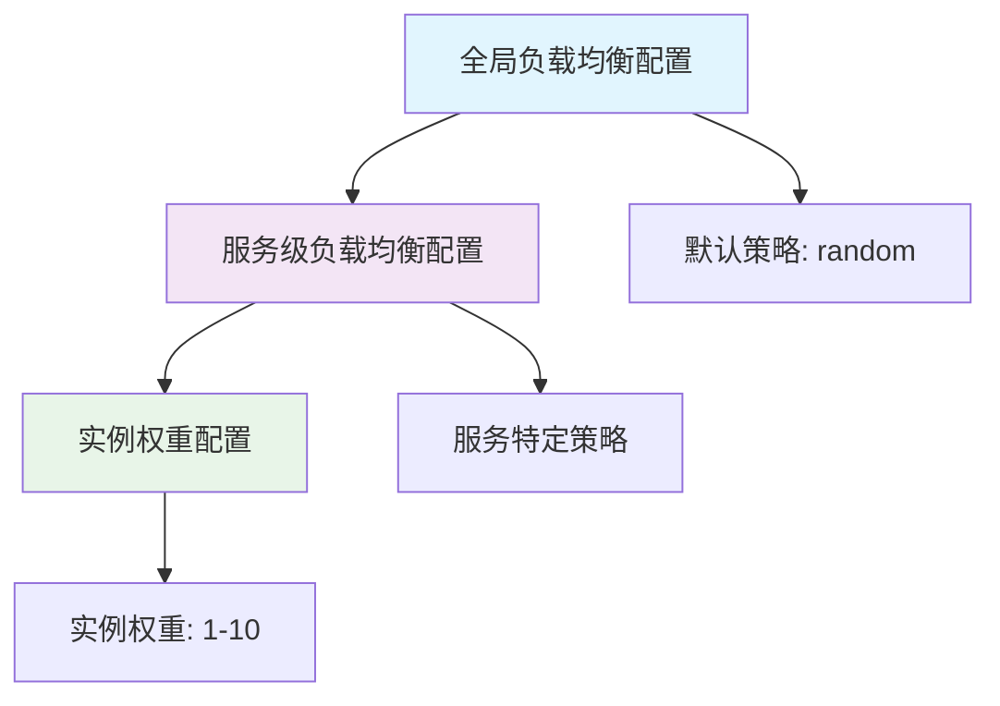
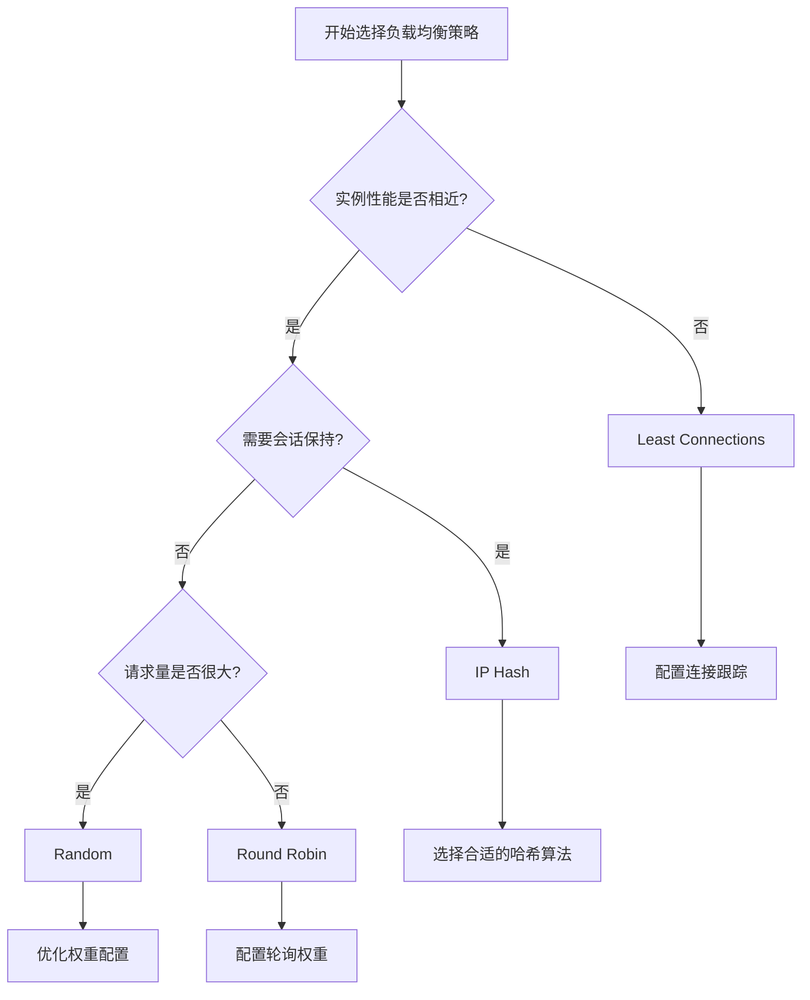

# 负载均衡配置

<!-- 版本信息 -->
> **文档版本**: 1.0.2  
> **最后更新**: 2026-05-21
> **Git 提交**: 61384b4a  
> **作者**: Lincoln
<!-- /版本信息 -->

Trunkline 提供六种负载均衡策略，支持全局、服务级别和实例级别的配置。本文档详细介绍各种负载均衡策略的配置方法和使用场景。

## 模块化配置说明

从 v2.8.x 版本开始，Trunkline 采用模块化配置结构，负载均衡相关配置位于独立的配置文件中：

- 主配置文件: `application.yml`
- 负载均衡配置: `config/router/loadbalancer.yml`
- 服务实例配置: `config/router/services.yml`

您可以在 `config/router/loadbalancer.yml` 文件中找到全局负载均衡配置（`model.load-balance.*`）与路由监控配置（`trunkline.loadbalancer.routing-monitor.*`）；各服务类型的实例与权重写在 `config/router/services.yml` 中。

## 负载均衡概述

### 支持的策略

| 策略 | 算法 | 特点 | 适用场景 |
|------|------|------|----------|
| **Random** | 随机选择 | 简单高效，长期均匀（默认） | 实例性能相近 |
| **Round Robin** | 轮询分配 | 保证每个实例都被使用 | 实例性能相近 |
| **Least Connections** | 最少连接数 | 自动平衡负载 | 请求处理时间差异大 |
| **IP Hash** | 客户端IP哈希 | 会话保持 | 需要客户端粘性 |
| **Consistent Hash** | 一致性哈希（虚拟节点 150） | 实例上下线只影响少量 key | 需要粘性且实例动态扩缩 |
| **Latency**（v2.9.3+） | EWMA 延迟感知 | 按历史调用延迟加权，延迟越低概率越高 | 跨地域/混合硬件，实例延迟差异显著 |

> 候选实例可先按**实例标签**圈选（标签路由，v2.9.7+），再由负载均衡策略从中选择，详见 [路由规则配置](routing-rules.md)。

### 配置层级



## 全局负载均衡配置

### 基础配置

在 `config/router/loadbalancer.yml` 文件中配置全局负载均衡策略：

```yaml
# config/router/loadbalancer.yml
model:
  # 全局配置
  load-balance:
    type: round-robin           # 全局默认策略（代码默认 random）
    hash-algorithm: "md5"       # ip-hash / consistent-hash 的哈希算法

  # 全局适配器配置 - 如果服务没有指定适配器，将使用此配置
  adapter: gpustack # 支持: normal, gpustack, ollama, vllm, xinference, localai

  # 全局限流配置
  rate-limit:
    enabled: true
    algorithm: "token-bucket"
    capacity: 1000
    rate: 100
    scope: "service"
    client-ip-enable: true  # 启用客户端IP限流

  # 全局熔断配置
  circuit-breaker:
    enabled: true
    failureThreshold: 5
    timeout: 60000
    successThreshold: 2

  # 全局降级配置
  fallback:
    enabled: true
    strategy: default
```

### 高级配置

```yaml
model:
  load-balance:
    type: consistent-hash
    hash-algorithm: "md5"       # ip-hash / consistent-hash 的哈希算法
    virtual-nodes: 150          # 一致性哈希虚拟节点数
    ewma-alpha: 0.2             # EWMA 平滑因子（latency 策略专用）
```

## 服务级负载均衡配置

### YAML 配置方式

在 `config/router/services.yml` 文件中配置各服务类型的负载均衡策略：

```yaml
model:
  services:
    chat:
      load-balance:
        type: least-connections
        hash-algorithm: "sha256"  # 仅 IP Hash 策略需要
      adapter: gpustack # 使用GPUStack适配器
      # 服务级别限流配置
      rate-limit:
        enabled: true
        algorithm: "token-bucket"
        capacity: 100
        rate: 10
        scope: "service"
        client-ip-enable: true
      instances:
        - name: "high-perf-model"
          base-url: "http://gpu-server:8080"
          path: "/v1-openai/chat/completions"
          weight: 3               # 高权重实例
        - name: "standard-model"
          base-url: "http://cpu-server:8080"
          path: "/v1/chat/completions"
          weight: 1               # 标准权重实例
    
    embedding:
      load-balance:
        type: ip-hash
        hash-algorithm: "md5"
      rate-limit:
        enabled: true
        algorithm: "token-bucket"
        capacity: 200
        rate: 20
        scope: "service"
        client-ip-enable: true
      instances:
        - name: "embedding-model-1"
          base-url: "http://embed-server-1:8080"
          path: "/v1/embeddings"
          weight: 2
        - name: "embedding-model-2"
          base-url: "http://embed-server-2:8080"
          path: "/v1/embeddings"
          weight: 2
```

### JSON 配置方式

Trunkline 也支持通过动态配置 API 更新实例配置：

```json
{
  "services": {
    "chat": {
      "loadBalance": {
        "type": "round-robin",
        "hashAlgorithm": "md5"
      },
      "instances": [
        {
          "name": "qwen2:7b",
          "baseUrl": "http://gpu-cluster:8080",
          "path": "/v1/chat/completions",
          "weight": 3
        },
        {
          "name": "llama3.2:3b",
          "baseUrl": "http://cpu-cluster:8080",
          "path": "/v1/chat/completions",
          "weight": 1
        }
      ]
    }
  }
}
```

## 负载均衡策略详解

### 1. Random（随机策略）

#### 配置示例

```yaml
model:
  services:
    chat:
      load-balance:
        type: random
      instances:
        - name: "model-1"
          base-url: "http://server-1:8080"
          weight: 1
        - name: "model-2"
          base-url: "http://server-2:8080"
          weight: 2
        - name: "model-3"
          base-url: "http://server-3:8080"
          weight: 1
```

#### 特点和适用场景

**特点**：
- 算法简单，性能开销最小
- 支持权重配置
- 长期来看请求分布均匀
- 无状态，易于扩展

**适用场景**：
- 实例性能相近
- 请求处理时间相对稳定
- 高并发场景
- 无状态服务

**权重计算**：
```
实例被选中概率 = 实例权重 / 总权重
```

示例中各实例被选中的概率：
- model-1: 1/4 = 25%
- model-2: 2/4 = 50%
- model-3: 1/4 = 25%

### 2. Round Robin（轮询策略）

#### 配置示例

```yaml
model:
  services:
    embedding:
      load-balance:
        type: round-robin
      instances:
        - name: "embed-1"
          base-url: "http://embed-server-1:8080"
          weight: 2
        - name: "embed-2"
          base-url: "http://embed-server-2:8080"
          weight: 1
        - name: "embed-3"
          base-url: "http://embed-server-3:8080"
          weight: 3
```

#### 特点和适用场景

**特点**：
- 保证每个实例都能获得请求
- 支持加权轮询
- 请求分布可预测
- 适合批量处理场景

**适用场景**：
- 实例性能相近
- 需要均匀分布请求
- 批量数据处理
- 测试和调试场景

**加权轮询算法**：
根据权重生成调度序列，权重为2的实例会连续被选中2次。

示例调度序列：embed-1, embed-1, embed-2, embed-3, embed-3, embed-3

### 3. Least Connections（最少连接策略）

#### 配置示例

```yaml
model:
  services:
    chat:
      load-balance:
        type: least-connections
      instances:
        - name: "fast-model"
          base-url: "http://fast-server:8080"
          weight: 2
        - name: "slow-model"
          base-url: "http://slow-server:8080"
          weight: 1
```

#### 特点和适用场景

**特点**：
- 自动平衡负载
- 适应实例性能差异
- 需要维护连接状态
- 动态调整请求分配

**适用场景**：
- 实例性能差异较大
- 请求处理时间变化大
- 长连接服务
- 需要精确负载平衡

**选择算法**：
```
选择实例 = min(当前连接数 / 权重)
```

### 4. IP Hash（IP哈希策略）

#### 配置示例

```yaml
model:
  services:
    chat:
      load-balance:
        type: ip-hash
        hash-algorithm: "md5"    # 支持: md5, sha1, sha256
      instances:
        - name: "session-model-1"
          base-url: "http://session-server-1:8080"
          weight: 1
        - name: "session-model-2"
          base-url: "http://session-server-2:8080"
          weight: 1
        - name: "session-model-3"
          base-url: "http://session-server-3:8080"
          weight: 2
```

#### 特点和适用场景

**特点**：
- 同一客户端总是路由到同一实例
- 支持会话保持
- 实例变化时会影响路由
- 可能导致负载不均衡

**适用场景**：
- 需要会话保持
- 有状态服务
- 缓存本地化
- 用户个性化服务

**哈希算法选择**：

| 算法 | 特点 | 性能 | 分布均匀性 |
|------|------|------|------------|
| MD5 | 快速，分布均匀 | 高 | 好 |
| SHA1 | 安全性较好 | 中 | 好 |
| SHA256 | 安全性最好 | 低 | 最好 |

#### 一致性哈希配置

一致性哈希是独立策略，扁平配置（虚拟节点数在 `model.load-balance.virtual-nodes`，默认 150）：

```yaml
model:
  load-balance:
    type: consistent-hash        # 直接选用一致性哈希策略
    hash-algorithm: "md5"        # 哈希函数：md5 / sha1 / sha256
    virtual-nodes: 150           # 虚拟节点数量
```

> 早期文档中的 `load-balance.consistent-hash.{enabled,virtual-nodes,hash-function}` 嵌套结构不存在；虚拟节点数是 `model.load-balance.virtual-nodes` 扁平键。

## 动态负载均衡配置

### 通过 API 调整实例权重

实例权重可通过实例管理 API 热更新（服务级策略调整后重启生效或走动态配置）：

```bash
# 场景：GPU 服务器性能提升，增加权重
curl -X PUT "http://localhost:8080/api/config/instance/chat/gpu-model@http://gpu-server:8080" \
  -H "Content-Type: application/json" \
  -d '{
    "name": "gpu-model",
    "baseUrl": "http://gpu-server:8080",
    "path": "/v1/chat/completions",
    "weight": 4
  }'

# 场景：CPU 服务器负载过高，降低权重
curl -X PUT "http://localhost:8080/api/config/instance/chat/cpu-model@http://cpu-server:8080" \
  -H "Content-Type: application/json" \
  -d '{
    "name": "cpu-model",
    "baseUrl": "http://cpu-server:8080",
    "path": "/v1/chat/completions",
    "weight": 1
  }'
```

## 负载均衡监控

### 监控指标

Trunkline 提供以下负载均衡相关指标：

```bash
# 查看负载均衡指标
curl "http://localhost:8080/actuator/metrics/trunkline_loadbalancer_selections_total"

# 查看实例请求分布
curl "http://localhost:8080/actuator/metrics/trunkline_requests_total"

# 查看连接数统计（仅 Least Connections 策略）
curl "http://localhost:8080/actuator/metrics/trunkline_rate_limit_remaining"
```

### Prometheus 指标

```prometheus
# 负载均衡请求总数
trunkline_loadbalancer_selections_total{service="chat",strategy="round-robin"}

# 实例请求分布
trunkline_requests_total{service="chat",instance="model-1",status="success"}

# 活跃连接数
trunkline_rate_limit_remaining{service="chat",instance="model-1"}

# 实例响应时间
trunkline_request_duration_seconds{service="chat",instance="model-1"}
```

### 监控仪表板配置

```yaml
# Grafana 仪表板查询示例
queries:
  - name: "请求分布"
    query: 'rate(trunkline_requests_total[5m])'
    
  - name: "负载均衡效果"
    query: 'trunkline_requests_total / ignoring(instance) group_left sum(trunkline_requests_total) by (service)'
    
  - name: "实例健康状态"
    query: 'trunkline_backend_health'
```

## 性能调优

### 5. Latency（延迟感知策略，v2.9.3+）

基于 EWMA（指数加权移动平均）的延迟感知负载均衡，根据每个实例的历史调用延迟动态调整选择概率：延迟越低的实例被选中的概率越高。

#### 工作原理

- 每次成功调用以实际耗时作为样本更新该实例的 EWMA：`ewma = alpha × sample + (1 - alpha) × ewma`
- 失败调用使用惩罚值（等效 30 秒超时）更新，惩罚高失败率实例
- 选择时按 `1 / (1 + ewma)` 作为权重进行加权随机选择
- 冷启动：未收到样本的实例权重为 1.0（零延迟等效），确保公平探索
- `alpha`（默认 0.2）控制平滑程度：值越大对新样本越敏感

#### 配置示例

```yaml
# 全局配置
model:
  load-balance:
    type: latency        # 延迟感知策略
    ewma-alpha: 0.2      # EWMA 平滑因子（可选，默认 0.2）

# 服务级配置（覆盖全局）
model:
  services:
    chat:
      load-balance:
        type: latency
        ewma-alpha: 0.3
```

#### 特点和适用场景

- **特点**：自动感知实例延迟变化并动态调整流量分配；无样本实例公平探索；延迟波动时逐步收敛
- **适用场景**：跨地域部署、混合硬件环境、实例负载随时间波动
- **注意**：延迟数据来自调用历史（非主动探测），高并发下约 1 个请求周期的收敛时间；与 Sticky 粘性路由配合时 duration 数据透传已打通




### 1. 策略选择指南

### 2. 权重配置最佳实践

```yaml
# 基于实例性能配置权重
model:
  services:
    chat:
      instances:
        # 高性能 GPU 服务器
        - name: "gpu-model"
          base-url: "http://gpu-server:8080"
          weight: 5              # 高权重
          
        # 中等性能服务器
        - name: "cpu-model"
          base-url: "http://cpu-server:8080"
          weight: 2              # 中等权重
          
        # 备用服务器
        - name: "backup-model"
          base-url: "http://backup-server:8080"
          weight: 1              # 低权重
```

### 3. 连接池优化

出站 WebClient 连接池配置位于 `config/common/webclient.yml`，前缀 `trunkline.webclient`：

```yaml
trunkline:
  webclient:
    connect-timeout-ms: 5000       # 连接超时
    response-timeout-seconds: 60   # 响应超时
    max-connections: 500           # 连接池大小
    pending-acquire-timeout-ms: 10000  # 获取连接超时
    max-idle-time-seconds: 300     # 空闲连接回收时间
```

> 早期文档中的顶层 `webclient.connection-pool.*` 键已废弃（连接池配置迁移到 `trunkline.webclient.*`）。

## 故障处理

### 1. 实例故障与熔断隔离

实例故障检测由熔断器负责（连续失败达 `failureThreshold` 即熔断该实例，OPEN 期间不参与负载均衡选择），详见 [熔断器](circuit-breaker.md)。

> 早期文档中的 `model.load-balance.health-check.*`（interval/timeout/failure-threshold/success-threshold）配置块**不存在**；故障检测即熔断器。

### 2. 故障转移

故障转移通过「换实例重试」实现（v2.9.6+）：调用失败（可重试错误：连接错误 / 5xx / 超时）时，当前实例加入本次请求的失败黑名单，经正常选择链（健康/熔断过滤 + 负载均衡策略）重新选择未失败的实例重试。

> 早期文档中的 `load-balance.failover.{enabled,retry-attempts,retry-delay}` 配置块与实例 `priority` 字段**不存在**；重试次数沿用各服务类型的重试策略，无需在负载均衡下配置。

#### 请求级故障转移（v2.9.6+）

从 v2.9.6 起，调用失败（可重试错误：连接错误 / 5xx / 超时）时，网关会**重新选择其他实例重试**，而非反复重试同一实例：

- **换实例重试**：可重试错误发生时，当前实例加入本次请求的失败黑名单，经正常选择链（健康/熔断过滤 + 负载均衡策略）重新选择未失败的实例重试
- **黑名单隔离**：同一请求内已失败的实例不会被重复选择（避免反复打同一故障实例）
- **全失败回退**：若所有实例均已失败或仅有一个实例，回退为原实例重试（保持既有行为），重试次数仍由 `RetryPolicy` 控制
- **不可重试错误**（如 4xx 客户端错误）不换实例、不重试，直接返回
- 默认启用，无需额外配置；重试上限沿用各服务类型配置的重试次数

### 3. 负载均衡问题诊断

```bash
# 检查实例状态
curl "http://localhost:8080/api/config/instance/chat"

# 查看实例熔断器状态
curl "http://localhost:8080/api/config/instance/circuit-breaker/states"

# 查看健康状态
curl "http://localhost:8080/actuator/health"
```

## 实际使用案例

### 案例 1：电商推荐系统

```yaml
# 需要会话保持的推荐服务
model:
  services:
    recommendation:
      load-balance:
        type: ip-hash
        hash-algorithm: "md5"
      instances:
        - name: "rec-server-1"
          base-url: "http://rec-1:8080"
          weight: 1
        - name: "rec-server-2"
          base-url: "http://rec-2:8080"
          weight: 1
        - name: "rec-server-3"
          base-url: "http://rec-3:8080"
          weight: 1
```

### 案例 2：多模型 AI 服务

```yaml
# 不同性能的模型实例
model:
  services:
    chat:
      load-balance:
        type: least-connections
      instances:
        - name: "gpt-4"
          base-url: "http://openai-proxy:8080"
          weight: 1              # 慢但质量高
        - name: "llama3.2:70b"
          base-url: "http://gpu-cluster:8080"
          weight: 3              # 快且质量好
        - name: "qwen2:7b"
          base-url: "http://cpu-cluster:8080"
          weight: 2              # 中等性能
```

### 案例 3：高并发场景

```yaml
# 高并发聊天服务
model:
  services:
    chat:
      load-balance:
        type: random             # 最低延迟
      instances:
        - name: "chat-1"
          base-url: "http://chat-server-1:8080"
          weight: 1
        - name: "chat-2"
          base-url: "http://chat-server-2:8080"
          weight: 1
        - name: "chat-3"
          base-url: "http://chat-server-3:8080"
          weight: 1
```

## 下一步

完成负载均衡配置后，您可以继续了解：

- **[限流配置](rate-limiting.md)** - 设置流量控制和保护
- **[熔断器配置](circuit-breaker.md)** - 配置故障保护机制
- **[监控指南](../monitoring/index.md)** - 设置负载均衡监控
- **[故障排查](../troubleshooting/index.md)** - 负载均衡问题诊断