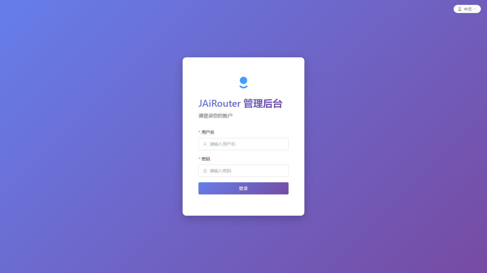
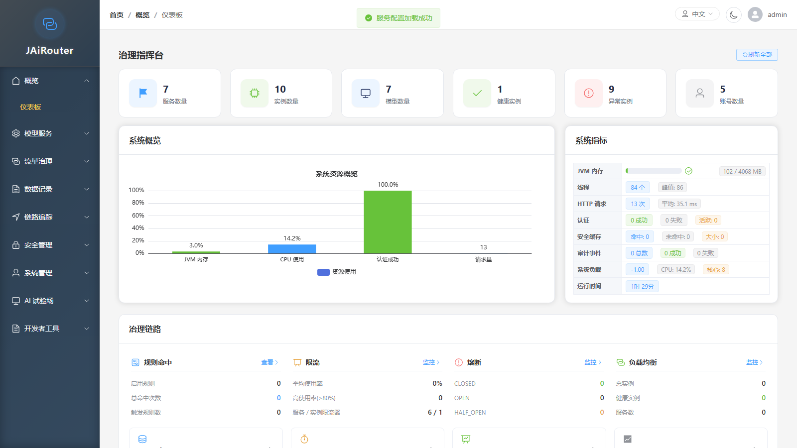

# Web 控制台操作手册

<!-- 版本信息 -->
> **文档版本**: 2.0.0
> **最后更新**: 2026-10-28
> **适用版本**: 新台控制台（Trunkline Console）
> **作者**: Lincoln
<!-- /版本信息 -->

本手册面向首次使用 Trunkline Web 控制台（下文简称「新台」）的操作者，覆盖登录、界面结构、快速接入、测试场、密钥与配额、观测与追踪、策略与系统管理的完整动线。

> 新台按任务流组织菜单，与早期「9 组 39 页」的旧管理后台不同；本文所有页面路径、菜单分组、权限码均以前端 `src/config/menu.ts` 与 `src/router/index.ts` 为准。

## 1. 登录与首次启动

### 1.1 访问地址

| 部署方式 | 地址 | 说明 |
|----------|------|------|
| 本地开发（Vite） | `http://localhost:3000/` | Vite dev server，热更新 |
| 生产/独立部署 | `http://<host>:8080/` | 后端直接托管 SPA，未登录自动跳转 `/login` |

### 1.2 页面标题

- 登录页大标题显示「**Trunkline 控制台**」；
- 语言包应用标题为「**Trunkline 管理后台**」（英文：**Trunkline Admin**）；
- 浏览器标签页标题格式为「**<当前页名> · Trunkline 控制台**」（由路由 `afterEach` 设置，如「总览 · Trunkline 控制台」）。

> 技术标识仍保留 `trunkline.*`（包名、指标名、配置前缀、容器名等），不影响产品展示名为 Trunkline。

### 1.3 默认账号

| 用户名 | 默认密码 | 说明 |
|--------|----------|------|
| `admin` | `ChangeMeOnFirstStartup123456` | 仅在账号表为空时自动创建，超级管理员 |

> ⚠️ **首次部署务必修改 `admin` 密码**。生产环境通过环境变量 `INITIAL_ADMIN_PASSWORD` 覆盖，或首次登录后立即修改。

### 1.4 Token 存储与路由守卫

登录成功后，JWT 存储于浏览器 `localStorage`，键名为 `admin_token`。前端路由守卫（`router.beforeEach`）在每次导航时依次判定：

1. 公开路由（如 `/login`）直接放行，已登录访问登录页则重定向到 `/overview`；
2. 未登录 → 重定向到 `/login`；
3. 读取 `localStorage` 中的 `admin_token`，解码 JWT 的 `exp` 字段判定是否过期，过期则清空 token 并回登录页；
4. 路由 `meta.permissions` 要求的权限码必须全部持有（ADMIN 恒通过），缺权限回 `/overview`。

> ⚠️ 不建议手动注入 token。手动写入的 token 若过期、或缺失 `permissions` claim，控制台将无法正常使用。

### 1.5 登录流程

1. 浏览器打开控制台地址，未登录自动进入 `/login`；
2. 页面标题显示「**Trunkline 控制台**」；
3. 输入用户名和密码，点击「**登录**」；
4. 登录成功后自动跳转到「**总览**」（`/overview`）。



---

## 2. 界面结构（新台 5 组菜单）

新台左侧为可折叠侧边栏，按任务流分为 **5 个菜单分组**，共 **13 个菜单项**。菜单可见性由权限码控制——缺少对应权限码的菜单项不会显示；普通调用角色默认仅见工作台/接入的模型/测试场/密钥等少数几项。



| 分组 | 菜单项 | 路由路径 | 权限码 | 说明 |
|------|--------|----------|--------|------|
| **工作台** | 总览 | `/overview` | `overview:dashboard:read` | 一站式总览 |
| **接入** | 快速接入 | `/quick-start` | `config:instances:read` | 四步向导：选服务商 → 填密钥 → 导入模型 → 拿密钥调用 |
| **接入** | 接入模型 | `/models` | `config:instances:read` | 已接入模型 / 公共模型库 |
| **接入** | 模型分组 | `/model-pools` | `config:instances:read` | 把多个模型通道归为一组，统一调用、自动分流与容灾 |
| **接入** | 密钥管理 | `/keys` | `security:apikeys:manage` | 签发 / 吊销 / 配额 |
| **接入** | 测试场 | `/playground` | `ai:playground:use` | 对话 / 向量 / 重排 / 语音 / 图像 |
| **运营观测** | 观测中心 | `/observe` | `monitoring:tokenusage:read` | 调用历史 / Token / 慢查询 / 异常 / 配额 / 熔断 / 限流 |
| **运营观测** | 链路追踪 | `/tracing` | `tracing:dashboard:read` | 请求链路查询与追踪仪表 |
| **高级策略** | 策略中心 | `/strategy` | `config:rules:read` | 路由规则 / 负载均衡 / 熔断阈值 / 响应缓存 / 用量配额 |
| **系统管理** | 账号与权限 | `/settings/accounts` | `system:accounts:manage` | 账号 / 角色权限 |
| **系统管理** | 模型配置 | `/settings/model-config` | `system:accounts:manage` | 供应商模板 / 模型分类 / 模型适配器 |
| **系统管理** | 审计与版本 | `/settings/audit-versions` | `system:accounts:manage` | 审计日志 / 配置版本 |
| **系统管理** | 状态监控 | `/settings/monitoring` | `system:accounts:manage` | 状态持久化 |

### 2.1 不在侧边栏、但可直达的路由

下列页面存在于路由表中，但已收敛为某页内的 Tab 或由入口跳转，不再单独占菜单项：

| 页面 | 路由路径 | 权限码 | 入口 |
|------|----------|--------|------|
| 模型分类 | `/model-categories` | `config:instances:read` | 「接入模型」页内 / 模型配置 |
| 模型适配器 | `/protocol-adapters` | `config:instances:read` | 「模型配置」页内 |
| 用量配额 | `/quota` | `config:quota:read` | 「策略中心」页内 Tab |
| 接入指南 | `/guide` | 已登录 | 顶栏帮助图标 + 快速向导第 3 步 |

> 旧深链 `/settings?tab=xxx` 会按路由表映射重定向到上述 4 个系统管理子路径。

### 2.2 顶栏

| 区域 | 元素 | 说明 |
|------|------|------|
| 左侧 | 品牌标识 | `brand-mark.svg` + 「Trunkline」字样 |
| 右侧 | 帮助图标 | 跳转「接入指南」`/guide` |
| 右侧 | 语言切换 / 主题切换 | 中/English、亮/暗主题 |
| 右侧 | 用户菜单 | 用户名 + 退出登录 |

---

## 3. 总览页（`/overview`）

总览页聚合真实业务指标，数据来自 `GET /api/dashboard/metrics`，返回六个分组：

| 分组 | 关键字段 | 含义 |
|------|----------|------|
| `jvm` | heapUsedMB / heapUsagePercent、threadCount、GC 次数与耗时 | JVM 内存、线程、GC |
| `http` | totalRequests、avgResponseTimeMs、maxResponseTimeMs、activeRequests | HTTP 请求量与延迟（基于 `http.server.requests`） |
| `security` | authSuccesses / authFailures / authAttempts、activeUsers、activeApiKeys、jwtValidations | 认证与安全指标 |
| `audit` | totalEvents、successEvents、failureEvents、healthScore | 审计事件统计 |
| `system` | availableProcessors、systemLoadAverage、processCpuUsage、uptimeSeconds | 操作系统与进程 |
| `monitoring` | retryAttempts、degradationLevel、errorsTotal | 监控系统自身的重试/降级/错误 |

---

## 4. 快速接入向导（`/quick-start`）

新台把「从 0 到第一次调通」收敛为四步傻瓜式向导（`QuickStartWizard.vue`），全程无需手写配置文件：

1. **选服务商**：从供应商模板目录（国内 / 国际 / 本地三组）选择预设，或选「自定义」填写名称、Base URL、路径、适配器（普通 OpenAI 兼容 / Ollama 本地）。本地预设或本地地址（localhost / 127.0.0.1 / host.docker.internal）自动免填上游密钥。
2. **填上游密钥**：填写发给下游模型服务商的 API Key（本地推理可跳过）。随后向导自动创建/复用供应商并「发现模型」。
3. **导入模型**：列出发现到的模型，按模型 ID 自动识别模型分类（chat / embedding / rerank / tts / stt / imgGen / imgEdit，识别不出归入默认分类，可逐个手改）；勾选要导入的模型（视频生成等暂不支持项自动剔除）。
4. **完成**：向导自动——
   - 按模型分类**自动建模型分组（池）**，命名规则为 `<服务商名>-<分类>`（如 `OpenAI-chat`），负载策略 `weighted-random`，成员为已导入实例；
   - **自动签发一个测试密钥**，`permissions` 填所导入的分类集合、`allowedGroups` 填新建的分组名；
   - 展示可复制的 **curl** 与 **Python (OpenAI SDK)** 调用示例。

> ⚠️ **v3.5 单线治理**：对外调用的 `model` 参数必须填**分组（虚拟模型名）**，不是上游实例名。向导生成的示例 curl 已按此口径填写。测试密钥值仅此一次展示，请立即复制保存。

示例（向导自动生成）：

```bash
curl http://<host>:8080/v1/chat/completions \
  -H "Content-Type: application/json" \
  -H "Authorization: Bearer <测试密钥>" \
  -d '{"model": "<服务商>-chat", "messages": [{"role":"user","content":"你好"}], "stream": true}'
```

---

## 5. 接入模型与模型分组

### 5.1 接入模型（`/models`）

「接入模型」页管理已导入的实例与公共模型库：查看某模型分类下的可用模型、发现模型、配置供应商模板与模型适配器。模型分类固定为 7 种：`chat`、`embedding`、`rerank`、`tts`、`stt`、`imgGen`（图像生成）、`imgEdit`（图像编辑）。

### 5.2 模型分组（`/model-pools`）

模型分组（池 / pool）是对外调用的唯一入口：把同分类下多个上游实例归为一组，按策略（如加权随机 `weighted-random`）自动分流与容灾。一个分组对外暴露为一个「虚拟模型名」，客户端用它调用，网关在池内选实例。

### 5.3 三道闸门权限模型

密钥的放行是串联的三道闸门，详见 [API Key 管理](../security/api-key-management.md)：

1. **闸门一·模型分类**：`permissions` 限定该密钥可调用哪些分类（chat/embedding/…）。请求先按 URL 端点确定分类，分类不在 `permissions` 内 → 403。
2. **闸门二·模型分组白名单**：`allowedGroups` 限定该密钥可用哪些分组（虚拟模型名）。v3.5 起原 `allowedModels`（实例名白名单）已移除，实例不可被直调。
3. **闸门三·运行约束**：`allowedIpAddresses`（IP 白名单）、`expiresAt`（有效期）、多窗口配额与告警阈值。

---

## 6. 密钥管理（`/keys`）

在「密钥管理」页签发、查看、禁用/启用、删除、重置/轮换密钥，并配置配额与告警。

- **签发**：填描述、勾选可调用的模型分类（闸门一）、勾选可访问的模型分组（闸门二）、可选 IP 白名单 / 有效期 / 配额。创建后密钥值**仅此一次**展示。
- **配额抽屉**：列表操作列「配额」可只改配额字段（每日 / 每小时 / 每月的请求与 Token 上限、每分钟速率、告警阈值），并可重置当日计数。
- **重置 / 轮换**：`reset` 保留原属性重发新值；`rotate` 保留 keyId 与全部属性、仅换 keyValue 并更新轮换时间。

> 密钥管理接口均要求 `security:apikeys:manage` 权限（管理面 `hasRole('ADMIN')`）。

---

## 7. 测试场（`/playground`）

测试场把统一接口 `/api/v1` 的全部模态收敛到一页，对应后端 `UniversalController`：

| 模态 | 页内 Tab | 后端端点 | 分类 |
|------|----------|----------|------|
| 对话 | Chat | `POST /api/v1/chat/completions` | `chat` |
| 向量 | Embedding | `POST /api/v1/embeddings` | `embedding` |
| 重排 | Rerank | `POST /api/v1/rerank` | `rerank` |
| 语音合成 | TTS | `POST /api/v1/audio/speech` | `tts` |
| 语音识别 | STT | `POST /api/v1/audio/transcriptions`（multipart） | `stt` |
| 图像生成 | Image | `POST /api/v1/images/generations` | `imgGen` |
| 图像编辑 | Image Edit | `POST /api/v1/images/edits`（multipart） | `imgEdit` |

在测试场选择模型分组（虚拟模型名）后即可试调用，验证整条链路是否打通。测试场需要 `ai:playground:use` 权限码。

---

## 8. 运营观测

### 8.1 观测中心（`/observe`）

一页聚合调用历史、Token 用量、慢查询、异常事件、配额、熔断、限流八个切面。Token 用量数据接口为：

| 端点 | 说明 |
|------|------|
| `POST /api/token-usage/record` | 记录单次调用 Token 用量（API Key 主体只能上报自身） |
| `POST /api/token-usage/record/batch` | 批量记录 |
| `GET /api/token-usage/statistics?startTime=&endTime=` | 按时间范围统计（按模型/分类/周月维度） |
| `GET /api/token-usage/recent?limit=20` | 最近用量记录 |

> 📌 **成本管理（账单反推均价 / 社区价格包 / 手动覆盖）**：产品规划中，当前版本代码未实现，待确认。观测中心目前展示的是 Token 用量与调用统计，**不包含按价格折算的费用/成本金额**。

### 8.2 链路追踪（`/tracing`）

基于 OpenTelemetry 的链路追踪页，支持按 Trace ID / 服务名 / 时间范围定位请求链路，查看延迟分布、错误率与吞吐量。追踪标签（tag/attribute）的真实命名见 [链路追踪概述](../tracing/index.md) 的「标签设计」章节。

---

## 9. 高级策略（`/strategy`）

策略中心一页收敛：路由规则、负载均衡策略、熔断器阈值、响应缓存开关、用量配额（`/quota` 为其页内 Tab）。响应缓存等开关在页内控制，不在菜单树单独体现。

---

## 10. 系统管理

| 页面 | 路由 | 内容 |
|------|------|------|
| 账号与权限 | `/settings/accounts` | 账号、角色与权限码分配 |
| 模型配置 | `/settings/model-config` | 供应商模板、模型分类、模型适配器 |
| 审计与版本 | `/settings/audit-versions` | 安全审计日志、配置版本对比与回滚 |
| 状态监控 | `/settings/monitoring` | 状态持久化（内存 / H2 / Redis / 文件） |

---

## 11. 凭据头口径

| 协议面 | 凭据头 | 说明 |
|--------|--------|------|
| OpenAI 兼容 `/v1/*` | `Authorization: Bearer <网关 API Key>` 或 `X-API-Key: <网关 API Key>` | 测试向导生成的 curl 使用 `Authorization: Bearer` |
| 控制台管理面 | `admin_token`（JWT，存于 localStorage） | 登录后的管理 API 凭据 |
| `Authorization`（发给下游） | — | 在实例/供应商配置中填写，网关**透传**给下游模型服务，不是网关自身凭据 |

---

## 12. 常见问题

### 12.1 登录后页面 401
JWT 过期（重新登录）或 `JWT_SECRET` 与部署时不一致（验签失败）。

### 12.2 登录后部分页面 403 或菜单缺失
当前角色缺少对应权限码。用 `admin` 登录，在「系统管理 → 账号与权限」为角色补码；菜单层已按权限码过滤，直接输 URL 访问无权限页会被守卫重定向回 `/overview`。

### 12.3 调 `/v1/chat/completions` 返回 403 或 404
- 403：请求的分类不在该密钥 `permissions` 内（闸门一）；
- 404/503：`model` 填了上游实例名而非分组（虚拟模型名），或该分组不在密钥 `allowedGroups` 内（闸门二）。v3.5 起实例不可被直调。

### 12.4 OpenAI SDK 接入 401
确认用测试向导签发的网关 API Key，`base_url` 指向 `http://<host>:8080/v1`，`model` 填分组名。

### 12.5 Redis 不可用
JWT 持久化 / 配额分布式存储依赖 Redis 时，本地开发默认关闭 Redis，JWT 走 H2 + 内存回退；生产请确保 Redis 可用。
