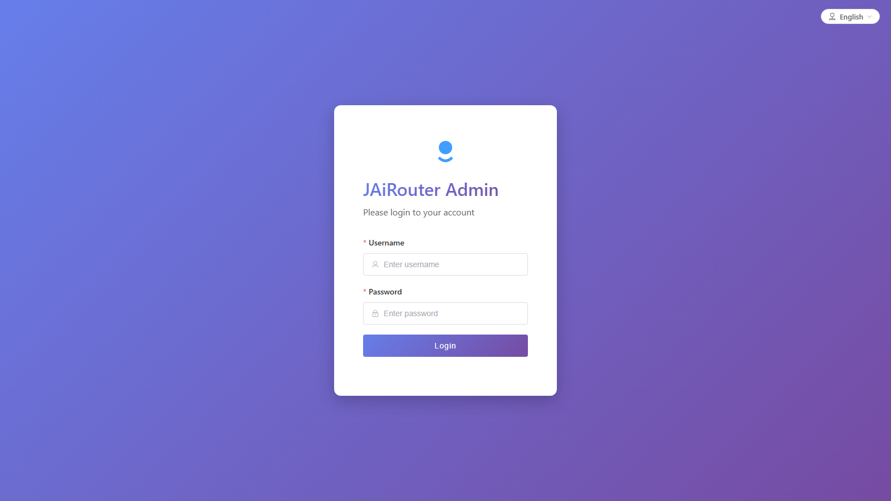
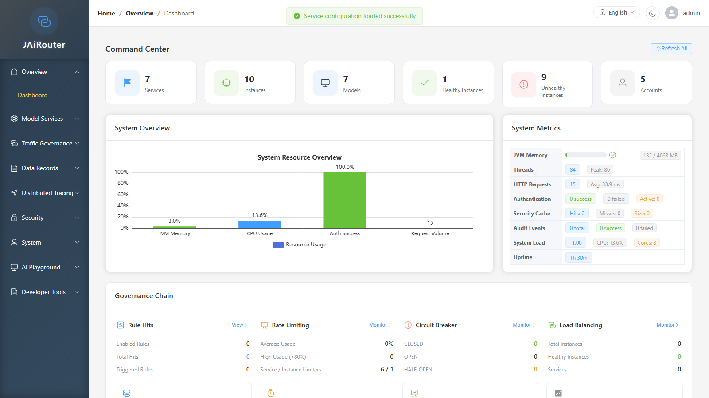

# Quick Start

<!-- 版本信息 -->
> **Doc Version**: 1.2.2
> **Last Updated**: 2026-09-18
> **Applicable Version**: v3.1.1+
> **Author**: Lincoln
<!-- /版本信息 -->

This guide will help you make your first API call to Trunkline and understand the basic concepts.

## Learning Objectives

After completing this guide, you will be able to:
- Start Trunkline service
- Configure your first AI model service
- Send API requests and receive responses
- Experience load balancing and rate limiting

## Prerequisites

- Trunkline is installed and running (see [Installation Guide](installation.md))
- At least one AI model service is configured and accessible

## Step 0: Generate Secure Keys (v3.1.1+ Recommended)

The production profile (prod) deliberately ships no default JWT key, so you need to generate one with **at least 32 characters**.

> 💡 **Tip**: You can use the built-in key generator in the image:
> ```bash
> docker run --rm sodlinken/jairouter:latest --generate-key
> ```
> Alternatively, use the command-line methods below:

### Linux / macOS / Git Bash

```bash
# Generate a Base64-encoded JWT key (32 bytes → 44 characters)
openssl rand -base64 32
```

### Windows PowerShell

```powershell
# Generate a Base64-encoded JWT key
[Convert]::ToBase64String((1..32 | ForEach-Object {Get-Random -Maximum 256}))
```

### Set Environment Variables

```bash
# Set the JWT key (replace with the value generated above)
export JWT_SECRET="your-base64-encoded-secret"

# Optional: override the admin password (production only)
export INITIAL_ADMIN_PASSWORD="your-own-strong-password"
```

> 💡 **Tip**: For quick local testing (dev profile), no key configuration is required — a built-in development key is included. The `JWT_SECRET` is only needed for production.
> 🔐 **Default console login**: `admin` / `ChangeMeOnFirstStartup123456` (created automatically **only when the account table is empty**). In production, override it with `INITIAL_ADMIN_PASSWORD` as shown above; otherwise change it after the first login.





## Recommended: 4-step new-console onboarding wizard

If you can already log into the new console (`http://<host>:8080/`), the fastest path is the **Onboarding → Quick Start** wizard (`/quick-start`), which auto-creates the provider, discovers & imports models, builds groups and issues a test key:

1. **Pick provider**: choose a preset (domestic / international / local) or fill a custom Base URL and adapter;
2. **Set upstream key**: the key for the downstream provider (skip for local inference);
3. **Import models**: the wizard discovers models and auto-classifies them by model ID (chat/embedding/rerank/tts/stt/imgGen/imgEdit); check the ones to import;
4. **Done**: the wizard auto-creates **model groups** per category (named `<provider>-<category>`), issues a test key with `allowedGroups` pointing to those groups, and gives copyable curl / Python SDK examples.

> ⚠️ **Since v3.5 the `model` parameter is the "model group (virtual model name)", not an upstream instance name.** Instances added by the API below should also be grouped before being called.

The API-based steps below remain valid for scripted or bulk setup.

## Your First API Call

### 1. Chat Completion

Make a chat completion request using the OpenAI-compatible API:

```bash
curl -X POST http://localhost:8080/v1/chat/completions \
  -H "Content-Type: application/json" \
  -H "X-API-Key: <API key created in the console>" \
  -d '{
    "model": "qwen2.5:7b",
    "messages": [
      {
        "role": "user",
        "content": "Hello, how are you?"
      }
    ],
    "max_tokens": 100
  }'
```

### 2. Text Embeddings

Generate text embeddings:

```bash
curl -X POST http://localhost:8080/v1/embeddings \
  -H "Content-Type: application/json" \
  -d '{
    "model": "text-embedding-ada-002",
    "input": "Hello world"
  }'
```

## Common Configuration Examples

### Online API Services

**OpenAI GPT**
```bash
curl -X POST "http://localhost:8080/api/config/instance/add/chat" \
  -H "Content-Type: application/json" \
  -d '{
    "name": "gpt-4o",
    "baseUrl": "https://api.openai.com",
    "path": "/v1/chat/completions",
    "adapter": "normal",
    "headers": {
      "Authorization": "Bearer sk-proj-xxxxx"
    }
  }'
```

**DeepSeek**
```bash
curl -X POST "http://localhost:8080/api/config/instance/add/chat" \
  -H "Content-Type: application/json" \
  -d '{
    "name": "deepseek-chat",
    "baseUrl": "https://api.deepseek.com",
    "path": "/v1/chat/completions",
    "adapter": "normal",
    "headers": {
      "Authorization": "Bearer sk-xxxxxxxx"
    }
  }'
```

**Anthropic Claude**
```bash
curl -X POST "http://localhost:8080/api/config/instance/add/chat" \
  -H "Content-Type: application/json" \
  -d '{
    "name": "claude-sonnet",
    "baseUrl": "https://api.anthropic.com",
    "path": "/v1/messages",
    "adapter": "claude",
    "headers": {
      "x-api-key": "sk-ant-api03-xxxxx"
    }
  }'
```

> **Note**: The Claude adapter automatically injects the `anthropic-version` header.

**Google Gemini**
```bash
curl -X POST "http://localhost:8080/api/config/instance/add/chat" \
  -H "Content-Type: application/json" \
  -d '{
    "name": "gemini-pro",
    "baseUrl": "https://generativelanguage.googleapis.com/v1beta/openai",
    "path": "/chat/completions",
    "adapter": "normal",
    "headers": {
      "Authorization": "Bearer AIzaSyxxxxx"
    }
  }'
```

### Local Inference Engines

**Ollama**
```bash
curl -X POST "http://localhost:8080/api/config/instance/add/chat" \
  -H "Content-Type: application/json" \
  -d '{
    "name": "llama3.2:3b",
    "baseUrl": "http://localhost:11434",
    "path": "/api/chat",
    "adapter": "ollama"
  }'
```

**vLLM**
```bash
curl -X POST "http://localhost:8080/api/config/instance/add/chat" \
  -H "Content-Type: application/json" \
  -d '{
    "name": "vllm-qwen",
    "baseUrl": "http://localhost:8000",
    "path": "/v1/chat/completions",
    "adapter": "vllm"
  }'
```

> **Tip**: For more configuration examples, see [Instance Configuration Examples](../configuration/instance-examples.md).

## View Service Status

### Check Instance List

```bash
# Get all chat service instances
curl "http://localhost:8080/api/config/instance/type/chat"
```

### View Monitoring Metrics

```bash
# View application metrics
curl "http://localhost:8080/actuator/metrics"

# View specific metrics (e.g., request count)
curl "http://localhost:8080/actuator/metrics/http.server.requests"
```

## Experience Load Balancing

Add a second service instance to experience load balancing:

```bash
# Add another instance
curl -X POST "http://localhost:8080/api/config/instance/add/chat" \
  -H "Content-Type: application/json" \
  -d '{
    "name": "llama3.2:1b",
    "baseUrl": "http://localhost:11434",
    "path": "/v1/chat/completions",
    "adapter": "ollama",
    "weight": 2
  }'
```

Now send multiple requests, and Trunkline will distribute them based on the configured load balancing strategy (default: round-robin).

## Next Steps

| Next Step | Content | Suitable For |
|-----------|---------|--------------|
| **[First Steps Guide](first-steps.md)** | In-depth configuration and production preparation | Ready to use in projects |
| **[Configuration Guide](../configuration/index.md)** | Detailed configuration parameters | Need specific configuration |
| **[API Reference](../api-reference/index.md)** | Complete API documentation | Development integration |
| **[Deployment Guide](../deployment/index.md)** | Production environment deployment | Going live |

## Troubleshooting

### Q: Service fails to start?

**A:** Check the following:
1. Port 8080 is not occupied
2. Java version is 17+
3. Check logs for detailed error information

### Q: Cannot connect to backend AI service?

**A:** Confirm:
1. Backend service is running normally
2. Network connection is normal
3. Configured URL and port are correct

### Q: API call returns error?

**A:** Check:
1. Request format is correct
2. Model name matches
3. Check Trunkline logs for detailed information
