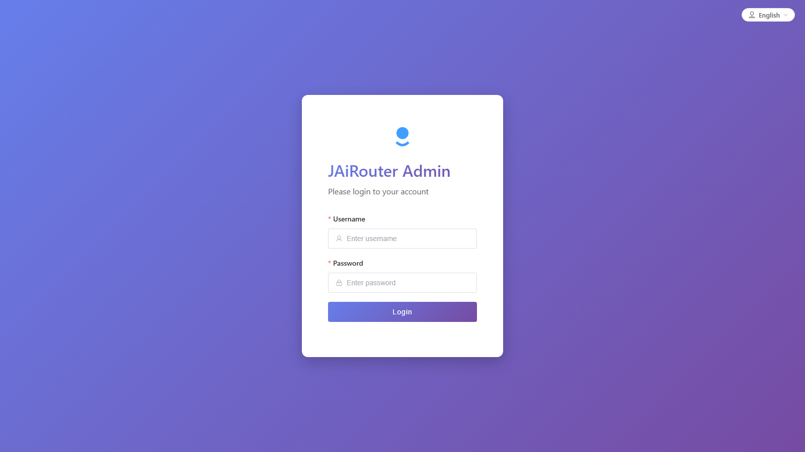
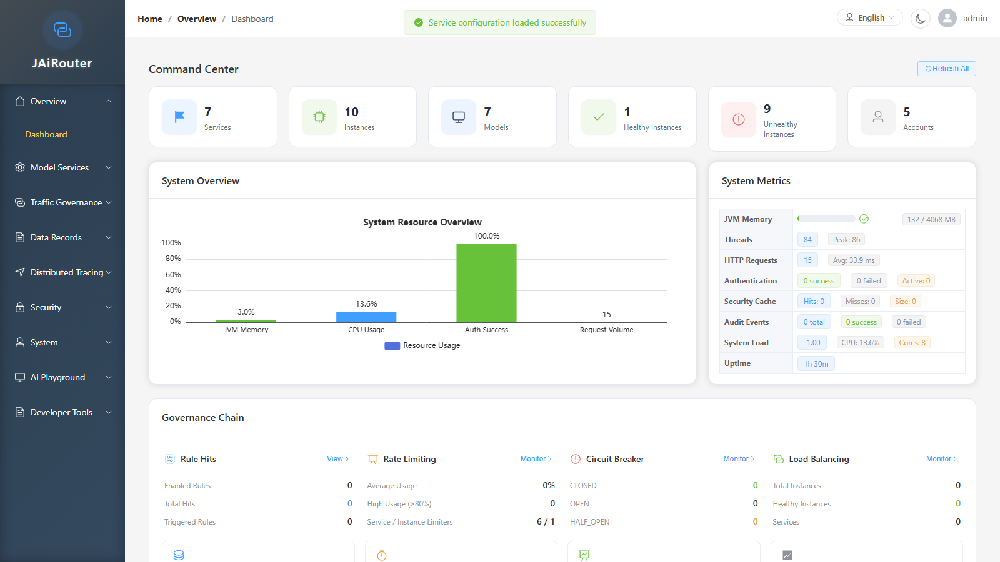

# Web Console Guide

<!-- Version Info -->
> **Doc Version**: 2.0.0
> **Last Updated**: 2026-10-28
> **Applies to**: New Console (Trunkline Console)
> **Author**: Lincoln
<!-- /Version Info -->

This guide is for first-time operators of the Trunkline web console ("the new console"). It covers login, layout, quick onboarding, playground, keys & quota, observability & tracing, and strategy/system administration.

> The new console organizes the menu by task flow and differs from the earlier "9 groups / 39 pages" admin UI. All page paths, menu groups and permission codes below follow the frontend sources `src/config/menu.ts` and `src/router/index.ts`.

## 1. Login and first start

### 1.1 URLs

| Deployment | URL | Notes |
|-----------|-----|-------|
| Local dev (Vite) | `http://localhost:3000/` | Vite dev server with HMR |
| Production / standalone | `http://<host>:8080/` | Backend serves the SPA; unauthenticated users are redirected to `/login` |

### 1.2 Page titles

- The login heading shows **"Trunkline Console"**;
- The i18n app title is **"Trunkline Admin"**;
- The browser tab title is **"<Page> · Trunkline Console"** (set by the router `afterEach`, e.g. "Overview · Trunkline Console").

> Technical identifiers still keep `jairouter.*` (package names, metric names, config prefix, container names); this does not affect the product display name "Trunkline".

### 1.3 Default account

| Username | Default password | Notes |
|----------|------------------|-------|
| `admin` | `ChangeMeOnFirstStartup123456` | Auto-created only when the account table is empty; super admin |

> ⚠️ **Change the `admin` password on first deploy.** In production override it with the `INITIAL_ADMIN_PASSWORD` env var, or change it right after first login.

### 1.4 Token storage and route guard

After login the JWT is stored in `localStorage` under the key `admin_token`. On every navigation the route guard (`router.beforeEach`) checks in order:

1. Public routes (e.g. `/login`) pass through; already-authenticated users visiting login are redirected to `/overview`;
2. Unauthenticated → redirect to `/login`;
3. Read `admin_token` from `localStorage`, decode the JWT `exp` claim to detect expiry; on expiry clear the token and return to login;
4. Every code in the route's `meta.permissions` must be held (ADMIN always passes); otherwise redirect to `/overview`.

> ⚠️ Do not inject the token manually. A manually written token that is expired or lacks the `permissions` claim will break the console.

### 1.5 Login flow

1. Open the console URL; unauthenticated users land on `/login`;
2. The page heading shows **"Trunkline Console"**;
3. Enter username and password, click **Login**;
4. On success you are taken to **Overview** (`/overview`).



---

## 2. Layout (5 menu groups)

The collapsible sidebar is organized into **5 groups / 13 menu items** by task flow. Visibility is filtered by permission codes — items you lack are hidden. A normal calling role sees only a few items (workbench / onboarding / playground / keys).



| Group | Menu item | Route path | Permission code | Purpose |
|-------|-----------|-----------|-----------------|---------|
| **Workbench** | Overview | `/overview` | `overview:dashboard:read` | One-stop overview |
| **Onboarding** | Quick Start | `/quick-start` | `config:instances:read` | 4-step wizard: pick provider → set key → import models → get a key to call |
| **Onboarding** | Models | `/models` | `config:instances:read` | Connected models / public model library |
| **Onboarding** | Model Groups | `/model-pools` | `config:instances:read` | Group channels into a virtual model for unified routing & failover |
| **Onboarding** | API Keys | `/keys` | `security:apikeys:manage` | Issue / revoke / quota |
| **Onboarding** | Playground | `/playground` | `ai:playground:use` | Chat / embedding / rerank / audio / image |
| **Observability** | Observe | `/observe` | `monitoring:tokenusage:read` | Call history / tokens / slow queries / errors / quota / circuit breaker / rate limit |
| **Observability** | Tracing | `/tracing` | `tracing:dashboard:read` | Request trace lookup & dashboard |
| **Strategy** | Strategy Center | `/strategy` | `config:rules:read` | Routing rules / load balancing / circuit breaker thresholds / response cache / quota |
| **System** | Accounts & Roles | `/settings/accounts` | `system:accounts:manage` | Accounts / role permissions |
| **System** | Model Config | `/settings/model-config` | `system:accounts:manage` | Provider templates / model categories / adapters |
| **System** | Audit & Versions | `/settings/audit-versions` | `system:accounts:manage` | Audit logs / config versions |
| **System** | State Monitoring | `/settings/monitoring` | `system:accounts:manage` | State persistence |

### 2.1 Routes reachable directly but not in the sidebar

These routes exist but are folded into in-page tabs or reached via entry points rather than separate menu items:

| Page | Route path | Permission code | Entry |
|------|-----------|-----------------|-------|
| Model Categories | `/model-categories` | `config:instances:read` | In "Models" / "Model Config" |
| Adapters | `/protocol-adapters` | `config:instances:read` | In "Model Config" |
| Quota | `/quota` | `config:quota:read` | Tab in "Strategy Center" |
| Integration Guide | `/guide` | authenticated | Top-bar help icon + wizard step 3 |

> Legacy deep links like `/settings?tab=xxx` are redirected to the four system sub-paths above.

### 2.2 Top bar

| Area | Element | Notes |
|------|---------|-------|
| Left | Brand | `brand-mark.svg` + "Trunkline" |
| Right | Help icon | Opens the integration guide `/guide` |
| Right | Language / theme switch | Chinese/English, light/dark |
| Right | User menu | Username + log out |

---

## 3. Overview (`/overview`)

The overview aggregates real business metrics from `GET /api/dashboard/metrics`, returned in six groups:

| Group | Key fields | Meaning |
|-------|-----------|---------|
| `jvm` | heapUsedMB / heapUsagePercent, threadCount, GC count & time | JVM memory, threads, GC |
| `http` | totalRequests, avgResponseTimeMs, maxResponseTimeMs, activeRequests | HTTP volume & latency (from `http.server.requests`) |
| `security` | authSuccesses / authFailures / authAttempts, activeUsers, activeApiKeys, jwtValidations | Auth & security metrics |
| `audit` | totalEvents, successEvents, failureEvents, healthScore | Audit event stats |
| `system` | availableProcessors, systemLoadAverage, processCpuUsage, uptimeSeconds | OS & process |
| `monitoring` | retryAttempts, degradationLevel, errorsTotal | The monitoring system's own retry/degradation/error counters |

---

## 4. Quick Start wizard (`/quick-start`)

The new console collapses "from zero to first successful call" into a 4-step wizard (`QuickStartWizard.vue`) with no hand-written config files:

1. **Pick provider**: choose from the provider template catalog (domestic / international / local groups), or choose "custom" and fill name, Base URL, path, adapter (plain OpenAI-compatible / Ollama local). Local presets or local addresses (localhost / 127.0.0.1 / host.docker.internal) skip the upstream key.
2. **Set upstream key**: enter the API key for the downstream model provider (skip for local inference). The wizard then creates/reuses the provider and **discovers models**.
3. **Import models**: discovered models are auto-classified by model ID (chat / embedding / rerank / tts / stt / imgGen / imgEdit; unrecognized ones fall to the default category and can be adjusted per model). Check the models to import (video generation and other unsupported items are excluded automatically).
4. **Done**: the wizard automatically—
   - creates **model groups (pools)** per category, named `<provider>-<category>` (e.g. `OpenAI-chat`), strategy `weighted-random`, members = imported instances;
   - **issues a test API key** with `permissions` = imported categories and `allowedGroups` = created group names;
   - shows copyable **curl** and **Python (OpenAI SDK)** examples.

> ⚠️ **v3.5 single-line governance**: the outbound `model` parameter must be a **group (virtual model name)**, not an upstream instance name. The generated example curl already follows this. The test key value is shown **only once** — copy it immediately.

Example (auto-generated by the wizard):

```bash
curl http://<host>:8080/v1/chat/completions \
  -H "Content-Type: application/json" \
  -H "Authorization: Bearer <test-key>" \
  -d '{"model": "<provider>-chat", "messages": [{"role":"user","content":"hi"}], "stream": true}'
```

---

## 5. Models and model groups

### 5.1 Models (`/models`)

The Models page manages imported instances and the public model library: view available models per category, discover models, and configure provider templates and adapters. There are exactly 7 model categories: `chat`, `embedding`, `rerank`, `tts`, `stt`, `imgGen` (image generation), `imgEdit` (image edit).

### 5.2 Model groups (`/model-pools`)

A model group (pool) is the only outbound entry: it groups several upstream instances of one category, and routes/fail over by strategy (e.g. weighted-random). Each group is exposed as one "virtual model name"; clients call it and the gateway picks an instance inside the pool.

### 5.3 Three-gate permission model

Key admission is a chain of three gates; see [API Key Management](../security/api-key-management.md):

1. **Gate 1 · model category**: `permissions` limits which categories (chat/embedding/…) the key may call. The request category is derived from the URL endpoint; a category outside `permissions` → 403.
2. **Gate 2 · model group whitelist**: `allowedGroups` limits which groups (virtual model names) the key may use. Since v3.5 the former `allowedModels` (instance-name whitelist) is removed; instances cannot be called directly.
3. **Gate 3 · runtime constraints**: `allowedIpAddresses`, `expiresAt`, multi-window quotas and alert thresholds.

---

## 6. API keys (`/keys`)

Issue, view, disable/enable, delete, reset/rotate keys, and configure quotas & alerts.

- **Issue**: fill a description, check callable categories (gate 1), check accessible groups (gate 2), and optionally set IP whitelist / expiry / quota. The key value is shown **only once** at creation.
- **Quota drawer**: the per-row "Quota" action edits quota fields only (per-day / per-hour / per-month request & token limits, per-minute rate, alert threshold) and resets the daily counters.
- **Reset / rotate**: `reset` reissues a new value while keeping attributes; `rotate` keeps the keyId and all attributes and only swaps the keyValue and updates the rotation timestamp.

> All key-management endpoints require `security:apikeys:manage` (admin-side `hasRole('ADMIN')`).

---

## 7. Playground (`/playground`)

The playground consolidates every modality of the unified `/api/v1` endpoints (backed by `UniversalController`) into one page:

| Modality | Tab | Backend endpoint | Category |
|----------|-----|------------------|----------|
| Chat | Chat | `POST /api/v1/chat/completions` | `chat` |
| Embedding | Embedding | `POST /api/v1/embeddings` | `embedding` |
| Rerank | Rerank | `POST /api/v1/rerank` | `rerank` |
| Text-to-speech | TTS | `POST /api/v1/audio/speech` | `tts` |
| Speech-to-text | STT | `POST /api/v1/audio/transcriptions` (multipart) | `stt` |
| Image generation | Image | `POST /api/v1/images/generations` | `imgGen` |
| Image edit | Image Edit | `POST /api/v1/images/edits` (multipart) | `imgEdit` |

Pick a model group (virtual model name) and send a test call to verify the whole chain. The playground requires the `ai:playground:use` permission code.

---

## 8. Observability

### 8.1 Observe (`/observe`)

One page aggregates call history, token usage, slow queries, exceptions, quota, circuit breaker and rate limit. Token usage endpoints:

| Endpoint | Purpose |
|----------|---------|
| `POST /api/token-usage/record` | Record one call's token usage (an API Key principal may only report itself) |
| `POST /api/token-usage/record/batch` | Batch record |
| `GET /api/token-usage/statistics?startTime=&endTime=` | Stats over a time range (by model / category / week-month) |
| `GET /api/token-usage/recent?limit=20` | Recent usage records |

> 📌 **Cost management (reverse-engineered unit price from bills / community price packs / manual overrides)**: planned product feature, **not implemented in the current codebase — to be confirmed**. The Observe page currently shows token usage and call stats only; it does **not** show cost/money converted from prices.

### 8.2 Tracing (`/tracing`)

OpenTelemetry-based tracing lets you locate requests by Trace ID / service / time range and view latency distribution, error rate and throughput. The real trace tag/attribute naming is listed in the "Tag design" section of [Distributed Tracing Overview](../tracing/index.md).

---

## 9. Strategy (`/strategy`)

One page consolidates routing rules, load-balancing strategies, circuit-breaker thresholds, the response-cache switch, and usage quota (`/quota` is an in-page tab). Feature switches such as response cache are controlled in-page and are not separate menu items.

---

## 10. System administration

| Page | Route | Contents |
|------|-------|----------|
| Accounts & Roles | `/settings/accounts` | Accounts, roles, permission-code assignment |
| Model Config | `/settings/model-config` | Provider templates, model categories, adapters |
| Audit & Versions | `/settings/audit-versions` | Security audit logs, config version diff & rollback |
| State Monitoring | `/settings/monitoring` | State persistence (memory / H2 / Redis / file) |

---

## 11. Credential header convention

| Surface | Credential header | Notes |
|---------|-------------------|-------|
| OpenAI-compatible `/v1/*` | `Authorization: Bearer <gateway API Key>` or `X-API-Key: <gateway API Key>` | The wizard curl uses `Authorization: Bearer` |
| Admin console | `admin_token` (JWT in localStorage) | Credential for admin APIs after login |
| `Authorization` (to upstream) | — | Configured per instance/provider; the gateway **passes it through** to the downstream model service, it is not the gateway's own credential |

---

## 12. FAQ

### 12.1 401 after login
JWT expired (log in again) or `JWT_SECRET` differs from deploy time (signature fails).

### 12.2 403 or missing menu items after login
Your role lacks permission codes. Log in as `admin`, grant codes under "System → Accounts & Roles". The menu is already filtered by codes; visiting a forbidden URL directly is redirected back to `/overview`.

### 12.3 `/v1/chat/completions` returns 403 or 404
- 403: the request category is not in the key's `permissions` (gate 1);
- 404/503: `model` is an upstream instance name instead of a group (virtual model name), or the group is not in the key's `allowedGroups` (gate 2). Since v3.5 instances cannot be called directly.

### 12.4 OpenAI SDK returns 401
Use a gateway API key from the wizard, set `base_url` to `http://<host>:8080/v1`, and set `model` to a group name.

### 12.5 Redis unavailable
When JWT persistence / distributed quota rely on Redis, local dev disables Redis by default and JWT falls back to H2 + in-memory. Ensure Redis is available in production.
