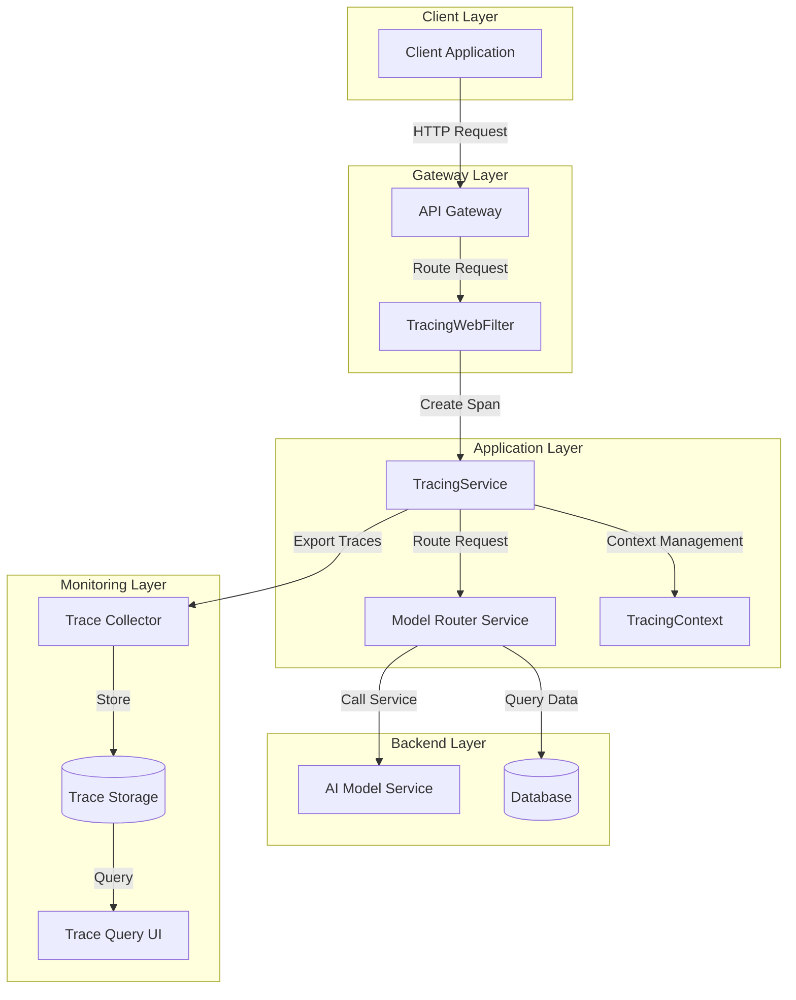
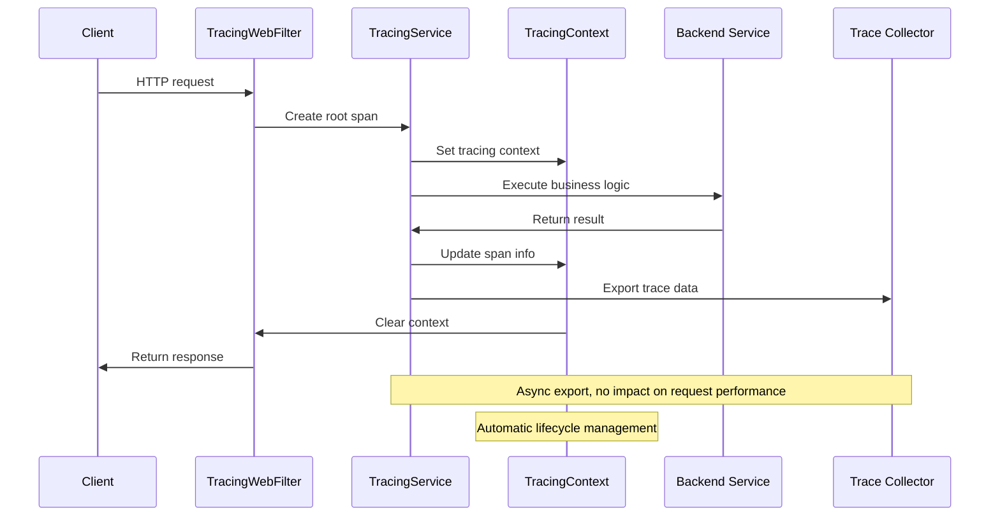

# Distributed Tracing Overview

<!-- 版本信息 -->
> **Doc Version**: 1.0.0
> **Last Updated**: 2026-06-15
> **Git Commit**: 933eeadf
> **Author**: Lincoln
<!-- /版本信息 -->

> **Version:** 2.9.5  
> **Last Updated:** 2026-06-09  
> **Configuration Path:** `src/main/resources/config/tracing/tracing-base.yml`

Trunkline integrates OpenTelemetry-based distributed tracing system, providing comprehensive request tracing, performance monitoring, and fault diagnosis capabilities.

## Key Features

### 🔍 End-to-End Tracing
- **Request-level tracing**: Complete tracing from client requests to backend service calls
- **Inter-service monitoring**: Automatic recording of microservice call relationships and latency
- **Async operation tracing**: Context propagation support in reactive programming (via `AsyncTracingProcessor`)
- **Component-level tracing**: Integrated tracing for rate limiter, circuit breaker, and load balancer

### 📊 Sampling Strategies
- **Ratio sampling**: Random sampling based on percentage (default: 0.1, optimized in v2.7.9 for 90% cost reduction)
- **Rule-based sampling**: Rule sampling based on service name, operation type, request path
- **Adaptive sampling**: Dynamic sampling rate adjustment based on arrival counts per span name (traffic)
- **Parent-based sampling**: Respect parent trace sampling decisions
- **Dynamic configuration**: Runtime sampling strategy adjustment without service restart

### 🏷️ Context Management
- **Trace identifiers**: Automatic generation and management of Trace ID and Span ID
- **MDC integration**: Automatic injection of tracing information into logs via `TracingMDCManager`
- **Context propagation**: Automatic tracing context propagation in reactive streams via `ReactiveTracingContextHolder`
- **Metadata tags**: Support for custom tags and business attributes
- **Structured logging**: JSON-formatted logs with trace context via `StructuredLogger`

### 🎯 Performance Monitoring
- **Response time statistics**: Record request processing latency and performance metrics
- **Error rate monitoring**: Statistics and analysis of error occurrences
- **Throughput analysis**: Monitor system processing capacity and load
- **Slow query detection**: Automatic identification and reporting of performance bottlenecks
- **Memory management**: Intelligent cache management with `TracingMemoryManager` and LRU eviction
- **Performance optimization**: Automatic detection of bottlenecks via `TracingPerformanceMonitor`

## Architecture Overview

## Core Components

### TracingService
Core tracing service component responsible for:
- Creating and managing Span lifecycle
- Handling tracing context creation, propagation, and cleanup
- Integrating sampling strategies for intelligent sampling
- Providing trace data export and storage interfaces
- Performance statistics and optimization triggers

### TracingWebFilter
Web filter component implementing:
- Automatic tracing wrapper for HTTP requests
- Tracing context creation and injection
- Context propagation in reactive streams
- Automatic annotation of requests and responses

### SamplingStrategyManager
Sampling strategy management supporting:
- Implementation and switching of multiple sampling algorithms
- Dynamic sampling rate adjustment
- Rule-based intelligent sampling
- Performance optimization of sampling decisions
- Runtime configuration updates

### TracingMemoryManager
Memory management component providing:
- LRU cache for trace data
- Memory pressure monitoring
- Automatic garbage collection triggers
- Cache hit/miss statistics

### AsyncTracingProcessor
Asynchronous trace processing component:
- Queue-based trace data processing
- Batch export to trace collectors
- Graceful degradation under high load
- Processing statistics and monitoring

### TracingPerformanceMonitor
Performance monitoring component:
- Real-time bottleneck detection
- Optimization suggestions generation
- Health status monitoring
- Performance reports generation

### StructuredLogger
Structured logging component:
- JSON-formatted log output
- Trace context injection
- Multiple log builders (Request, Response, Error, Performance, Security, etc.)
- Custom field support

### Security Components
- **TracingSecurityManager**: Access control for trace data
- **TracingSanitizationService**: Sensitive data sanitization
- **TracingEncryptionService**: Trace data encryption

## Tag / Attribute design

Span names and attribute keys are centralized in `org.unreal.modelrouter.monitor.tracing.TracingConstants`. The names below are the real ones in code (the technical service identifier `jairouter` is kept as-is).

### Span operations

| Constant | Value | Meaning |
|----------|-------|---------|
| HTTP_REQUEST / HTTP_RESPONSE | `http.request` / `http.response` | Inbound HTTP request/response |
| CHAT_REQUEST | `ai.chat` | Chat |
| EMBEDDING_REQUEST | `ai.embedding` | Embedding |
| RERANK_REQUEST | `ai.rerank` | Rerank |
| TTS_REQUEST | `ai.tts` | Text-to-speech |
| STT_REQUEST | `ai.stt` | Speech-to-text |
| IMAGE_GENERATION | `ai.image.generation` | Image generation |
| IMAGE_EDIT | `ai.image.edit` | Image edit |
| LOAD_BALANCING | `infrastructure.load_balancing` | Load balancing |
| RATE_LIMITING | `infrastructure.rate_limiting` | Rate limiting |
| CIRCUIT_BREAKING | `infrastructure.circuit_breaking` | Circuit breaking |
| HEALTH_CHECK | `infrastructure.health_check` | Health check |
| BACKEND_CALL | `backend.call` | Backend adapter call |
| ADAPTER_* | `adapter.gpustack` / `adapter.ollama` / `adapter.vllm` / `adapter.xinference` / `adapter.localai` / `adapter.openai` | Adapters |
| AUTHENTICATION / AUTHORIZATION / DATA_SANITIZATION | `security.authentication` / `security.authorization` / `security.sanitization` | Security |
| CONFIG_LOAD / CONFIG_UPDATE / CONFIG_VALIDATION | `config.load` / `config.update` / `config.validation` | Config |

### Attribute keys

| Group | Keys |
|-------|------|
| HTTP | `http.method`, `http.url`, `http.scheme`, `http.host`, `http.target`, `http.status_code`, `http.request_content_length`, `http.response_content_length`, `http.client_ip`, `http.user_agent`, `http.response_time_ms` |
| AI service | `ai.service.type`, `ai.model.name`, `ai.model.provider`, `ai.request.tokens`, `ai.response.tokens`, `ai.total.tokens`, `ai.temperature`, `ai.max_tokens`, `ai.stream` |
| Infrastructure | `component`, `strategy`, `instance`, `algorithm`, `capacity`, `rate`, `tokens.remaining`, `circuit.state`, `failure.count`, `success.count` |
| Backend | `backend.adapter.type`, `backend.instance.name`, `backend.base_url`, `backend.endpoint.path`, `backend.retry.count`, `backend.max_retries`, `backend.timeout`, `backend.connection_pool` |
| Security | `user.id`, `user.type`, `auth.method`, `auth.api_key.id`, `auth.jwt.subject`, `security.sanitized_fields`, `security.sanitization_rules` |
| Error | `error`, `error.type`, `error.message`, `error.stack`, `error.code`, `error.retry_after` |

### Events

`request.start` / `request.end` / `response.start` / `response.end`; business events `load_balancer.selection`, `rate_limit.check`, `circuit_breaker.state_change`, `backend_call.start/end`; security events `auth.success` / `auth.failure` / `authz.success` / `authz.failure` / `data.sanitized`; error events `error.occurred` / `retry.attempt` / `fallback.executed`.

### Common tag-value enums

| Dimension | Values |
|-----------|--------|
| component | `http-server`, `http-client`, `load-balancer`, `rate-limiter`, `circuit-breaker`, `health-checker`, `backend-adapter`, `security-filter`, `config-manager`, `sanitizer` |
| strategy | `random`, `round-robin`, `least-connections`, `ip-hash` |
| algorithm | `token-bucket`, `leaky-bucket`, `sliding-window`, `warm-up` |
| circuit.state | `closed`, `open`, `half-open` |
| backend.adapter.type | `gpustack`, `ollama`, `vllm`, `xinference`, `localai`, `openai`, `normal` |

### Context & propagation headers

- Context keys: `tracing.trace_id`, `tracing.span_id`, `tracing.parent_span_id`, `tracing.sampling_decision`, `tracing.current_span`;
- Propagation headers: W3C `traceparent` / `tracestate`, custom `X-Trace-Id` / `X-Span-Id` / `X-Parent-Span-Id`, plus `X-Request-Id` / `X-Correlation-Id`;
- MDC injects `traceId` / `spanId` (see `TracingMDCManager`).

> Sensitive attributes are sanitized by `TracingSanitizationService` (matched case-insensitively on the key name, masked, and recorded as a `span_attribute` sanitization audit).

## Data Flow

## Integration Advantages

### 🚀 Performance Optimization
- **Async export**: trace data is processed asynchronously, without impacting business request performance
- **Memory management**: intelligent span caching and expiry eviction
- **Batched processing**: supports batch collection and transport of trace data

### 🛡️ Reliability
- **Fault isolation**: tracing failures do not affect business functionality
- **Degradation**: supports graceful degradation of tracing
- **Resource limits**: built-in resource-usage monitoring and protection

### 🔧 Ops-friendly
- **Zero-intrusion**: automatic tracing via filters and AOP
- **Observability**: exposes metrics for the tracing system itself
- **Diagnostics**: detailed error messages and debug logs

## Use Cases

### Microservice Chain Analysis
- Visualize service call relationships and dependency graphs
- Identify performance bottlenecks between services
- Analyze impact scope of service failures
- Optimize service deployment and resource allocation

### Performance Issue Diagnosis
- Locate specific stages of slow requests
- Analyze database query performance
- Identify code hotspots and optimization opportunities
- Monitor system capacity and scaling needs

### Root Cause Analysis
- Quickly locate error origins
- Analyze error propagation paths
- Evaluate fault impact scope
- Validate effectiveness of fixes

### Business Process Optimization
Based on trace analysis you can:
- Optimize key business flows
- Improve user experience
- Lower operational cost
- Raise service quality

## REST API Endpoints

### Query API (`/api/tracing/query`)
- `GET /trace/{traceId}` - Get trace chain details
- `GET /search` - Search traces with filters
- `GET /recent` - Get recent traces
- `GET /services` - Get service statistics
- `GET /statistics` - Get trace statistics
- `POST /export` - Export trace data
- `POST /cleanup` - Clean up expired traces
- `GET /operations` - Get operation list
- `GET /health` - Query service health check
- `GET /performance/stats` - Get performance stats
- `GET /performance/latency` - Get latency analysis
- `GET /performance/errors` - Get error analysis
- `GET /performance/throughput` - Get throughput analysis

### Performance API (`/api/tracing/performance`)
- `GET /stats` - Get performance statistics
- `GET /processing-stats` - Get async processing stats
- `GET /memory-stats` - Get memory usage stats
- `GET /health` - Get tracing system health
- `GET /bottlenecks` - Detect performance bottlenecks
- `GET /suggestions` - Get optimization suggestions
- `GET /report` - Generate performance report
- `POST /optimize` - Trigger performance optimization
- `POST /tuning` - Execute performance tuning
- `POST /memory/gc` - Trigger garbage collection
- `POST /memory/check` - Execute memory check
- `POST /processing/flush` - Flush processing buffer
- `GET /metrics/dashboard` - Get dashboard metrics
- `GET /alerts/active` - Get active alerts

### Actuator API (`/api/tracing/actuator`)
- `GET /status` - Get tracing system status
- `GET /health` - Get health status
- `GET /config` - Get tracing configuration
- `PUT /config` - Update tracing configuration
- `POST /sampling/refresh` - Refresh sampling strategy
- `GET /stats` - Get tracing statistics
- `POST /enable` - Enable tracing
- `POST /disable` - Disable tracing
- `GET /export` - Export tracing data
- `POST /clear-cache` - Clear tracing cache

## Next Steps

- [Quick Start](quickstart.md) - Quickly enable and configure tracing features
- [Configuration Reference](config-reference.md) - Detailed configuration options
- [Usage Guide](usage-guide.md) - Common use cases, API reference and best practices
- [Troubleshooting](troubleshooting.md) - Common issues and solutions